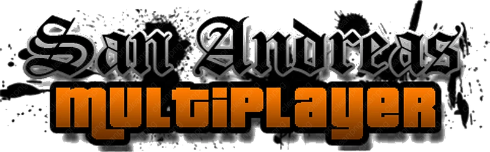
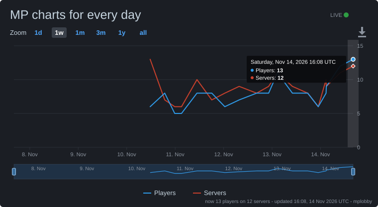
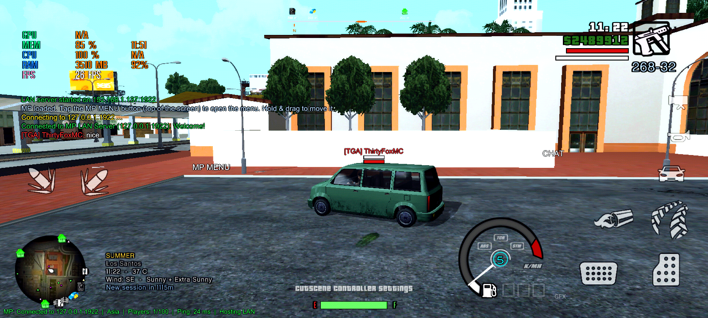

<p align="center">
  
</p>

# MP – Multiplayer for GTA San Andreas Mobile

<p align="center">
  <a href="https://github.com/ThirtyFoxMCx00E1/wagu/releases/latest"></a>
  <a href="https://mpsamp-open.github.io/"></a>
  <a href="https://mpsamp-open.github.io/"></a>
  <a href="https://github.com/ThirtyFoxMCx00E1/wagu/releases"></a>
  <br>
  <a href="https://github.com/ThirtyFoxMCx00E1?tab=followers"></a>
  <a href="https://github.com/ThirtyFoxMCx00E1/wagu/stargazers"></a>
  <a href="https://github.com/ThirtyFoxMCx00E1/wagu/forks"></a>
  <a href="https://github.com/ThirtyFoxMCx00E1/wagu/commits"></a>
  <a href="https://github.com/ThirtyFoxMCx00E1/wagu"></a>
  <br>
  <a href="https://mpsamp-open.github.io/"></a>
  <a href="https://github.com/ThirtyFoxMCx00E1/AndroidModLoader"></a>
  <a href="https://discord.gg/tbsDknk34y"></a>
</p>

<p align="center">
  <a href="https://mpsamp-open.github.io/"></a>
  <br>
  <sub>Live from the MP lobby - players and servers online right now (refreshes every 10 minutes)</sub>
</p>

<p align="center">
  <a href="https://discord.gg/tbsDknk34y" title="Join the MP Discord"></a>
  <br>
  <sub>Tap the Discord logo to open the server in the Discord app: <a href="https://discord.gg/tbsDknk34y">discord.gg/tbsDknk34y</a></sub>
</p>

MP is an AML (AndroidModLoader) mod that brings multiplayer to GTA San Andreas Mobile. Players meet
and play together in the same game world, with real-time player synchronization of movement,
animations and combat.

## Preview 



Prebuilt binaries:

| File | ABI | Target |
|---|---|---|
| `bin/libMP32.so` | armeabi-v7a | GTA SA 2.00 (32-bit), AML 1.4.0, works alongside FLA 7.6 |
| `bin/libMP64.so` | arm64-v8a | 64-bit GTA SA builds (2.10+) |

## Downloads and packages

| Download | What | Size |
|---|---|---|
| [**MP 3.40.2 client**](https://github.com/ThirtyFoxMCx00E1/wagu/releases/latest) | The mod for your phone (libMP32.so + libMP64.so, MP folder, voice APK) | ~19 MB |
| [**MP full**](https://github.com/ThirtyFoxMCx00E1/wagu/releases/latest) | Client + 24/7 server + HiveMQ kit | ~21 MB |
| [All versions / changelogs](https://mpsamp-open.github.io/#versions) | Every release with its changelog on the website | |

**Package: HiveMQ + OpenJDK Java 21 + Android NDK r30 linux + more** (release [`Assets-1-2-3`](https://github.com/ThirtyFoxMCx00E1/wagu/releases/tag/Assets-1-2-3), about 1.8 GB in total)

| File | What | Size |
|---|---|---|
| [`android-ndk-r30-linux.zip`](https://github.com/ThirtyFoxMCx00E1/wagu/releases/download/Assets-1-2-3/android-ndk-r30-linux.zip) | Android NDK r30 for Linux (build libMP32.so / libMP64.so) | 704 MB |
| [`hivemq-4.56.0.zip`](https://github.com/ThirtyFoxMCx00E1/wagu/releases/download/Assets-1-2-3/hivemq-4.56.0.zip) | HiveMQ 4.56.0 (the MP lobby broker for your own VPS) | 726 MB |
| [`OpenJDK21U-jdk_x64_linux_hotspot_21.0.13_9.tar.gz`](https://github.com/ThirtyFoxMCx00E1/wagu/releases/download/Assets-1-2-3/OpenJDK21U-jdk_x64_linux_hotspot_21.0.13_9.tar.gz) | OpenJDK 21.0.13+9 x64 Linux (Java for HiveMQ) | 198 MB |
| [`open.mp-win-x86.zip`](https://github.com/ThirtyFoxMCx00E1/wagu/releases/download/Assets-1-2-3/open.mp-win-x86.zip) | open.mp server for Windows x86 | 34 MB |
| [`MapAndreas-linux-x86.zip`](https://github.com/ThirtyFoxMCx00E1/wagu/releases/download/Assets-1-2-3/MapAndreas-linux-x86.zip) | MapAndreas for Linux x86 | 32 MB |
| [`YSI-Includes.zip`](https://github.com/ThirtyFoxMCx00E1/wagu/releases/download/Assets-1-2-3/YSI-Includes.zip) | YSI includes (Pawn) | 3.3 MB |

## Built with

| Repo | Used for |
|---|---|
| [termux-app](https://github.com/ThirtyFoxMCx00E1/termux-app) | Termux (terminal for Android) - runs the 24/7 server and the Termux web console on a phone |
| [Termius-SSH](https://github.com/ThirtyFoxMCx00E1/Termius-SSH) | Termius SSH and server tools - managing the VPS / Oracle / Debian 24/7 servers |
| [Psdk-aml](https://github.com/ThirtyFoxMCx00E1/Psdk-aml) | Plugin SDK for AML (game_sa, gta_base, RenderWare headers) |
| [AndroidModLoader](https://github.com/ThirtyFoxMCx00E1/AndroidModLoader) | AML - loads libMP32.so / libMP64.so into GTA SA |
| [SAUtils](https://github.com/ThirtyFoxMCx00E1/SAUtils) | Mod library for GTA SA mods (menus, settings) |
| [ARMPatch](https://github.com/ThirtyFoxMCx00E1/ARMPatch) | Hooks and patches for ARM / ARM64 code |
| [AML_PrecompiledLibs](https://github.com/ThirtyFoxMCx00E1/AML_PrecompiledLibs) | Precompiled libraries for AML mods |
| [AArchASMHelper](https://github.com/ThirtyFoxMCx00E1/AArchASMHelper) | AArch32 / AArch64 assembly helpers |
| [AML_ImGui](https://github.com/ThirtyFoxMCx00E1/AML_ImGui) | Dear ImGui (graphical user interface) for AML mods |
| [mysql-server](https://github.com/ThirtyFoxMCx00E1/mysql-server) | MySQL Server (database for the server side) |

## Features

- **Local/online server data**: UDP server on port **1922**. Default host `127.0.0.1:1922`, editable in the menu.
- **Host LAN server toggle**: runs the server inside the game, so friends on the same Wi-Fi or hotspot can join with your LAN IP (shown in the menu).
- **Connect / Disconnect**: connecting teleports you to Grove Street (CJ's house). Once the server accepts you, `title_logo_connected.png` appears in the center of the screen and `sound_effect_connected.mp3` plays at the same moment. The logo stays fully visible, then fades off over 20 ticks (1 tick = 50 ms), and is gone at 7 s.
- **Connection status** text in the bottom-left corner (Connected / Connecting / Disconnected, players, ping, LAN host).
- **Name tags with health bars** in the SA-MP style: the name sits on top in the player's color, then an armour bar (only when armour > 0), then the red health bar. Your own name tag is shown too (you can turn it off).
- **Name tag size** and draw-distance sliders.
- **Chat system** (top-left, next to the mobile radar) plus a **virtual keyboard** made only for chat and text fields. You can move the chat with the X/Y sliders.
- **Voice chat** (3.11): the mic button next to Chat opens the voice panel (mic on/off, volume, mic boost, voice pitch). Players near you hear you, louder up close and nothing past 40 m. A speaker icon shows over whoever is talking. Players can be muted in the player list.
- **Chat timestamps** (3.11): `[18:02:48]` in front of every line, turned on in Settings > Chat.
- **Kill feed** on the right: `Killer [weapon icon] Victim`. A skull means suicide or a world death.
- **Player radar icons**: each remote player gets a radar blip in their own color, and on the pause-menu map a marker plus their name in their color.
- **Sync**: NPCs (people + traffic, 2.18), position, heading, walk/run/sprint movement (slow walks too), crouch, jump/climb/fight anims, aiming, every bullet and rocket, interiors, health/armour, death, and driving (model, position, speed, rotation, colours, paintjob, tuning, damage, doors, lock, engine/lights/siren, steering, horn, Hydra thrusters, turrets).
- **Combat**: the shooter decides the damage. When you hit someone's avatar, the damage is sent to that player. Your kills show up in everyone's kill feed.
- **Floating ImGui menu** (no tab inside the game's settings). It has a draggable `MP` bubble and a `Chat` bubble, and other developers can add their own menu sections, windows and bubbles (see below).

## 24/7 server on a phone (no cloud server, no card)

On a spare Android phone, install [Termux](https://f-droid.org/packages/com.termux/) and run:

```
curl -fsSL https://raw.githubusercontent.com/ThirtyFoxMCx00E1/wagu/main/termux/install.sh | bash
```

It builds `mp_server` on the phone and runs it 24/7 in the internet lobby (free public brokers, no port forwarding), restarts it after a crash and, with the Termux:Boot app, after a reboot. Commands: `mp-server status | log | config | restart | stop | update`. Keep the phone charging, on Wi-Fi, and set Termux's battery use to Unrestricted.

## 24/7 server on Debian 12 or Ubuntu (VPS or own PC)

The [HiveMQ kit](HiveMQ/README.md#debian-12-own-pc-or-vps) runs on Ubuntu 22.04 / 24.04 or Debian 12. The small Debian 12 installer (677 MB, sha256 `cd4462c06aa8892e692c0c4b9c17802f38c8ab8690e85cbfb5ccaa5956e9af17`, same as Debian's) is in the HiveMQ [Derbian release](https://cdimage.debian.org/cdimage/archive/12.15.0/amd64/iso-cd/): [debian-12.15.0-amd64-netinst.iso](https://cdimage.debian.org/cdimage/archive/12.15.0/amd64/iso-cd/debian-12.15.0-amd64-netinst.iso). Install it with only "SSH server" and "standard system utilities", then as root:

```
wget -qO- https://raw.githubusercontent.com/ThirtyFoxMCx00E1/wagu/main/HiveMQ/vps-setup.sh | bash -s europe
```

Use `asia`, `na` or `oceania` for the other regions. On a VPS, pick Debian 12 in the provider's image list instead of the ISO. Ping depends on where the machine is, so Europe, NA and Oceania need a VPS in or near those regions (Frankfurt, Virginia / Ohio, Sydney).

## Changelog

- **4.08**: Day Z base building, faded server rows, connection screen for new servers, text only player HUD, new region picker.
  - Project Day Z Legacy: Rust style base building with SA-MP samp.img pieces (foundation, wall, doorway, window frame, ceiling, door) in wood or concrete. Open it with /build, /base or the new hammer button. You need a Toolbox in your inventory and the Day Z models setting on. Pieces snap to the foundation grid, have collision, are saved on the server (dayz_bases.txt), and only the owner can remove them. Doors open for the owner and party members.
  - The game background on the right side of each server list row now fades out instead of ending in a hard cut.
  - Creating a new custom server now shows the connection screen while it joins (also when hosting for another phone).
  - The player name HUD on the right side (from /settings) is now only outlined text, with no blue box or background.
  - The region picker (pin icon) uses the same panel style as the MP launcher server UI.
  - New tool: tools/make_dz_build.py takes the pieces out of SA-MP samp.img / samp.txd.

- **4.07.2**: the server title logo and the Add server preview are no longer squashed.
  - A 1024x256 logo was drawn as 1024x64 (the texture size was multiplied twice by the UV scale), so the title logo in game and its thumbnail in Add server looked flat. They now keep the real size of the PNG / JPG.
- **4.07.1**: every sound works without pasting mp3s, hosted servers no longer freeze.
  - Only the music (dz_ambient / war_ambient) came from Host/Media; the button click (Global_click), hit (sound_010) and "connected" (sound_effect_connected) sounds stayed silent when they were not in files/MP. A missing one is now downloaded once from Host/Media into files/MP (Wi-Fi or mobile data) and used from there.
  - Fix: a server hosted on the phone (and the game of the host) froze the first time a server list asked it for its info (country / gamemode / tags / description, since 4.04). The dedicated server had the same freeze.
- **4.07**: Mega Vil blue HUD, /settings menu for host owners, server title logo upload with X / Y / Z, streamed music, launcher hides the GTA HUD.
  - The right side HUD panel (TIME / ID / CASH / BANK) was violet: now Mega Vil Futuristic blue and bigger (rows 50 px, text 25 px, icons 30 px). The needs hexagons are tinted the same.
  - New /settings (only the host owner of a custom server; [ADMIN] / [MOD] on the featured ones): Settings Menu > Account, Textdraw >>, Entering Door (0 - 5 seconds), Server Logo, Server settings >>, Server rules >>. Textdraw: HUD Mode (HUD Variant 1 blue, 2 violet, 3 emerald, 4 crimson, 5 gold, or Disable), Dollar Cent ($525,250.00), HUD Player (name + id), Ammo Info, Logo Server, Logo Position X / Y and Logo Size Z. The choice goes to everyone on the server and the host phone keeps it. /ss and /srvsettings still open the old server settings page.
  - + Add server > scroll down > Server title logo (PNG / JPG): Import title logo opens the Files app (MP Voice 4.07), PNG keeps its transparency (max 1024x256, 200 KB). Everyone on the custom server sees it on top of the screen (instead of the Broker MQTT title). X / Y / Z (size) sliders move it; Remove takes it off.
  - Music: war_ambient.mp3 (Brief Case War) and dz_ambient.mp3 (Day Z) don't have to be in files/MP anymore - the media player streams them from Host/Media in this repo over Wi-Fi or mobile data. A local copy is still used first.
  - The MP launcher (server UI) now hides the GTA HUD and its touch buttons the same way the connection screen does, so nothing shows through or gets the taps.
  - Entering Door: the house door menu opens after you stand in the door for the set seconds (default 2).
- **4.06**: ping back down, public lobby players visible on every region, real jitter, no server icon on + Add server.
  - Higher ping / nobody in the list after 4.05.8: the network watcher counted any interface coming or going (VPN app, hotspot, Wi-Fi Direct, CLAT, second SIM) as a Wi-Fi <-> mobile data switch, wiped the region pings and moved the lobby off a working broker again and again. It now only looks at the network the internet traffic really uses, and a change has to last 1 s. Region pings are kept until the new measurement replaces them.
  - 4.05.9 sent every sync twice through the lobby relay too. The relay is TCP (nothing gets lost there), so the copies only doubled the broker messages and raised the ping. Copies are now only sent on a direct UDP path with real loss. The voice-priority mark on the TCP lobby link is gone (it made bigger bursts slower on some Wi-Fi and mobile networks), and slow mobile uplinks get 25 s instead of 12 s before the link counts as dead.
  - Public lobby on regions: players whose phones use the public lobby (region not reachable from their network) were invisible to everyone on Asia, EU, NA and Oceania. Their servers now show in the list while you are on a region; joining one moves your lobby link to the public broker and back to your region when you leave.
  - Jitter: a host always showed 0 (its own server is on the same phone), now it shows the jitter of its lobby link. Small jitter is no longer rounded down to 0.
  - + Add server: the server icon / background picker is removed.
- **4.05.9**: better connection on weak Wi-Fi and mobile data, plus a network tools pack (MP-NetTools-4.05.9.zip).
  - Weak link mode: MP now measures packet loss and jitter. When loss is 5% or more, or jitter is 45 ms or more (and it isn't just a slow or full link), every position sync is sent twice, 20 ms apart, so one lost packet no longer makes players jump. It also does this for 10 s after a Wi-Fi <-> mobile data switch. The server and other players drop the duplicate. Loss and jitter are shown in the launcher and the status line.
  - The game UDP socket and the lobby TCP socket now ask for voice-class priority (DSCP EF / SO_PRIORITY 6), so Wi-Fi routers that support WMM send game packets first.
  - VPS: extra TCP settings from NetworkOptimizer (buffers, SACK, fewer SYN retries). Every region gets a sockperf test server on UDP + TCP 11111 after the region install is run again.
  - MP-NetTools zip: mp-nettest.sh (UDP/TCP latency, jitter and loss to all 4 regions), sockperf / netperf built for Android arm64 and armv7, net-merge (Wi-Fi + mobile data at once, no root), RIPDPI (operator blocking / DPI, no root), Relay (phone data to a PC), net-merge for Linux, NetworkOptimizer for other VPSes, and a script that downloads the NetworkEnhancer and wifi-bonding-nolog Magisk modules (root). See README-NetTools.md in the zip.
- **4.05.8**: loading screen fix, Wi-Fi <-> mobile data fix, launcher touches no longer reach the game.
  - Stuck on the loading screen after updating: 4.05.5 switched off the texture database guard from 4.04.2. Phones that still had a texdb pack in the game folder (the v4.02 GTA V pack, another mod's textures, a half-copied update) got the old loading-screen crash / hang back. The guard is on again (same decoder, it only stops at the end of the buffer).
  - Day Z world textures: the texture destroy hook gives the game its real result back (4.05.7 returned nothing) and does no work at all while no world texture is swapped (the loading screen destroys thousands of textures).
  - Switching Wi-Fi -> mobile data (or back) froze the game and left you on the public HiveMQ lobby. Now the phone's networks are watched every 0.5 s: the lobby connection of a network that is gone is dropped at once and reconnected on the new one, brokers that failed during the switch get no back-off, the 4 regions are measured again right away (a ping round across the switch is thrown away instead of marking every region "down" for 2 minutes), and you stay on your own region broker.
  - DNS has a time limit now (2.5 s for a broker it knew, it then uses the last good address). Right after a switch Android's DNS can hang for 5-30 s.
  - Lobby / login / friends links: TCP keepalive + 12 s user timeout, a dead path is noticed in seconds. With no network at all the phone waits for one instead of walking every broker into a timeout.
  - In a game: the server is told "same session, new path" the moment the network changes (and every 1 s while it stays quiet), not after 5 s of freeze.
  - Website: reconnects on network change / back online / tab back from the background, keepalive 15 s, a ping round measured while offline is thrown away, and it moves back to the best region when that answers again.
  - Launcher / keyboard / login / dealer open: the game gets no new finger at all. Taps that MP's hit test missed went through to GTA, so the HUD behind the launcher (clock, money, weapon icon - hidden or not) and CLEO touch zones still reacted. A finger that was already down for the game (the joystick) still gets its release.
  - Region icon: a third hit test straight from the touch event (before ImGui and the game), so the region list opens even when ImGui gives the tap to another window.
- **4.05.7**: launcher clean-up, Day Z chat text.
  - Favorites and Lan are only the top tabs now. They were in the side bar too. The side bar's Internet item stays lit on all server list tabs.
  - The + (add server) icon is gone from the toolbar. Add server is in the side bar.
  - Day Z world textures now actually show. 4.05.5 only answered the texture database lookup, but the map's textures come out of the TXD slots, so the game never asked and nothing changed. Now every GTA texture with a name from the pack gets the GTA V image put in when the game reads it, and every TXD already loaded is updated the moment the world textures turn on (you see it right away, no restreaming). The GTA originals come back when you leave the Day Z server. The log says how many were replaced ("DzModels: world textures on - ... swapped").
  - Day Z Legacy chat: "Press F2 to open the control panel" now says to tap the gear button next to the top bar (or type /panel).
- **4.05.6**: region icon fix, part 2.
  - Lost "finger lifted" events: if the game never reported a release, the next taps were dropped for as long as you kept tapping (the 1.5 s timeout restarted with every tap). So the region icon, and sometimes other launcher buttons, looked dead. A new press now frees a stuck finger right away when it's the same finger again or the launcher / keyboard is open.
  - Second hit test for the launcher toolbar and title icons (region, refresh, settings, +, help, friends, bell, close). A press inside the icon counts even when ImGui gave it to another window, as long as nothing of MP's is drawn over it. The log says which window took it ("4.05.6: toolbar ... tapped but ImGui gave it to ...").
  - The region list no longer covers the region icon on short screens. It opens to the left of the icon instead.
- **4.05.5**: Day Z world textures, launcher buttons fix.
  - Project Day Z Legacy: the GTA V texture pack from release v4.02 (texdb gta3 `.dat` / `.toc` / `.tmb`) is converted to normal TXDs (`Host/DayZ/models/world`, 6 files, 129 MB, plus `world.idx`). On the Day Z server the game downloads them, like the MTA models, and uses them for the map textures. They're read one texture at a time when the game asks for one. New setting: **Day Z: GTA V world textures**. They also show up on Cloud Storage as a new **World** folder.
  - The pack's road models (cuntwroad22 / 68 / 71) are swapped in on the Day Z server with TXDs made from their textures.
  - The texture-database RLE hook (4.04.2 crash guard) is turned off. The new world textures are already unpacked.
  - Launcher: the switch region icon and the other profile / toolbar buttons can be tapped again. A floating game window was drawn on top of the launcher and took the taps. Windows like that now go behind the launcher, and the log names any window that was above it.
  - Website: the small GTA SA multiplayer logo with the green outline in the top-left corner is gone.
  - New tools: `tools/texdb2txd.py` (mobile texdb -> PC TXD: RLE undone, DXT kept, 8888 / 565 converted to DXT) and `tools/make_dz_world.py` (builds the Day Z world folder and its manifest lines).
- **4.05.4**: new website address.
  - The website moved to **[mpsamp-open.github.io](https://mpsamp-open.github.io)** (the new mpsamp.open GitHub organization). The old address thirtyfoxmcx00e1.github.io/wagu forwards there and stays online as a backup.
  - The game downloads regions.txt from the new site and falls back to the old one if it can't reach it. The "update your MP" message, the login bot status link, the Termux installer, vps-setup.sh and the HiveMQ docs use the new address too.

- **4.05.3**: fixes.
  - Launcher: the switch region icon (the map pin) did nothing - it is the only toolbar button that toggles, and one tap that arrived twice opened and closed the region list in the same moment. Now it toggles at most once per 400 ms and the opening tap can't close the list again.
  - Server list: Language has its own column. It used to show in the Tags column when a server had no tags; Tags now shows only tags.
  - New "Global" location with its own flag (a white globe on blue, drawn in the game so it works with any bg_server.jar). The default server, Brief Case War, MW3, Mega Vil Futuristic roleplay and Project Day Z Legacy show the Global flag. Hosts can pick Global first in + Add server > Server location.
  - Server list: who is playing now shows WITHOUT joining for servers in every region. The region bridge (HiveMQ/bridge/MpBridge.java) only copied the l/ listing between the Asia / Europe / NA / Oceania brokers, not d/<token> (country, tags, description and the player names), so a server hosted on another region's broker had an empty player list until you joined it. It now copies d/ too (`details = on`, default). Run the HiveMQ update on the region VPS to get it.
  - MP Voice app and MP Textdraw Editor app: same look as the in-game MP Launcher (blurred night city ui_bg.jpg behind see-through slate glass, PLAY title bar, blue tab underline, square boxes, green action button).
  - Website: game-launcher look (dark launcher window with title bar and nav over the blurred art, big hero, CLIENT / FULL switch and a green INSTALL button). The Tools menu (Termius, MP Oracle, Termux, MP Railway) is hidden.

- **4.05.2**: fixes.
  - Launcher: the ui_bg.jpg picture now only fills the launcher panel (almost full screen), like the server list; around it the game shows dimmed again instead of the picture covering the whole screen.
  - Launcher toolbar: refresh, switch region, settings (gear) and add server (+) could not be tapped - they sit over the GTA weapon icon and the weapon switch took the tap. While the launcher or the keyboard is open the game now sees no finger, no weapon cycle and no HID button (pointer state, CPad, CHID and every CWidget check), and the toolbar buttons and top tabs fire on the press. The gear never shows disabled any more.
  - Day Z download window: the panel was drawn over its own button. Panel and button are one window now; the button says DOWNLOAD IN BACKGROUND (play now, the thin bar on top keeps showing the rest) and when the download is done the window and its button are gone together.
  - Day Z connection screen: the chat lines no longer show over it (the chat box was already hidden).
  - Day Z status column: the temperature number (36.9C) is removed - only the thermometer icon.

- **4.05.1**: fixes.
  - 24/7 servers were listed twice: two chains of GitHub shifts ran side by side (a failed "is a shift running?" check started a second chain, and each shift queues the next). Now a failed check starts nothing, and a shift that sees a newer shift online hands over and stops instead of queueing another. The website and the launcher also show a 24/7 server only once (the newest copy).
  - Day Z backpack, again: 4.05 updated the object's CMatrix, but on mobile that matrix isn't linked to the RenderWare frame the bag is drawn from. The bone matrix now goes straight into the frame, so the bag stays on the spine when driving, crouching, leaning and prone.
  - CS:GO look: a blurred night Los Santos picture (ui_bg.jpg, built into the .so) sits behind the launcher; the pages, the server list rows and the header are see-through glass on it. The "Please Wait, Loading Server Data" window uses the same look (square, blue title line, flat blue / green bars).
  - Real ping: a 24/7 or player host now sends its own broker round trip in its listing, so the ping column is your ping plus the host's (it used to guess the host's leg = yours). Older hosts still show the old estimate.
  - broker.txt now has the 4 region blocks (Asia, Europe, NA, Oceania): picking a region in the launcher moves the lobby to that region's broker.

- **4.05**: fixes + global hubs.
  - Join screen: the second small "CONNECTING TO SERVER" box (4.04) is removed; the main "Please Wait, Loading Server Data" window shows the connecting state alone.
  - Day Z backpack: it now really follows the spine bone (driving, crouch, lean, prone). The bone follow never switched on: it looked for `CEntity::UpdateRW`, which GTA SA mobile doesn't have; it now uses `CMatrix::UpdateRW`. The calibration is kept per bag model / level (`files/MP/dz_bagcal.bin`), so a bag made again in a car or prone sits right at once.
  - Day Z status column: the small orange dot left of the thermometer (the temperature rising arrow) is removed.
  - Global hubs: `HiveMQ/global/` - `edge-mosquitto.sh` (Eclipse Mosquitto, 5-20 MB RAM) and `edge-emqx.sh` (EMQX with dashboard) turn any small VPS into another region with the same logins, topic rules and TCP tuning; `emqx/Dockerfile` for Sidekick; `regions-template.txt`; a table of fast locations per region (Singapore, Hong Kong / Tokyo CN2 GIA, Amsterdam AS9929, Los Angeles CN2 GIA, Fremont, New York, Vancouver, Sydney). The website has a new Global section.
  - Credits (website, README, Project Day Z Legacy): libks, signalwire-c, FreeSWITCH, Eclipse Mosquitto, EMQX, MQTTX, Mainflux, awesome-mqtt, vps-hosting-providers, Sidekick, Aeon-MLTB, whmcs-vps-reseller and the GitHub topics kvm-vps, vps-admin, vps-managment, vpshosting.

- **4.04.2**: fix: crash / freeze on the game's loading screen ("Loading..." never ends).
  - Crash log: SIGSEGV in memcpy from libGTASA + 0x1E73DD (RLEDecompress) <- TextureDatabaseRuntime::LoadFullTexture <- RwTextureRead <- CTouchInterface::CreateAll. The game unpacks an RLE packed texture from a texture database (texdb) without checking the end of the buffer, so one damaged or mismatched texture entry (a replaced texdb .dat / .toc, a texture pack for another game version) wrote past the texture and killed the game while loading.
  - MP now hooks RLEDecompress with the same decoder plus an end-of-buffer check: a bad texture is cut off (and logged) instead of crashing.
  - The AML crash log now shows the real MP version (it said 3.37).
  - texdb research: the "compressed" entries are this RLE (escape byte, count, one pixel unit).
- **4.04.1**: fix: the game looked stuck on the loading screen.
  - On a fresh install (no MP config yet) the full-screen server browser opened by itself at the first start, on top of the game's loading screen, and took every touch. It now never opens by itself: open it from the ⋮ menu -> Server.
  - The server browser can not be open before the game has loaded (no player yet).
- **4.04**: CS:GO style server browser, chat GIFs, clipboard and texdb research.
  - MP launcher server list redone in the CS:GO community server browser style: almost fullscreen, square boxes (no round edges), columns for name / players / map / gamemode / ping / location. A featured / selected server strip at the top shows the description, IP (internet server IPs stay hidden), favourite star, preview image and a ping stability graph. Tapping a row opens its player list.
  - Row backgrounds now come from bg_server.jar (bg_1.jpg .. bg_250.jpg plus bg_default / bg_bcw / bg_dz / bg_mw3 / bg_rp and flags.png) in files/MP instead of the icons. Icons.jar is still read as a fallback.
  - Gamemode highlight colours, country flags and tags (featured / default / custom) for each server. + Add Server lets you set the server location (every country, "Server location: {country}"), the gamemode name and colour, custom tags, a description and a preview image (picked with the Files app, one jpg / png, through MP Voice 4.04). The preview is shared with other players over the server list.
  - Lan list moved to the top tabs; the layout pages stay in the left sidebar. Favourites tab.
  - Profile dropdown at the top right: Settings, About, Switch account, Log out. Up to 3 Discord accounts can be saved (the login bot allows 3 accounts too).
  - The virtual keyboard, the spawn picker and the join loading screen ("CONNECTING TO SERVER") use the same square CS:GO look. The floating menu is unchanged.
  - Virtual keyboard: COPY and PASTE (Android clipboard) on the input line. In chat a GIF button opens a GIF page (categories + animated grid from github.com/ThirtyFoxMCx00E1/animated-gifs, downloaded on demand from the wagu gifs branch). A tapped GIF is sent as [gif:N] and shown animated on its own tall chat row, so chat text never overlaps it (older lines move up).
  - Textdraw Editor and MP Voice apps restyled to match the server UI, and both play Global_click.mp3 on every tap.
  - texdb research (gta3 .toc / .dat): the .toc header "checksum" is the .dat file size, followed by one u32 offset per gta3.txt entry (0xFFFFFFFF = missing). A .dat entry is u32 id/format, u16 width, u16 height (0x8000 = has mips), u32 size, then the data; entries whose first data word is 0 are uncompressed, so a database can be written without compression. The per-texture ID is a name hash (h = h*33 + ...), only partly solved; the compressed entries are not decoded yet.
- **4.03**: Project Day Z Legacy UI fixes.
  - The prone button no longer overlaps the scoreboard / stats board: it now sits left of the status icons and below the stats board.
  - The chat box and the floating mod menu are hidden on the Day Z connection screen (like the join screen).
  - Credits / Settings / Rules panels: the yellow outline (and the window / frame borders) are removed.
  - Server list: the Project Day Z Legacy row now uses the transparent dz_icon.png like the other featured servers (left icon + faded icon on the right). The old drawn badge (an opaque dark disc) is gone; the icon texture cache was also raised 96 -> 192 so the featured icons no longer fail to load after Day Z / RP textures fill it.
- **4.02**: Project Day Z Legacy fixes + Cloud Storage.
  - Zombies no longer teleport onto you: the Day Z zombie walk command had its parameter types wrong ("iffffi"), so the walk mode landed in the time slot and the game warped every zombie to the player after ~2 s. They now walk / run to you by themselves (time -1 = never warp). The survival-mode zombies lost their 2 s warp too.
  - The PRONE button no longer sits on top of the ear / eye status icons on the right side; it is centred just above that column.
  - DFF / TXD loader: the mobile texture database (gta3 / txd .dxt/.etc/.pvr + .txt, see the txd+gta3.zip release asset) is one flat table keyed by texture name. MTA textures with a stock name (army, sweet, wmopj, ak47, white64, weapon icons...) came out as the GTA texture. While an MTA dff is read, TextureDatabaseRuntime::GetTexture now answers from that model's own TXD first, then the other MTA TXDs (shared item textures such as the cartridge texture), then the game. tools/dz_texcheck.py lists name clashes and missing textures for the model pack.
  - Cloud Storage page in the MP launcher (STORAGE > Cloud Storage): the Day Z model pack per folder (zombies, players, weapons, items, vehicles, buildings, animals) with size on the phone, Download, Delete (tap twice) and Download / Delete everything. Deleted models download again here or on the next Day Z visit; models in use on the server are kept. The website has the same Cloud Storage list (live from Host/DayZ/models/manifest.txt).
  - CLEO menu / Cheat Menu work again in single player: off a server (not connected, not hosting) their buttons and windows are no longer hidden and CLEO touch scripts are never blocked.
- **4.01**: Project Day Z Legacy MTA models: fixed the RenderWare texture symbol name (the model loader always failed its engine check, so every model stayed GTA). Models now swap the XkiLoader way: the game reads its own gta3.img data and the clump/atomic loader hooks (plus a ped SetClump fallback) feed it the MTA dff from memory, with no more cd-size patching (vehicles keep the old buffer swap). dzmodels_log.txt lists the new hooks. Research notes: research/xkiloader-findings.md.
- **4.00.2**: Project Day Z Legacy fixes:
  - **Can't move / zombies don't move** (Tierra Robada, Bone County, anywhere): while an MTA DayZ model waited to be swapped, the zombies with that model were deleted every second and your skin was switched away and back again and again - if the model never got free this went on forever (zombies respawning in place, your character reset all the time). Now new zombies just use another model until it is swapped, and the skin trick is done once per skin, only while you stand still. The controls are given back for 10 s after a spawn, and `/stuck` moves you a few metres if you are ever stuck.
  - **Zombie walk styles** only use names the game can read (8 letters); a zombie that should walk but stands still for 3 s goes back to the normal walk / gets its task again.
  - **Click sound**: `global_click.mp3` is found with any capital letters (`Global_click.mp3`, `GLOBAL_CLICK.MP3`, `global_click.mp3.mp3` ...) and a click file the mp3 decoder can't read (wav / ogg / m4a) plays with the Android decoder.
  - The website uses the multiplayer icon as its tab icon; `.github/social-preview.png` is the image for GitHub link previews (Settings -> Social preview).
- **4.00.1**: Project Day Z Legacy fixes:
  - **No fog** - the fog is removed completely (no fog events, clear view; /fog says there is none).
  - **Ambient music plays**: dz_ambient.mp3 that is really an m4a / aac / ogg / opus / webm (YouTube downloads) or an mp3 the built-in decoder can't read now plays with the Android decoder; the file is also found as "dz_ambient.mp3.mp3", "DZ_Ambient.MP3", "dz_ambient (1).mp3", .m4a ... in files/MP, files/MP/music or files/; put it in while playing and it starts within 20 s. Why it does (not) play: `files/MP/dz_music_log.txt`.
  - **No "now playing" card / chat line** for the music anymore.
  - **Bone County: can't move** - the Las Barrancas spawn was in the cliff pueblo and Fort Carson inside the houses; they are on open ground now (town road / gas station). After any spawn, if you push the stick for 2.5 s and don't move, the controls are given back, then you are moved a few metres onto the ground.
- **4.00**: fixes from testing 3.63 on the phone, a full-screen MP launcher and a clean screen for /tde.
  - MP launcher (server UI): opens **full screen** (no margins, square edges), same Valorant look and layout.
  - /tde (Textdraw Editor): **all GTA HUDs are hidden** while it is open (radar, money, weapon, health, touch buttons) and the Day Z HUD too; they come back when you close it.
  - Project Day Z Legacy: the **map / GPS is unlocked from the start** - no GPS item to find any more (players were confused). Key 7 / the GPS button still hides and shows it. The spawn and guide messages say so.
  - Project Day Z Legacy: the **journal** (debug monitor, achievements, skills) has no dark label box over the book page any more (the same fix as the inventory); the values are no longer cut off on the right, the scrollbar is thin and see-through.
  - Project Day Z Legacy: the **drive HUD** (SPD, ENG / TNK / WHL / DRS / LGT / BDY, HP / FUEL / SPD bars) stays where it was, about 15 % bigger.
  - Project Day Z Legacy: the **PROJECT DAY Z LEGACY** title logo at the bottom is drawn a bit higher.
  - Project Day Z Legacy: the **status icons** on the right (ear / eye, sound + visibility levels, temperature, blood, food, drink, humanity) and the empty armour slots are **green** like MTA DayZ; yellow when low, blinking red when critical.
  - Project Day Z Legacy: the **backpack follows the spine bone** every frame (it moved with the body only after a delay before: floating while running, jumping behind in cars).
  - Project Day Z Legacy: **zombie animations** instead of GTA fist fights: each zombie has its own walk style (staggering drunk walk, slow limp, dragging feet), they stand and sway / look around when idle, and attack with claw swipes (left / right arm), a two-arm smash, a lunge / grab and a bite lurch; they turn to you before an attack. The damage now comes from their attack (same difficulty / skill rules).
  - Project Day Z Legacy: **PRONE** button (white icon, right side): lie on the belly like MTA DayZ ("FLOOR_hit_f"), crawl slowly with the joystick (up / down = forward / back, left / right = turn), tap again to get up. Prone is the quietest and hardest to see.
  - Project Day Z Legacy: **KNOCKED DOWN** banner (Apex Legends style, no background - outlined text a bit below the centre): "KNOCKED DOWN <name>" + damage inflicted when you knock a player down, "ZOMBIE KILLED" (+ HEADSHOT) for zombies.
  - Project Day Z Legacy: **MTA DayZ models**: the zombies, skins, guns and loot that are already in the game are swapped again after a download finishes (they stayed GTA before); a model is only skipped after it failed twice. `/dzmodels` shows the status (`/dzmodels reset` retries skipped models), the Day Z settings have a status line, an on / off switch and "Retry skipped models", and everything is written to `files/MP/dzmodels_log.txt`.
  - Link previews: `docs/social-preview.png` (San Andreas Multiplayer logo, 1280 x 640) + Open Graph tags on the website, so shared links show the MP image.
- **3.63**: **MP launcher** in a Valorant-style look (same layout), **Friends / Chats / Party / Community / Inbox**, a new virtual keyboard look and **Project Day Z ambient music**.
  - Launcher: translucent navy panels with chamfered corners, thin outlines, corner ticks, teal pill tabs and red accents (#FF4655); the layout, buttons and pages are where they were.
  - Friends: every phone gets an 8-digit player ID (shown in the Friends page). Search by player name or ID, tap ADD + to send a request, they see it in the Inbox (bell icon in the title bar) and Accept or Decline; you can cancel a sent request. Friends show online / offline (last seen), and have Chat, Party and Remove.
  - Chats: direct messages with friends, group chats (NEW GROUP CHAT, add members, leave) and party chat. Messages are signed (ECDSA P-256) and end-to-end encrypted (ECDH + AES-256-GCM), delivered over the HiveMQ broker even when the friend is offline.
  - Party: invite up to 4 friends (5 players), accept / decline invites, party chat.
  - Community: create a community (name, description), discover others in the side list, Join / Follow / Leave, post to it, the owner can delete it.
  - Inbox: friend requests, accepts, party / group invites and new messages, with a red badge on the bell.
  - Virtual keyboard: chamfered translucent navy keys with thin outlines, teal for Shift / ?123 / emoji when on, red Enter, red-outlined close, input line with a teal frame and a red edge. Same keys, same layout.
  - Project Day Z ambient music: after you press Play and tap a spawn location the ambient track starts, fades in, plays to 1:00:02, fades out, waits 17 s + 20 ticks and starts again (endless). A "Now playing" card shows the title, artist, link and time. /music or the Day Z panel setting turns it on / off. The track is streamed from the phone (a second at a time, never fully in RAM).
  - Music credits: "No Man's Land | Metro / S.T.A.L.K.E.R Atmospheric Playlist" by **Lemuria** ([YouTube channel](https://www.youtube.com/@lemurian.archives), [the video](https://youtu.be/aVTcVx1570w)). The track belongs to its owner and is not included in MP: save your own copy as `files/MP/dz_ambient.mp3`. Credits are in /credits and the Day Z credits page.
- **3.62**: **Project Day Z Legacy** download window, like MTA's "Download progress" when you join a server.
  - On the Day Z connection screen a window shows the GitHub download of the MTA DayZ models: resource 'dayz' and its file count, where it comes from (raw.githubusercontent.com - wagu, or the mtadayz fork), the file now loading (e.g. File 34 / 166: zombies/txd/56.txd - 83 models, about 62 MB), a progress bar with %, MB done / total, speed and time left, and failed files.
  - Play shows "Downloading..." until it is done; PLAY NOW in the window starts at once and the rest keeps loading (a thin bar with % on top of the screen in game). Files already saved on the phone count at once, so the next time it finishes in a moment.
  - MTA backpacks (Patrol, Assault, ALICE) sit on the back like on MTA DayZ: turned +90 around X (the models lie on their back) at 0.225 behind / 0.22 up, the same spot for every pack.
- **3.61**: **Project Day Z Legacy** uses the real MTA DayZ models, loaded from GitHub - nothing to copy into the MP folder.
  - All dff / txd / col files of MTA DayZ ([NullSystemWorks/mtadayz](https://github.com/NullSystemWorks/mtadayz/tree/master/DayZ/models), DayZ/models) are hosted in this repo under `Host/DayZ/models`, with `manifest.txt` (model id, files, sizes, CRC). `tools/make_dz_models.py` refreshes them.
  - On the Day Z server the game downloads the models it needs (about 62 MB the first time, then from its own cache) from `raw.githubusercontent.com/ThirtyFoxMCx00E1/wagu/main/Host/DayZ/models/` (fallback: the mtadayz fork) and swaps them in while you play: 27 zombies, 11 survivor / bandit / hero / army / ghillie skins, 13 guns (M1911, Revolver, Winchester, Remington, PDW, MP5A5, AK-74, M4A1, Lee Enfield, M24, knife, hatchet, binoculars), the UAZ (Patriot) and the loot (cans, water, medkit, bandage, morphine, epipen, blood bag, painkillers, antibiotics, map, GPS, watch, compass, toolbox, jerry can, clothes, ammo boxes, Patrol / Assault / ALICE backpacks). When you leave Day Z the GTA models come back.
  - The PC TXDs are decoded on the phone (DXT1 / DXT3 / DXT5, 8888, 888, 565, 1555, 4444, palettes), max 1024 px for skins, 512 for guns / zombies / the car, 256 for loot.
  - Setting: Settings > "Day Z Models (GitHub)" (on Day Z) and the menu toggle "Day Z: MTA DayZ models (download)". If the game ever closes while a model loads, that model stays GTA from then on; if the engine checks fail (for example a limit adjuster moved the streaming tables) nothing is replaced.
- **3.60.1**: **Project Day Z Legacy**: the bottom-left "SUMMER / Los Santos / 24 C / Extra Sunny / New session in ..." text is gone while you play on Day Z.
  - That text comes from another mod (DynamicSeason) printed with the game's font right over the Day Z GPS. While you are in game on Day Z, game-font text that starts in the bottom-left corner is not drawn (MP's own text and the other servers are not touched; it comes back in the pause menu and after you leave).
- **3.60**: **Project Day Z Legacy** fixes from the 19 new screenshots: spawning, freezes, a bigger HUD like the MTA DayZ screenshots, icon buttons, the 10 rules window, a new server icon and a click sound for every button.
  - Spawn fix: tapping a location on the spawn map now always spawns you there (before every location put you at the same Grove Street spot). The login cabin parks you under Grove Street, and that spot was saved as "where you logged out" - now only real outdoor positions are saved.
  - Stuck / roof spawn fix: after a spawn the controls, HUD and ped are unfrozen again for 3 s, and a bad height (under the map or on a roof) is moved down to the ground.
  - Hotspot freeze fix: when the host left the vehicle near the other player, the other phone froze - the host's shared zombies / NPC copies were sent to the other phone. On Day Z the NPC sharing is off (Day Z has its own zombies) and the default server rules system doesn't run there.
  - Freeze fix at Grove Street and the country side: the loot objects were asked for again every frame (ground + model streaming for every spot in 110 m). Now max 4 tries per pass, 10 passes a second, the ground only within 70 m, and a spot that failed waits before the next try. Ruins debris is built 3 pieces at a time instead of 26 retries every frame.
  - HUD like the screenshots: no "Press F2" line (this is a phone); the F2 / BAG / J text buttons are icon buttons (gear, backpack, journal) with a 50 % black background next to the top bar; the TAB button is gone (the player list is in the 3-dots menu). Bigger scoreboard moved under the GTA clock / weapon icon, bigger ear + eye, status icons (temperature, blood, food, drink, humanity) moved left of the fire / sprint buttons, bigger armour slots, weapon name + ammo, FPS | PING and ANTI-RELOG.
  - Inventory: no extra black layer over the inventory texture, the bag side uses the same texture, no doubled label backgrounds / weapon name; the HUD is hidden behind it.
  - Rules: the Rules button on the connection screen is gone. After you tap Play + a location, the 10 rules window shows once (like the default server).
  - Backpack on the back is upright now (it was sideways at the hip).
  - Server list: new Project Day Z Legacy icon (rounded tile with transparent corners like the other featured servers).
  - global_click.mp3: put it in the MP folder and every button of the mod clicks (like the MO launcher UI); click.mp3 is then skipped so it never clicks twice.
- **3.59**: **Project Day Z Legacy** gets the MTA DayZ systems (ported from [MTA DayZ / NullSystemWorks 0.9.9.5a](https://github.com/ThirtyFoxMCx00E1/mtadayz), credited in the cabin CREDITS) and the original MTA DayZ textures (inventory panel, item icons, status icons, GPS map, compass, spawn selection, journal), plus the features from the 11 new screenshots. Includes everything from 3.58 (first release that ships it).
  - New inventory like the real one: textured background with labels (PRIMARY / SECONDARY / GEAR / FOOD / MEDICINES / TOOL BELT), item icons, weight bar, ground + bag tabs.
  - Loot glow + beams: aiming at a loot object straight on gives it a glowing outline, otherwise only a light beam; both only for you and never through walls (line of sight checked).
  - Party markers above your party members with the distance in metres, visible through walls (party only).
  - Fake death: at 5% HP you go DOWN (11 lying animations, cannot move) instead of dying; 10% is only the low-health warning. Your party revives you with the new medicines (Morphine, Epinephrine, Blood bag): +50% HP. Bleed-out 120 s with a party (45 s solo), GIVE UP button.
  - Server list: Project Day Z Legacy highlighted in yellow like the other featured servers; name changed from Remastered to Legacy everywhere (server list, connection cabin, title logo, in-game logo).
  - ANTI-RELOG DISCONNECT = DEATH 15 in the top left like the screenshot: shooting or getting hit starts 15 s, leaving during it kills your survivor.
  - TAB player list matching the screenshots (name, level, murders, zombie kills, alive time, FPS, ping, party chip), paged for 250 players.
  - From the MTA DayZ changelog: sound + visibility levels (zombies hear / see you), zombies spawn around the loot spots (radius + max per loot), limited petrol at the gas stations, 21 achievements, anti-advertising, temperature with arrows, rain when it is cloudy, old clothes / skins, fractured arms + legs, /vehrespawn (admin), pain camera sway (vignette), helmets stop headshots, [DayZAdmin] gameplay variables in game, binds GPS (7) and compass (8), spawn selection map, randomized loot, random clothes on spawn, logs, /chat toggle, hunger + thirst by difficulty, debug monitor in the journal (6 / F1), new damage code, sprinting zombies (veteran + hardcore), Check Body, unconscious fixes. Removed like the original: viral zombies, housing.
  - From 0.9.9.5a: 12 skills (Soldier / Medic / Scavenger / Engineer, skill points from kills), NPC survivors, the journal (F1: debug monitor, achievements, skills).
  - Packages: the full zip now has both APKs (MP-Voice + MP-Textdraw-Editor), lib/ and assets/.
  - Not 1:1 with MTA: no MySQL (the server saves to its file), first-person 360 and camera sway are approximated, the glow is a screen outline, zombies are spawned per phone, country flags replaced by the party chip, 250 players max (protocol limit).
- **3.58**: New featured server **Project Day Z Legacy** (gamemode Proper DAYZ, port 1933, 250 players, 24/7 on the Broker bot with the other 4 featured servers = 5 servers in the MP 24/7 workflow). Cabin connection screen (PLAY / RULES / CREDITS / SETTINGS, fireplace, sofa, lamps, rifles), new logo (hand print + zombie hand + LEGACY), 15 random spawns, real loot objects (guns, bags lvl 1-3, food, fuel canisters) in houses, gas stations and military bases with pick up animation, inventory with KG bars, armour slots, drive HUD next to the GPS-gated square radar (COORDS | MAP), compass, scoreboard, humanity / blood / infection, damage numbers, real fog (90 m), zombies, ruins, parties of 4 with unique colours, ANTI-RELOG, F2 control panel with 50 commands, yellow login / register UI. Internet page split into PUBLIC (default + custom servers) || FEATURED (MW3, Brief Case War, Mega Vil Futuristic, Project Day Z). Black glass 50% hexagon HUDs, Timber: Bobcat 422, safe vehicle spawn on the ground, real log models (scatter, 2-hand pick up, 1-3 logs, crouch at the truck bed to load), GPS route lines (Mega Vil + Timber quest), Mega Vil taxi NPC waiting + red ring, Mega Vil 11 rules on spawn, hotspot freeze fix, bans by name actually ban, anti-cheat ignores flying vehicles (3 fly / teleport kicks = permanent ban, admins + moderators unban) with a toggle in Server management, bigger /tde tools.
- **3.57**: Vehicle HUD in hexagons: speed (car icon), engine ON/OFF and fuel (pump icon) in one horizontal row with hunger and energy; fuel system with /refuel and /engine
  - Bottom-right HUD is now one horizontal row of hexagons (no more stacked boxes): speed, engine, fuel, hunger, energy
  - Speed hexagon: car icon + mph; engine hexagon: engine icon + ON (green) / OFF (red); fuel hexagon: pump icon + % (green / yellow / red)
  - The 3 vehicle hexagons only show in a vehicle (bicycles: speed only)
  - Fuel: -1 % every 350 m driven and a little while idling; 0 % stops the engine; teleports do not use fuel
  - /refuel at any of 17 GTA SA gas stations ($1 a %), /fuel shows the tank, /engine turns the engine off / on
  - Same servers as hunger + energy (default server, custom servers with the HUD permission)
- **3.56**: Forgot username / Forgot password on the login screen (and /forgotuser, /resetpass in Discord); the Timber pickup now spawns a bit in the air after the teleport
  - Login screen: Forgot username? and Forgot password? buttons; a /gen CODE in #verification proves it is your Discord
  - Forgot username: back to Login with your username filled in
  - Forgot password: New password + Confirm screen, Save & Login logs you straight in; your other phones get logged out
  - Discord bot: /forgotuser shows your game username, /resetpass opens a form for a new password (only you see both)
  - Timber job: the pickup spawns 1 m above the barn floor and drops onto its wheels (no more stuck in the floor)
- **3.55.2**: /dealerspot reset puts the dealership receptionist, car lot and showroom camera back on their original positions; /dealerspot auto turns the wall check on again
  - /dealerspot reset: original table positions (only snapped to the ground), no wall check, camera as in 3.55
  - /dealerspot auto: wall check on again, the spots are checked again when you come near
  - /dealerspot: shows the mode and where the spots are
- **3.55.1**: Dealership spots never inside walls: the receptionist, car lot and showroom camera are checked against the world and moved to the nearest clear place
  - Receptionist spot: ground, nothing solid at body height, clear 0.6 m around her; else the nearest clear spot (up to 20 m)
  - Car spot: flat ground in a 3 m circle (the car turns), 2.4 m headroom, clear lines to the edge, 4.5 m+ from her; she faces the lot
  - Showroom camera: picked around the car with a clear view (never inside a wall), from above as a last resort
  - /dealerspot shows where the spots ended up and if they were moved
- **3.55**: Car dealership receptionist + showroom (default server, Mega Vil), chat fade on/off, hexagon HUD labels, new GTA-style system font, bigger Broker MQQ logo, [INFO] tips every 35 min 20 s, green/red mission chat
  - Receptionist at Coutt and Schutz (Jefferson, LS) on the default server and Mega Vil, plus Otto's Autos (SF) on the default server: Access Showroom, Cardealer list (Light Truck & Vans, Heavy Truck, SUV & Wagon, Motorbike & Bike, Lowriders, 2 Doors & Compact, 4 Doors & Luxury, Sports & Super, red Sell Vehicle)
  - Showroom preview: the car on the lot under a fixed camera, 06/20 index, name - price, trunk capacity, 9 colour circles, Cancel / PURCHASE / < / >; controller: D-pad + A, LB / RB browse, B back
  - Mega Vil: bought cars go to the garage (server checks price + place, cash + bank); default server: game money, into My Vehicles; picked colour is kept for later spawns
  - Settings > Display > Chat fade on/off + seconds (/chatfade on|off|seconds): off = the chat stays on screen
  - HUD labels are hexagons now (Mega Vil right panel: players, ID, cash, bank, job; hunger / energy)
  - New system font: Fredoka (GTA SA style, OFL), Arial kept as a font choice and as fallback for missing glyphs
  - Broker MQQ title logo bigger (x1.35) and a bit lower
  - [INFO] tips to everybody every 35 min 20 s (Mega Vil: roleplay tips)
  - Mission chat: is on a mission / finished = green, failed = red
- **3.54**: **Admin and moderator chat commands.**
  - New staff commands for [ADMIN], [MOD] and the server owner: /kick, /ban, /unban, /bans, /warn (3 warnings = kick), /mute, /unmute, /sethealth, /setarmour, /fine, /givecash, /reportmute, /goto, /gethere, /makevip, /makeadmin, /resetstats and /givecookie. Type /acmds for the list. A player can be picked by id or by part of the name.
  - /report [id] [what happened] for every player: it goes to the staff online; /reportmute [id] [minutes] blocks it for a player.
  - /givecash and /fine use the server money on Mega Vil (cash first, then the bank) and MW3 cash on MW3; /resetstats also clears the saved progress, Mega Vil money / level and MW3 stats.
  - /makeadmin gives the [MOD] tag and moderator rights, /makevip gives the [VIP] tag; both are kept in ranks.txt and stay after a re-join (the 24/7 servers save it).
  - Same rules as before: moderators can't use commands on other staff, and on Brief Case War / MW3 / Mega Vil a moderator's /ban is a kick. On a custom server the owner can do everything.
  - Server Management page: new Warn, Go to, Get here and Heal buttons.
  - /fine (Mega Vil police) and /goto [place] still work as before for players who are not staff.
- **3.53.2**: **Chat colors in Settings > Display, Mega Vil taxi passengers always there.**
  - Settings > Display: Server chat color (server and system messages) and Player chat color (the text players type), with color swatches, R / G / B sliders and Default. Only on your screen.
  - Mega Vil taxi job: the passenger is made as soon as the fare starts (up to 300 m away), stands on the street (not under it or on a roof), and if the game can't make one, the passenger gets in anyway when you stop at the yellow marker - no more waiting for a ped.
- **3.53.1**: **One RULES window, Broker MQQ title on join, live player count, timber yard roof fix, Chinese / Japanese / Korean text.**
  - The small "Welcome to MP LAN Server" box is gone: the RULES window with the 10 rules is the only one when you join the default server.
  - The Broker MQQ title shows from the moment you connect to the default server (connecting screen, spawn picker, under the RULES window), not only after every window was closed.
  - Leaving a server: the launcher list shows the new player count within a second (it used an old scan, so it said 2/100 for minutes).
  - Timber: the yellow "i" markers and the /timber teleport are on the floor of the timber yard, not on the barn and canopy roofs.
  - Chinese, Japanese and Korean (and Thai) now find the phone's font in every font folder (Samsung, Xiaomi, Android 12+): the texts change instead of staying English. If a phone really has no such font, the language page says so.
- **3.53**: **Friends can join, Server Management, 24/7 Broker servers, controller, timber.**
  - Joining a private server on a hotspot no longer freezes: the phone accepts the host's reply from its hotspot address, and the connecting screen gives up after 25 s with a message instead of staying black.
  - New Server Management page in the launcher (only while you are on a server): hosted by Broker (24/7 bot), [MOD] Trunk and [ADMIN] SENJI on the 4 featured servers; gamemodes, permissions, rules, players and bans. The admin and moderators can change them on the featured servers even when other players joined first; on a custom server only the host owner can.
  - The 4 featured servers (MP LAN Server, Brief Case War, Call Of Duty: Modern Warfare 3, Mega Vil Futuristic) are only joined on the Broker 24/7 copy: an old phone can no longer host them, so the moderator / admin permissions always work. Their language is fixed to All and can't be changed.
  - Broker 24/7: the featured servers run non stop on GitHub Actions (workflow MP 24/7 featured servers, like the Discord bot runner): every shift starts the next one before it stops, so there is no offline gap. The standby Broker on phones is gone (no more 'standby # broker may offline').
  - Language page: a dropdown instead of buttons; Chinese, Japanese, Korean and Thai fonts load in the background, so the screen no longer freezes.
  - Full controller support: D-pad / left stick move between buttons, A press, B back / close, X cursor, Y menu, LB / RB switch pages, LT / RT and right stick scroll, Start closes.
  - Timber: the truck after /timber spawns on the ground, not in the air; the tree has a hitbox and the chainsaw cuts it (attack or CUT button) once you are inside the circle.
- **3.52**: **Languages.** Settings > Language (in the launcher and the in-game menu) with 21 languages: English, Spanish, Filipino, Indonesian, Portuguese (Brazil), Arabic, Korean, Russian, Chinese (Simplified), Vietnamese, Japanese, French, German, Italian, Turkish, Polish, Thai, Malay, Ukrainian, Dutch and Chinese (Traditional).
  - Everything MP draws changes at once, no restart: the launcher, every menu and dialog, the HUD, tooltips, buttons, sliders and the server / system chat lines (player chat stays as it was typed, and what you type is never touched). All 2786 texts of the mod are translated (machine translation, files/MP/lang/<code>.lng), numbers and names inside a text are kept.
  - Fonts: Latin with accents, Vietnamese, Cyrillic and Arabic come from the built-in Arial (Arabic is shaped and drawn right to left). Chinese, Japanese, Korean and Thai use the phone's own font (Noto Sans CJK / Noto Sans Thai / Droid Sans Fallback), added to the UI font when you pick the language. A text the font can't show stays English instead of showing boxes.
  - Safe formats: a translation is only used when it keeps the same %d / %s in the same order, so a bad translation can never crash the game.
  - tools/i18n: extract.py (all texts from the source), translate.py (makes the .lng files, Traditional Chinese from Simplified with OpenCC).
  - **One world, no more blinking people / traffic.** Each area has one NPC host and everybody near sees the same people and cars (up to the full 100+ players). Before, a player joining with a lower id took the area over and everyone's peds and traffic vanished and came back, again on every join / leave. Now a newcomer follows the host that is already there (it never hosts in its first 5 s), a follower stays with its host while that host is around, two hosts that meet only merge after 4 s together, what was on your phone before you joined is no longer sent as yours (it showed the same car / person twice), and a copy near the edge of the range is kept to 200 m instead of blinking at 150 m.
- **3.51.1**: **Timber spots like the screenshot, CLEO menu always blocked.**
  - The Timber Storage, its yellow "i" and the job start are now at the green barn of the screenshot in Flint County (-535, -178), the same spot as the samp-rvrp lumberjack job.
  - Trees: 48 spots in the pine forest around the barn (the samp-rvrp lumber trees + 5 more around each one). Every mission picks 16 at random, never the same spot twice, and each next marker is somewhere else (at least 55 m from the last tree). A spot that ends up in the river moves to a nearby tree on land.
  - **CLEO menu + Cheat Menu blocked automatically**: the CLEO Android menu and its touch / swipe cheat scripts are now blocked on every server, like Cheat Menu (libCheatMenu.so / libCheatMenu64.so). Only a custom server with the Cheat Menu permission on allows them. The MP cheats (/fly, /god, /tp, ...) are not blocked: [ADMIN], [MOD] (moderator.txt) and the host of a custom server switch them for everyone with Settings > Cheats > Disable cheats or the new `/cheats on` / `/cheats off`.
- **3.51**: **Timber job, Broker MQQ title, no [ ] in names.**
  - **Timber (lumberjack) gamemode** (on by default on the default server, after the Wild West Roleplay lumber job and the two screenshots): `/timber` takes you to the Timber Storage barn in Flint County, gives you a chainsaw and a Sadler pickup, and marks 16 random trees (red marker + radar). Hold **CUT** with the chainsaw next to the tree: the "Cutting tree" bar fills (and drops when you stop), Birch / Oak / Yew trees have health. The tree falls with real hinge physics, then **LOAD**: you kneel and work on the log ("Loading timber N%"), and real log piles appear in the pickup's bed (7 timber a load). Sell at the **Timber Storage** (yellow spinning "i" + floating text) with `/unloadtimber`: the money goes to your paycheck (`/mysalary`, `/collectsalary`). Woodcutting skill (oak at level 2, yew at level 3), a tired cooldown after a mission, a 60 s sell cooldown ("You can now sell lumbers again!"). Commands: `/timber`, `/timberhelp`, `/cut`, `/loadtimber`, `/unloadtimber`, `/mysalary`, `/collectsalary`, `/timberskill`, `/checkjobcooldown` (`/cooldowns`), `/timbergps`, `/fixjob`, `/quitjob`; staff: `/timberpos tree|storage|start` writes `files/MP/timber.txt` to move the spots.
  - **Broker MQQ title** on the default server: an icon (a slanted red B and brown M under a red swoosh) with "Broker MQQ" under it, at the top of the screen, in the Mega Vil title style, red and brown, without a ROLEPLAY ribbon.
  - **No [ ] in player names**: tags in brackets are for staff, factions and clans. The launcher refuses them and the server removes them. Factions: `/createfaction` (also `/fcreate`, `/clan`) on Mega Vil.
- **3.50.1**: **Moderator (Trunk) fix, default server gamemodes, drift only for cars.**
  - **moderator.txt**: with the MP moderator key in `files/MP/moderator.txt` and the name **Trunk**, your own name tag, chat lines and kill feed always show **[MOD] Trunk**. On the default server moderators now have the admin permissions (kick, **ban**, mute, cheats switch, Server settings). `/modcheck` tells you where the file was found, if the key is valid, which MP version the server runs and whether it gave you [MOD] (a copy older than 3.40.1 on an old phone / a VPS that didn't update can't).
  - **Default server gamemodes**: Server settings (MP menu > Players) and MP Launcher > Add server > Gamemodes show every gamemode **ON** (fixed) on the default server, instead of OFF.
  - **Drift**: only cars on the road score drift points - planes, helicopters, RC aircraft, boats and trains don't, and a car in the air (jump / fall) doesn't either.
- **3.50**: **Server anti-cheat, the Textdraw Editor (in the game and as an app) and server Plugins.**
  - **Anti-cheat** (the checks of [Nex-AC](https://github.com/ThirtyFoxMCx00E1/Nex-AC) 1.9.69, ported to the MP protocol): AirBreak, Teleport (also pickups from far away), Fly, Speed, Health / Armour, Weapon / ammo, Special actions (jetpack), Godmode, Invisible, Money, Tuning, Lag-comp spoof, Parkour, Quick turn, Rapid fire, Fake spawn, Fake kill, Pro aim, CJ run, Car shot, Car jack, Unfreeze, AFK ghost, Reconnect, High ping, Dialog, Sandbox, Invalid version, Seat / slot / callback flood, admin and moderator key brute force, Crashers, NOPs and DoS. Each check warns, then kicks for 4 min 29 s after too many warnings; admin, moderators and the host only get the warning. **Always on** on the default server, Mega Vil Futuristic Roleplay, Brief Case War and MW3 (the checks that the menu cheats would trip only run while the cheats are off there). **Custom servers**: MP Launcher > Add server > Gamemode, scroll down: **Anti-cheat** on / off and every check on its own. `mp_server --anticheat [hexmask]` / `--no-anticheat` for VPS / Termux servers.
  - **Textdraw Editor in the game**: `/tde` (also `/textdraw`, `/tdeditor`) opens a full-screen editor on top of the game, after [samp-textdraw-editor](https://github.com/ThirtyFoxMCx00E1/samp-textdraw-editor): projects, settings, list, depot (deleted textdraws come back), new / copy / delete, drag position, text size and letter size, text, fonts 0-5 (sprite browser with 576 sprites, preview models), alignment, proportional, outline, shadow, colour / background / box colour (palette + HEX), box, selectable, global or player textdraws, undo / redo, auto-save every minute. `/tde save | new | open <name> | export [openmp] | close | help`. A project is ONE `.mptd` file in `files/MP/tde/projects/`; Pawn export (SA-MP or open.mp) in `files/MP/tde/export/`, import of `.mptd` or SA-MP editor `.pwn` / `.txt` (sscanf-style) from `files/MP/tde/import/`.
  - **Plugins** (MP Launcher > Add server, under Rules): type **Textdraw** (the two others are not used yet) > **Import file** copies a `.mptd` into `files/MP/<server name>/`. When you host that server every player that joins sees those textdraws.
  - **MP Textdraw Editor app** (optional, `textdraweditor/`, built by the GitHub workflow **MP Textdraw Editor**): landscape, GTA SA background, login / register / forgot / reset password pages (after bootstrap-5-login-page) with the same MP account as the game (Discord `/gen` code), the same tools as `/tde`, and it saves the same single `.mptd` file (a copy goes to `Download/MP Textdraws` for the Plugins import). Pawn export for SA-MP and open.mp, import of `.mptd` / `.pwn` / `.txt`, share.
  - README live card restyled as a two-panel statistics chart (players and slots in use per server, 24 h peak vs now).
- **3.40.2**: **Home Kit: /setup houses stand on the ground.** Picking a building with < > in `/setup <home_name>` put the house model with its middle at the ground, so half of it (the ground floor) was under the ground or under water. The house is now raised by the model's real bottom (read from the game's model size) and stands on the lowest ground under the slot, so you walk in on the ground floor.
  - `/hometp <home_name>`: if the house model and its floor load a moment after you arrive and you end up under it, you are put back on the door step (6 s guard).
  - README live card redrawn as a statistics chart (white page, title + unit line, a Servers panel and a Regions panel with "10 min before" vs "now" bars, a note paragraph and the source line).
  - Web Termux console: new `git-helper` command (Git helper that removes only Claude from a repo's history; wagu is already clean).
- **3.40.1**: **Trunk = the reserved moderator name, and moderator.txt fixed.** The name **Trunk** (also TRUNK, trunk, T_r_u_n_k, 7runk, "[MOD] Trunk"...) is now reserved for moderators like SENJI is for the admin: only a phone whose `moderator.txt` holds an MP moderator key can use it. Everyone else gets "Reserved (moderator)" in the name box, the join is blocked on the phone and every 3.40.1 server refuses it (REJECT_NAME_RESERVED). With the key the player is **[MOD] Trunk** on every MP server: the [MOD] name tag over the head, [MOD] Trunk in chat, in the kill feed and in the player list, and the moderator permissions (kick / mute / freeze / cheats on-off / staff-only hosting) on the 4 default servers.
  - Fixed: moderator.txt sometimes did nothing on the default server. The moderator check only ran when the phone got a brand-new slot - a re-join from a phone that still had its old slot (game restarted, Wi-Fi to mobile data, 24/7 bot / host broker relay) kept the old rank without [MOD]. Now every join packet is checked again, the old slot gets the [MOD] tag and all players see it right away.
  - Fixed: a key with a space, CR or LF around it (Notepad / Termux editors) no longer fails. A server owner's moderator.txt line `Trunk MOD:<key>` works too. A second MP moderator key is accepted (both keys work).
  - New `test/trunk_test.cpp`: on the default server Trunk is refused without a key and with a wrong key, [MOD] Trunk joins, the other players see the tag, kick + cheats switch work, and a re-join leaves no Trunk_2 ghost.
  - Website: the version history works again (3.39.1 - 3.40 had no item list, so the page showed "Could not load the version history"); the Assets download list points at the right release (HiveMQ 4.56 + OpenJDK 21 + Android NDK r30 + open.mp + MapAndreas + YSI).
  - README: live "players online" card (refreshes every 10 minutes from the MP lobby), release / stars / followers / forks badges, Discord button, screenshot gallery, every changelog from 3.38 to 3.40.1.
- **3.40**: **Loading window**: joining any server now shows a "Please Wait, Loading Server Data..." window (Liberty Unleashed style) instead of the resource lines in the chat - the step (Server Info, Resources with each name, Player, Vehicle, Weapon Info, World Data) with its own bar + count and a green bar for everything, animated. **189 server resources** (64 new: Home Kit, progress save, needs, rules, settings, BCW, MW3, Mega Vil roleplay parts, voice, sync parts, controller...), so the loading takes a bit longer. After the join the chat says **Welcome to {server name}** on every server.
- **3.39.3**: The hunger + energy HUD is back to the 3.39.1 look (two squares in the bottom-right corner). Everything else from 3.39.2 stays: controller support, /hometp, the info pickups in the Mega Vil lobby.
- **3.39.2**: **Controller support**: play MP's screens with a gamepad - Back turns the MP cursor on/off (hold it: MP menu), left stick / D-pad moves it, A taps (hold + move drags), B closes, right stick scrolls; the spawn picker uses D-pad + A; the cursor turns on by itself on the launcher, login and keyboard. **Hunger + energy HUD** now looks like the screenshot: one dark box at the right edge with fork + spoon and bowl icons and green values. **/hometp <home_name>** teleports you to your house door (or one you have a key for; no name = your only house). Mega Vil Futuristic lobby: the 5 info spots (Rules, Jobs, Money & Invest, Phone & Panel, Life) are the real spinning yellow info "i" pickup now; the welcome stays medium-big floating text.
- **3.39.1**: **Saved progress**: on the default server (after the login) and on custom servers your place, money, weapons + ammo, health, armour, hunger and energy are saved every 15 s and when you leave, and come back on the next join - also after a game or server restart (/save saves now). **Houses come back** after leaving and rejoining (lost pages are asked again, the owner is matched by account, phone or name). **/homedelete <name>** deletes your house (asks first). House door marker and floating text now sit on the ground, not in the air. **Rules window opens by itself** after the login on the default and custom servers (no need to type /rules). **Server settings** open right away (no more long 'asking the server'). **moderator.txt** is found in any data folder and any spelling, so the [MOD] tag shows on the default server. Mega Vil Futuristic: the white welcome board is now medium-big floating text.
- **3.39**: **HOME KIT** gamemode (on the default server automatically, on custom servers with Add server > Gamemodes > Home Kit): **/create house <name>**, **/setup <name>** (slot window: 16x16 or any size up to the limit, the tapped square glows on the ground, green = OK, red = over the limit), **/buyhouse**, **/sellhouse**, **/edithouse**, **/edithouseinteriors** with real GTA SA buildings, furniture and interiors, house doors with white floating text and a red marker, 19+ commands. **/mv** My Vehicles list (model, status, distance; Select / Close). **Hunger + energy HUD** bottom-right (/eat /sleep /rest /needs; default server always, custom servers by permission, never on Mega Vil). **RULES** window after the login (default: 10 rules; custom: Add server > Rules with title + 1)-10)), /rules. **Server settings** page (/settings): everyone sees the gamemodes, permissions and rules; the host owner changes them on a custom server, only the admin and moderators on the 4 featured servers. Kicks are not bans any more: **{FFFFFF}[{FFFF00}SERVER{FFFFFF}]: name got kicked by reason** for everyone and a **4:29 wait** before joining again. Only the admin or a moderator phone can host the 4 featured servers (the 24/7 bot hosts them). New gamemodes from the open.mp forum: **Cops and Robbers**, **Attack / Defend**, **Survival (DayZ)**, **Stunt freeroam**, **Drift**. Fixes: the login screen always shows on the 4 servers after a rejoin or game restart, moderator.txt accepts any layout, SA-MP dialog buttons are black with white text, chat colour codes, the pause-menu map image now matches the radar blips (right size), other players' arms come up when they aim any gun (no restart of the aim every 250 ms, aiming while walking).
- **3.38** (servers only - phones stay on 3.37): **the 24/7 bot hosts the 4 servers everywhere.** `install.sh` runs all 4 featured servers (Default, Brief Case War, MW3, Mega Vil Futuristic) as a 24/7 bot host on Termux or any Linux, with a Railway Dockerfile for the cloud. The Termux web console shows which of the 4 servers are hosted by the bot and which by a phone. Every VPS runs `mp-bridge`: a public lobby mirror that lists the region's 24/7 servers on broker.hivemq.com and carries their game, and `server/run_24_7.sh` keeps a server up on any always-on machine.
- **3.37**: **WARDROBE CLOTHES** (Mega Vil lobby > T-shirt button): a new **CLOTHES** tab next to OUTFITS dresses CJ in the real game clothes, piece by piece - **TOPS** (T-shirts, shirts, hoodies, jackets, vests), **HAIR** (32 cuts + beards), **PANTS**, **HATS** (caps, berets, cowboy, helmets, bandanas), **SHOES**, **GLASSES**, **CHAINS**, **WATCHES** and full **OUTFITS** (cop, medic, valet, pimp, racing suit, ski mask...). 287 pieces, scroll with a drag. Tapping a part or a piece **flies the camera close** to that part of the body (head, face, neck, chest, wrist, legs, shoes) with a slow sway and focus corners; **FULL VIEW** zooms back out. SAVE keeps the outfit (files/MP/outfit.txt) and puts it back on every spawn; the other players see your clothes.
- **3.36.1**: **PLAYER INFO** (PANEL > STATUS and BAG) shows a **man figure texture** instead of the real character (no camera on you, no freezing): every body part is tinted by its condition, with your floating name tag (`[MOD]` name, ID, health + armour) over its head.
- **3.36**: **hotel rooms with a computer** on every server (Jefferson Motel, Four Dragons, Caligula's + `files/MP/hotels.txt`): walk to the desk, tap the computer button, browse **eyefind.info** (Southern San Andreas Super Autos, Legendary Motorsport, Pedal and Metal, Elitas Travel, Docktease, search) and buy from a scrolling grid of vehicle pictures; **PANEL > STATUS** has its own page with your real character, your floating name tag and your stats; **races wait for players** (never start alone); server icons moved into **`files/MP/Icons.jar`**, vehicle pictures in **`files/MP/Vehicles.jar`**.
- **3.35.2**: **wardrobe** ped stands still on the floor (no more fall / teleport back / fall loop), the **login screen every time** you join, **"port taken"** check with a free port, **moderator.txt** = `[MOD] name` everywhere, and **Name tag: show yourself** in the player Settings dialog.
  - **Cosmetic wardrobe**: the game puts the ped's feet at the given height, but 3.35.1 placed him 1 m above the floor and then compared his body centre with the wrong height - so every second he "was off the spot", got teleported back up and fell again. Now his feet are put right on the floor (no drop), he is frozen where he stands, and he is only put back if he is really gone (pushed away or under the floor), at most 3 times per outfit.
  - **Login**: leaving the server, losing it, restarting the game or joining again always shows the login screen (no more automatic login from a saved session; the old login token in account.txt is removed, your user name stays filled in).
  - **Port taken**: every player hosted with the same port. The Add server / Host page (MP launcher Servers + the menu page) now checks the port: featured servers' ports, other servers in the online lobby / Wi-Fi / your list with another name, and ports already used on this phone. A taken port shows "Port N is taken (server) - this port needs a new one" with a **Use free port M** button, and Host / Add refuse a taken port.
  - **Moderators**: `files/MP/moderator.txt` with the MP moderator key on your phone is enough - you join as `[MOD] your name` (name tag, chat, kill feed) on every updated server, with any name. A server owner's own moderator.txt list (`name key`) still works.
  - **Name tag: show yourself**: the toggle is now in the player list > Settings dialog too (and has a clearer name in Settings > Display).
- **3.35.1**: the **wardrobe** ped lands on the shop floor (no more frozen in the air in the falling pose).
  - **Cosmetic wardrobe**: he was frozen at the spot before the Didier Sachs floor had loaded, so he hung in mid-air with the fall animation. Now the floor under the spot is found first, he is put just on it and drops onto it, and only when he stands still (or after 2.5 s) the fall animation is cleared and he is frozen standing. New outfits land the same way, and the camera follows his real height.
- **3.35**: **openmp.com** website with its own downloads, **moderators** (`[MOD]`), player **Settings** dialog, **taxi passengers**, a **welcome board** at the Mega Vil plaza, `/googlemap`, and wardrobe / bag / pause map fixes.
  - **Website = openmp.com** ([mpsamp-open.github.io](https://mpsamp-open.github.io/)): its own repo, and **Download** gets the files straight from the site (`downloads/MP-client.zip`, `MP-full.zip`, `libMP32.so`, `libMP64.so`, `MP-Voice.apk`, `HiveMQ-kit.zip`) - no links to this repo any more. The Termux installer downloads the server source from the site too. Published with `tools/publish_site.py <version>`. New background pictures: the real GTA SA / Los Santos night wallpapers.
  - **MP launcher**: the version under the logo always shows the real version (it was stuck at "v3.24").
  - **Moderators**: list them in **`moderator.txt`** next to `mp_server` (`<name> <key>` per line - separate from the admin key). The player puts the same key in `files/MP/moderator.txt` and joins with that name: **`[MOD] name`** with its own flowing cyan / green / gold tag in the name tag, chat and kill feed. Moderators can kick, mute and switch cheats on their server (ban stays admin only; staff can't kick staff). `mp_server --mods <file>` for another path; a phone-hosted server reads `files/MP/moderators_server.txt`.
  - **Server modes locked**: on a server that is not yours, players can't switch off the server modes any more (sync animations / explosions / NPCs, open world, actors, gang zones) - only the owner, `[ADMIN]` or `[MOD]`.
  - **Player list > Settings**: SA-MP style dialog (Name | Status, Enable / Disable, Toggle + Close) with your UID, username, Discord and rank, plus Name Tag, Damage Indicator, Kill Feed, Chat Bubble, Voice Chat, Hit Sound, Chat Timestamp, Radar Player Icons - and on Mega Vil also Global Chat (OOC) and Google Map Radar, on MW3 the PUBG compass.
  - **Mega Vil `/googlemap on|off`**: Google radar + pause map, or the game's own radar (no argument = switch).
  - **Mega Vil taxi job - real passengers**: a person waits on a street (yellow marker). Stop next to them: they walk to the taxi and get in. Drive to the fare marker and stop: they get out and walk away, you get paid. No passenger = no fare.
  - **Mega Vil plaza**: a white board in the middle of the pathway - "Welcome to Mega Vil Futuristic Roleplay Server" with the basics under it. The floating info pickups moved to both sides of the path.
  - **Cosmetic wardrobe**: you stand on the Didier Sachs shop floor (no more camera inside the wall or falling ped), fixed camera in front of you; **Save** no longer flies the camera back - it goes straight to the lobby screen.
  - **Bag (PANEL)**: PLAYER INFO shows your real player (camera on your ped, drag to turn it) instead of the white figure; the white figure only in a car.
  - **Pause map (Mega Vil)**: the Google map uses the game's real map scale - the blips sit on the right streets (it was drawn too small).
- **3.34**: **Factions**, the new **Mega Vil HUD**, **cosmetic room**, damage numbers, AFK, fonts / UI scale, louder voice, **hotspot multiplayer**, lower ping with many players in every region, and the **HiveMQ kit merged into this repo**.
  - **Crash fix (BugReports)**: the three `aml_crashlog` files (SIGSEGV while a save loads) came from MP objects (MW3 props, briefcases, ATMs, drops, the pet, cosmetic props) still holding the game's object / dummy pools. They are all freed before the load and made again after it.
  - **Ping with 25 / 100 players**: the server gives every player a send budget (far players are updated less often when it is full, near players and shots always first), and the phone measures ping on its own lane so it is not stuck behind game packets. **Region branches**: phones in Asia, Europe, North America and Oceania stay on their own region's VPS, and the bridge carries the game VPS to VPS to the main HiveMQ machine (see [HiveMQ/](HiveMQ/README.md)).
  - **Hotspot multiplayer**: turn on the phone hotspot and host; friends on the hotspot find the server by themselves (the phone also asks the usual hotspot addresses 192.168.43.1, 192.168.49.1, 172.20.10.1, ...). The MP menu shows this phone's Wi-Fi / hotspot address and port.
  - **24/7 servers with the bot (1/100)**: MP LAN Server, Brief Case War, Modern Warfare 3 and Mega Vil Futuristic keep the bot online even with nobody playing; the VPS watchdog now also restarts a server that is running but does not answer. The Termius / Termux console runs several bot typers at once in endless loops.
  - **Pause map**: the player markers stay still where the player is and their names keep the same size when you zoom in or out. **Mega Vil** uses the Google-style map on the pause map too.
  - Removed the `MP: Connected to ... | ping | host` status line, the number under the **MW3 compass** (PUBG-style compass only), and the **camera shake** (also a "No camera shake" switch in Settings).
  - **Mega Vil lobby**: the button is now **Spawn**, next to it a **cosmetic** icon button: the camera flies (eased) into the clothes shop room with new display props, a side bar with outfit categories, SAVE / CANCEL, then back to the lobby. The lobby markers are floating, spinning pickups (like the Grove Street ones) instead of NPCs.
  - **Mega Vil HUD**: ONLINE / BANK / ID + level / JOB / CASH boxes on the right (new generated icons, under the mobile buttons, no overlap); the 5 status circles use icons instead of text. **Received** items are square boxes with an orange bar instead of notifications. The bag / status panel is square, 60% see-through slots, 40% player info with sky-blue accents, and shows **your real character** (camera on your ped) instead of a picture. Level, XP, items, skin, tasks and house are saved when you leave and come back.
  - **Factions** (`/faction`): up to 25 factions with tag, title, colour, player limit (max 25), description and rules; creating one costs $25000 cash. Members show as `[TAG] name` in name tags, chat and the kill feed, and their radar / map icon has the faction colour (no faction: green).
  - **AFK**: after 3 minutes without moving you are AFK (shown on the name tag and player list), after 20 minutes you leave. **Damage indicator**: `-25.00` and `<shooter> hit the head / left torso / ...` above the name tag, fades out after 4 s. **Player ids**: `name (1)` in name tags and the player list. Custom servers get all three as permission switches in the add-server page.
  - **Chat scroll**: drag or use the mouse wheel on the open chat box.
  - **Settings > Display**: 9 fonts (Arial, Pricedown, Roboto, Roboto Condensed, Noto Serif, Mono, Coming Soon, Dancing Script, Carrois Gothic), font effects (none, outline, bold outline, shadow), font scale and UI scale.
  - **Voice chat**: volume up to 500%, mic boost up to 8x with a limiter (loud without crackle), pitch 0.4 - 2.2 with presets Monster, Deep, Normal, High, Chipmunk and Crazy.
  - `/stats` and `/char` work on all 4 servers (custom servers with Authentication on); in Discord they are `/statsdc` and `/chardc`.
  - Website: new sa-mp.mp-style dark design with GTA SA artwork, no "Source on GitHub" button.
- **3.32**: Fixes the **freeze when people join** a server and the **crash in CStreaming::GetNextFileOnCd** (SIGSEGV with ZyZ Limit Adjuster), plus the new **MP Oracle** page.
  - Other players' skins, clothes, cars, weapons, pickups and projectiles now stream in the background (REQUEST_MODEL) instead of LOAD_ALL_MODELS_NOW, which stopped the whole game for every player that joined and crashed inside ZyZ Limit Adjuster's streaming hook.
  - Story-character skins (Sweet, Cesar, ...) load into their slot in the background too; the avatar appears as soon as the model is in.
  - New players appear one every 60 ms instead of all in the same frame (a full server joining no longer hitches).
  - Your own skin change, /spawn and game loadouts still load right away.
  - The mod list in crash logs now says 3.32 (it said 3.04.6 / 3.21.6).
  - Website: MP Oracle page (oracle.html) - paste the Oracle API key config once, it saves the encrypted HiveMQ secrets and runs MP Oracle claim, then shows the server IP.
  - Plays with 3.31 and the other supported versions (no server change).
- **3.31**: The bag now uses the **PLAYER INFO + INVENTORY layout from the screenshot**, and the **ATM is in the Mega Vil style** (same real ATM layout).
  - Bag (inventory) in the layout of the screenshot: PLAYER INFO on the left (cyan title bar, your name, the body figure with 6 % boxes joined by lines, HEALTH and ARMOUR bars, a full-width red CLOSE button) and INVENTORY on the right (cyan title bar, weight in Kg top right, a 5 x 3 grid of square cells with the name and amount in each, the picked cell dark blue, and AMOUNT / USE / GIVE / DROP along the bottom). All text in English.
  - ATM: same real ATM layout (screen with 4 + 4 side keys, keypad, card reader, receipt, cash slot, EXIT), now drawn like the other Mega Vil Futuristic UI: dark glass, sky blue edges and glow lines, rounded keys. CANCEL / CLEAR / ENTER keep their red / yellow / green as coloured edges.
  - Plays with 3.30 and the other supported versions (no server change; real drops still need a 3.30+ server).
- **3.30**: New **bag layout** (Citizen + Backpack), a **real ATM machine screen**, **English food names**, **real dropped items** you can pick up, and the NPC talk outline / position fix.
  - Bag (inventory) in a new two-panel layout: CITIZEN on the left (body figure tinted by your condition, health / armour / food / water) and BACKPACK on the right (weight meter, 5 x 3 rounded tiles over the 16 slots with scroll, amount stepper - n +, USE / GIVE / DROP, round red X to close).
  - ATM: the screen is now a real ATM machine - steel body, blue MEGA BANK topper, blue screen with side keys (Withdrawal, Deposit, Investments, Transfer, fast cash), a 1-9 / 00 / 0 keypad with red CANCEL, yellow CLEAR and green ENTER, card reader, receipt slot and a cash slot that lights up after a withdrawal. No more green UI.
  - Food names in English: Es Teh is now Iced Tea and Nasi Goreng is now Fried Rice (shop, bag and pawn).
  - Real drops: dropping an item (phone, burger, pizza, can, takeaway, medkit, repair kit, backpack...) puts the real object at your feet for everyone, spinning with a 3D label. Walk up and tap Pick up. Drops vanish after 15 minutes.
  - NPC talk: Talk / Nevermind and the topics have their full white outline again (it was cut off at the bottom) and the column sits left of the PANEL icon instead of over it. The Use ATM button uses the same column.
  - Plays with 3.29 servers and clients (real drops need a 3.30 server: run update.sh on the VPS).
- **3.29**: New **bag layout**, **real ATM machines + ATM screen**, **investments**, marriage / seatbelt / pawn, plaza **info people**, click sounds and a welcome message on Mega Vil.
  - Bag (inventory) in the new layout from the screenshot: a see-through 4 x 4 grid left of you (16 slots, was 15), your name in a red tag, weight in kg, and the actions in a column right of you: Amount, Use, Give, Drop, Close.
  - Sounds: click.mp3 for UI buttons, click2.mp3 for phone taps, click3.mp3 for a "Received" item card. Paste the 3 files into the MP folder (see PASTE_CLICK_MP3_HERE.txt). A missing file is just silent.
  - ATMs: every ATM is a real ATM machine now (GTA model 2942), not just a ring. Walk into the ring and tap Use ATM: an ATM screen with cash / bank, withdraw and deposit buttons, transfer, and investments. /atm opens it at an ATM.
  - Ganton ATM moved off the road onto the walk by the gym door.
  - Invest: one city market with 3 plans - Mega Vil Bond (safe), Holo-Tech Stocks (medium), VilCoin (high risk). Prices move every 5 minutes for everyone. /market, /invest [1-3] [amount], /sellinvest [1-3] [amount or all], or the ATM screen.
  - From Diverse Roleplay: /propose [id] + /accept marry ($500 wedding), /divorce ($1,000), /seatbelt and /checkseatbelt [id] (police can /fine), /pawn [bag slot] [amount] at a 24/7 or tech shop, /rules.
  - Lobby: 6 info people stand in Mega Vil Plaza with floating text about the server, rules, jobs, money and invest, phone and panel, and life commands. The lobby camera now looks at them.
  - A welcome message in the chat when you join Mega Vil Futuristic.
  - NPC talk: Talk and Nevermind (and the topics) are one per line, a bit right of centre, with no background and a white outline.
  - Mega Vil: no save is loaded or swapped (no 100% save, no switching back to GTASAsf) and story missions/cutscenes don't take the clock, so the server's day and weather never jump.
  - Plays with 3.28.2 servers and clients (the new parts need a 3.29 server: run update.sh on the VPS).
- **3.28.2**: No more **"Connecting to the city..."** text on Mega Vil, and the game **remembers your login** again (log in once per phone).
  - Mega Vil: the "Connecting to the city..." text is gone. Note: Mega Vil needs the broker / server online - while it is offline the city data cannot arrive.
  - Login: remember me is back on (AUTH_AUTOLOGIN_AT_START). Log in once on a phone, then the game logs in by itself on every start.
  - Plays with 3.28.1, 3.28, 3.27 and the other supported versions.
- **3.28.1**: Fixes the **broken / scrambled UI** of 3.28 (every menu, the HUD and the radar came out as stretched triangles).
  - Fixed: in 3.28 the whole MP UI (HUD, radar, menus, text) was drawn as stretched, glitching triangles. The new batched drawing passed 32-bit indices to the game, but the game's `RwIm2DRenderIndexedPrimitive` reads 16-bit ones (its symbol ends in `Pti`, an `unsigned short*`), so every index was read as two wrong ones. The batches use 16-bit indices now, and each batch keeps its own indices until the frame is drawn. Checked with a test that replays 200 random draw lists the way the game reads them: every triangle matches.
  - The 32-bit freeze fix and the Mega Vil HUD changes of 3.28 stay. Everyone on 3.28 should update - 3.28.1 plays with 3.28, 3.27 and the other supported versions.
- **3.28**: Fixes the **32-bit freeze right after the spawn** (3.27 radar), and moves the Mega Vil HUD: NEW CITIZEN box above the radar, the city event at the bottom centre, the status circles in the bottom-right corner, a PANEL icon with no background, and no separate phone button.
  - Fixed: on 32-bit phones (libMP32.so, GTA SA 2.00) the game froze as soon as you spawned in Mega Vil Futuristic with 3.27. The new vector radar sent the whole HUD as one huge draw call (20,000 - 40,000+ vertices; in 3D while driving it went past the 65,535 limit of the 16-bit indices). Now the ImGui renderer draws in small batches of 1,024 triangles with only the vertices each batch uses, and big draw lists are split at 64 K vertices (VtxOffset). 64-bit was luckier, but gets the same fix.
  - The radar itself is about 5 x lighter: road pieces outside the square are skipped, the road strips are drawn without anti-aliasing (half the vertices), the nearest map cells are drawn first and the roads stop at 16,000 vertices a frame, so it can never grow that big again.
  - Mega Vil HUD: the **YOU ARE A NEW CITIZEN** box now sits right above the radar (lined up with its left edge).
  - Mega Vil HUD: the city event (for example **EVENT: Double Pay Hour 9:41 /joinevent**) is shown at the bottom centre of the screen, with the greenzone badge above it, instead of a line in the top-left list.
  - Mega Vil HUD: the health / armour / hunger / thirst / stamina circles moved from the bottom centre to the bottom-right corner (left of the sprint and fist buttons).
  - Mega Vil HUD: the PANEL button is only the 4-square icon now (no round background, ring or label) and it took the old phone button's place. The separate phone button is gone - the phone is in PANEL > Phone, `/phone`, and it still pops up by itself on an incoming call. The unread SMS badge is on the PANEL icon.
  - Plays with 3.27 and the other supported versions. Everyone on 32-bit should update.
- **3.27**: Mega Vil Futuristic gets a **Google-Maps-style radar** (square, bottom left) in **2D** and **3D**, the **stuck emote / NPC talk bug is fixed**, and MW3 gets a **PUBG compass**.
  - New radar on Mega Vil (replaces the game's radar while you play, comes back when you leave): a square map at the bottom left like the reference screenshot, drawn from vectors - no radar textures. Light land, white roads with a grey edge, blue water, green parks, grey district names (Pershing Square, Commerce, Downtown...), Google-style pins for City Hall, Job Center, banks, shops, food, hospitals, police and the others (one letter each), your house, the other citizens as coloured dots, the GPS route / job target / 911 call as pulsing pins that stick to the frame when they are off the map, and the greenzones. A white "N" sits on the frame.
  - 2D mode: north up, Google's blue dot with a heading beam. 3D mode: the map tilts like Google navigation - heading up (it turns with the camera), real height from the road nodes (bridges and the San Fierro hills rise), roads get thinner with the distance, pins stand up, a light haze hides the far edge, the N chip orbits the frame and you are a blue 3D arrow. It zooms out by itself when you drive fast.
  - Tap the small **2D / 3D** chip in the corner of the radar to switch. Settings > Display > **Mega Vil radar**: Game radar / Google map 2D / Google map 3D (default 3D).
  - The map data (all 30,587 vehicle path nodes and 31,468 links of San Andreas, the 307 water polygons from water.dat and 152 district names) is built into the .so by `tools/radar/gen_map.py` - nothing to download.
  - Fixed: pressing **Talk** on a person in the street started the endless `wave` loop, and a looping emote only ended after you moved 1.5 m - which the animation itself blocks, so you were stuck waving / dancing. Now Talk plays a short 2.5 s wave that ends on its own (and with the talk), every emote ends as soon as you push the joystick, and a red **STOP EMOTE** button shows while any emote plays (`/e c` still works).
  - Fixed: after Nevermind / Goodbye the same person asked you again 0.35 s later, so you could never get away. Now nobody asks for 6 s after a talk, the person you just talked to is left alone for 90 s, and nobody asks while you play an emote.
  - MW3: a **PUBG-style compass** at the top centre: bearings every 15 degrees, N / NE / E ... letters (N in yellow), ticks every 5 degrees fading to the sides, a pointer and the current bearing in a box. Teammates show as triangles in your team colour, the two nearest capture zones as diamonds in the owner's colour with their distance. Settings > Display > **MW3: PUBG compass on top** (on by default). The arena tag moves under it.
  - Preview: `Screenshots/Preview_3.27_radar_compass.png`, drawn by the real drawing code with `tools/preview/radar_preview.cpp` (software rasterizer, no phone needed).
- **3.26**: Mega Vil Futuristic gets the **PANEL** wheel, the **Bag** (status + inventory), the **Citizen ID** and **"Received" toasts**, in its own layout (sky blue on dark glass).
  - PANEL (round button left of the phone, or `/panel`): a radial wheel of five segments - VEHICLE, DOCUMENTS, STATUS, BAG, PHONE - around a round CLOSE button; the segment under your finger lights up sky blue. Vehicle opens the phone garage, Phone opens the phone, Status / Bag open the bag, Documents opens your ID.
  - Bag (`/inv`, `/bag`, `/i`): one rounded window. Header: title, CAPACITY bar (`8.8 / 50.0 kg`, red near full) and a round X. Status strip: your avatar, name and ID, HEALTH and ARMOUR ring gauges and six body condition chips (head, torso, both arms, both legs, green / amber / red, lowered by the hits you take and slowly healed). A 5 x 3 grid of rounded tiles with count badges, and a side panel for the tapped item: big icon, what it does (`Drink - fills 45 thirst`), how many and how heavy, a `-  amount  +` stepper (tap the number to type it) and USE / GIVE / DROP. Item icons come from the new `rp_items.png` (built into the .so too).
  - Citizen ID (`/docs`): a sky blue Mega Vil ID card with a photo, name, player ID, phone, job, home and time in the city, licence pills (driving / weapons / jetpack) and a barcode; SHOW ID says it in /me, CLOSE.
  - The bag is kept by the server: every new citizen gets a Backpack once; opening it shows `ACTION: <name> opens the Backpack and takes out the things inside.` and gives 10x Es Teh, 10x Nasi Goreng and a Phone. Food, drinks, medkits and repair kits bought in the shops go into the bag (Es Teh and Nasi Goreng are in the food shop now). USE eats / drinks only what you need, GIVE hands items to the nearest citizen within 4 m, DROP throws them away. Saved as `I` lines in `rp_citizens.txt`.
  - "Received" toasts: stacked on the right (`+10 Es Teh - Added to your bag`), the same item merges and restarts; each stays **15 s** with its time line running out, then fades and slides off over **20 ticks** (1 s) instead of disappearing at once.
  - Preview: `Screenshots/Preview_3.26_panel_inventory.png`, drawn by the real UI code with `tools/preview/rp_inv_preview.cpp` (software rasterizer, no phone needed).
- **3.25**: New 24/7 featured server **Mega Vil Futuristic** (Roleplay RP, 250 players), the RP phone, lobby / home spawn, Broker 24/7 on every featured server.
  - Server list textures like Brief Case War (briefcase) and MW3 (guns): Mega Vil has its badge (`rp_icon.png`) on the left and a glowing phone (`rp_phone.png`) faded on the right of the sky blue row; the phone is also on the RP login screen. Both are built into the .so too and written into the MP folder when missing, so they show even if only the libraries were updated.
  - Mega Vil Futuristic: a new pinned server like Brief Case War and MW3 (UDP 1932, `mp-rp.service` on the VPS, hosted by the Broker standby phones when the VPS is down). Roleplay RP is the only gamemode on it: no teams, all other gamemodes / race / DM / gates are off. Sky blue everywhere: the launcher row (sky blue highlight + outline + RP icon), the website list, the login / create account / MP auth panels, the HUD and the title + icon at the top.
  - Spawn: citizens without a house spawn at the **Lobby Hub** (Mega Vil Plaza, sky blue `< SPAWN >`). Once you own a house you always spawn at home (also after the hospital), never at the hub; `/setspawn` inside your house saves the exact point.
  - Citizens (saved on the server in `rp_citizens.txt`, plus a signed card on the phone so progress survives a host change): cash + bank, level / XP, phone number, job, house, vehicles, pets, items. Payday every 30 minutes played (salary + 0.1 % interest).
  - 20 jobs with real tasks and checkpoints: Taxi Driver, Trucker, Pizza Boy, Bus Driver, Garbage Collector, Mechanic, Paramedic, Police Officer, Military Soldier, Firefighter, Drone Courier, Street Sweeper, News Reporter, Pilot, Dock Worker, Lawyer, Ice Cream Vendor, Cyber Hacker, Holo Engineer (+ Citizen). Police: cuff, ticket, jail (/arrest), wanted list.
  - Peaceful: you cannot kill or hurt other players. Only an on-duty Police Officer or Military Soldier can (fists or guns); everyone else's damage to players is blocked. Greenzones (the Plaza, City Hall, both hospitals, the bank) are always safe.
  - The phone (button on the right, or /phone): status bar, wallpapers (Sky Blue, Neon, Sunset, Matrix), app grid. Contacts, Messages (SMS by phone number), Phone (calls with Answer / Decline - a connected call carries voice chat across the city), Bank (deposit / withdraw at ATMs, transfer anywhere), Jobs, GPS, Shop, Garage, Houses (48), Pets (8 holo pets), Emotes & Dances (from rpemotes), Vil Feed, News & Events, 911, Taxi, Settings, and real Games: Snake, 2048, Sky Hop, Tic-Tac-Toe (high scores saved).
  - Shops: food & drinks, clothes, vehicles, tech, licensed Ammu-Nation (weapons only there), drone delivery anywhere (+10 %).
  - RP HUD layout (from the screenshot): the info panel (TIME / ID / NAME / JOB / CASH / BANK) moved under the game's clock, money, weapon and health so it no longer covers them, with no background and no outline (text only); the NEW CITIZEN box moved to the left (it covered the sprint button), black 60 % background, no outline; YOU ARE IN A GREENZONE is centred at the bottom above the status circles, text only; the top title is only the words now (no badge).
  - MP Launcher region switch: a bar above the Internet server list with **Auto | Asia | Europe | NA | Oceania**, each with its broker ping and number of servers (green dot = the lobby broker in use). Auto = lowest ping region, every region listed. Tap a region = the lobby moves to that region's broker, it becomes your hosting region and only its servers are listed (the featured 24/7 servers and Wi-Fi servers always stay). Saved in the config (`Region`, `LobbyAuto`).
  - Phone app icons: 17 drawn app icons (Contacts, Messages, Phone, Bank, Jobs, GPS, Shop, Garage, Houses, Pets, Emotes, Vil Feed, Games, News, 911, Taxi, Settings) in `rp_apps.png` (one 504x252 atlas, built into the .so and written into files/MP when missing). The old letter tiles stay as a fallback.
  - Talk to pedestrians: walk close, they stop and look at you, then **Talk** / **Nevermind**, with custom subtitles.
  - Needs (hunger, thirst) and stamina circles on the RP HUD, new citizen helper box, greenzone badge, info panel like the screenshots.
  - City events every 15 minutes: Double Pay Hour, Holo Cash Drop, Neon Night Festival, Mega Lottery Draw, Holo Tower Rush. Mega Lottery (tickets 1-60).
  - 170 RP commands (no cheats): /shop, /phone, /bank, /atm, /jobs, /work, /duty, /gps, /buyhouse, /sellhouse, /setspawn, /myhouse, /myveh, /garage, /pet, /me, /do, /ooc, /b, /s, /w, /pay, /give, /call, /sms, /911, /taxi, /e [emote], /cuff, /ticket, /arrest, /frisk, /repair, /heal, /lotto, /stats, /id, /time, /help ... (`/rphelp` lists them all).
  - VPS kit: HiveMQ CE now comes from our fork [ThirtyFoxMCx00E1/hivemq-community-edition](https://github.com/ThirtyFoxMCx00E1/hivemq-community-edition) (its `MP build` release `mp-2026.6`, sha256 checked; the official release is the fallback). Java heap: 10 GB (`-Xms5g -Xmx10g`) on 14 GB+ machines, 8 GB on 10-14 GB. More heap = more queued messages and connections, not a lower ping.
  - Broker bot: stays on Mega Vil 24/7 like on MW3 / BCW, never leaves. Max players on Mega Vil: 250 (the other servers stay at 100).
- **3.24**: Broker standby pool (100 backup hosts), MW3 stats that survive a host change, launcher profile, chat icon, real passenger door animations.
  - Broker standby pool: every phone that has MP open, is online and idle is one of 100 standby Brokers (rank #1..#100 from its device id, shown in Settings). When Modern Warfare 3, Brief Case War or the MP LAN Server is missing from the lobby, the phone whose turn comes first (20 s + 2 s per rank) hosts it in the background, so **Broker** is already there when you join - nobody has to open it first. The 24/7 machine or the older copy still wins the duplicate merge; the standby copy closes by itself when the 24/7 host is back and nobody is on it. Settings: `Broker standby` (on by default).
  - MW3 stats no longer reset when the host changes (24/7 host down, a phone copy, a Broker takeover). Every MW3 host signs your stats (HMAC-SHA256) and sends this "stats card" to your phone (`MP/mw3_card.txt`); the next host gets it from your phone and restores it when it is newer than what that host has. The phone can not change the numbers (bad signature = ignored).
  - MW3 saves to disk every 15 s when something changed and right when a player leaves (was every 60 s, so up to a minute was lost when a phone host closed). A phone copy now lists itself as x/64 (MW3) and x/20 (Brief Case War) instead of x/100.
  - MP Launcher: your profile at the top left - your Discord profile picture (fetched by the MP login bot after you log in, saved as `MP/avatar.png`), account name and `@discord` name, green dot = logged in this game session. No account on this phone yet (never verified with `/gen` / never created one) = the blank default picture and "Guest / Not logged in".
  - Floating bar: `⋮ | chat icon | mic` - the word "Chat" is now a speech-bubble icon (`MP/chat_icon.png`, drawn by hand if the file is missing).
  - Other players getting in as your passenger now do the full game sequence on your screen: walk to the door, reach for the handle, pull the door open, climb in and pull the door shut. Getting out: open the door, climb out. A moving car, a far avatar or a stuck task (4.5 s) still warps them in as before.
- **3.23.6**: new admin key.
  - The administrator (SENJI) has a new admin key with a new hash. 3.23.6 servers accept only the new key; the 3.11.6 key no longer works on them.
  - The phone still sends the old key, as a retry, to a server that has not been updated yet (keep the old key file as `admin.txt` next to the new `administrator.txt`).
  - The key itself is never in the repo or the public package, only its SHA-256.
- **3.23.5**: fixed "host left / finding new host" while alone, and a 24/7 host bot.
  - The cause: the check that merges two copies of the same featured server matched your own listing (or another phone's copy of it), so it stopped your server and moved you to a copy that was not there. It now skips its own server, and if the copy it moves you to does not answer within 20 s, your phone hosts again right away.
  - Timeout raised from 20 s to 30 s, so a short lag spike on mobile data no longer kicks you.
  - New 24/7 bot **Broker** that always stays in Default Server (1/100), Brief Case War (1/20) and Call Of Duty: Modern Warfare 3 (1/64). It counts in the server list, shows in the Player list as `Broker (host, 24/7 bot)`, and is shown as the host of those 3 servers (`Host: Broker` on the HUD, `host: Broker (24/7)` on the server card). Nobody else becomes host there.
  - Discord bot: `/stats` and `/char` cards no longer have a website link, only Refresh and Switch view.
  - The VPS updates by itself: every 10 minutes its autopilot checks GitHub and, when there is a new mod version or HiveMQ kit, runs `curl -fsSL https://raw.githubusercontent.com/ThirtyFoxMCx00E1/wagu/main/HiveMQ/update.sh | sudo bash` on its own (`MP_AUTOUPDATE=0` in `/etc/mp-hivemq/mp.env` turns it off). It also restarts a stopped Brief Case War or MW3 server. Run that command once by hand to get this autopilot.
  - From Termux: `mp-server vps-update ubuntu@your-vps` runs the update on the VPS over SSH. The website's Termius page shows it with a Copy button, and its bot runs `update` by itself when a region is behind.
- **3.23.4**: new MW3 stats display.
  - The stats box in the bottom right is gone: no background, no green outline, and it no longer covers the sprint button.
  - The stats are now two plain text lines at the bottom of the HUD, right aligned, on the same rows as the tournament and event lines: `[TAG] Rank (rank progress %)   Score   XP` in the team colour, then `Kills   Deaths   K/D   Spree   Caps` in white. The +score / +$ reward still floats up above them.
- **3.23.3**: MW3 has no separate player list any more.
  - Removed the extra MW3 list window and its LIST button. The normal Player list in the top bar dots menu now shows MW3 players as `[TAG] name` in their team colour with their MW3 score, and keeps select and mute voice. `/players` opens that same list.
- **3.23.2**: fixed the game closing (no crash log) after logging in to MW3.
  - 3.23 made all 162 MW3 map objects right after login, 99 of them at the LS Docks lobby, and kept their 26 models loaded for good. On phones with many mods this could run the game out of memory or fill the object pool, and Android closed it with no crash log.
  - Now the objects stream by distance like an SA-MP streamer: only the ones within 220 m of you exist (removed past 280 m), at most 3 new ones a frame, none in the lobby, and the game's object pool always keeps 60 free slots.
  - The game thread now has its own signal stack, so a crash writes a crash log instead of closing silently.
  - The MP log now records each MW3 step (join, lobby, team tapped, deploy, map objects), so if the game still closes, the last line shows where.
- **3.23.1**: the MW3 server is 24/7 like Brief Case War.
  - When the VPS copy is down, the first player who taps Call Of Duty: Modern Warfare 3 keeps it running on their phone (open, no password, login on, cheats and CheatMenu off, 64 players, MW3 gamemode only). Everybody else joins that phone, nobody has to wait.
  - When the VPS copy is back, players move to it automatically, like Brief Case War.
  - The phone saves MW3 stats to `mw3_stats.txt` in the mod's data folder.
- **3.23**: new 24/7 featured server **Call Of Duty: Modern Warfare 3** (MW3, port 1931), a full port of the SA-MP gamemode MW3SAMP.
  - **Always on:** the VPS runs it (`mp-mw3.service`). It is pinned in the Internet list with a green banner and the crossed guns icon, like Brief Case War, even at 0/64. MP 3.23+ only, login on, cheats and CheatMenu off.
  - **Connection screen:** the Los Santos Docks & Warehouses. Tap one of the 8 teams (Eurasia, Arabia, Soviet, USA, Australia, Brazil, Taliban, France) and you spawn in its base right away, no waiting for other players. `/class` opens the 15 classes (the locked ones need a rank).
  - **Gamemode:** 34 capture zones (Bone County / Verdant Meadows, LV + Easter Bay airports, LS Docks container yard, SF Easter Basin military base and more) with green rings, names and radar zones in the owner colours. Capture: 25 s on foot (45 s for special zones), +5 score and $5000, team mates in the zone +2. Owned zones pay every 10 minutes. Bases are safe. The MW3SAMP map objects are placed too.
  - **Ranks and classes:** 21 ranks (Private to Commander) with health / armour bonuses, 15 classes (Assault, Sniper, Medic `/heal`, JetTrooper `/jp`, Engineer `/tank`, Pilot `/air`, Spy and more).
  - **Kills:** +2 score, $1500. Multi kill badges (DOUBLE KILL, TRIPLE KILL, ULTRA KILL, MULTI KILL, MEGA KILL, SAVAGE) in a green box with a black outline on the top and bottom only, killing sprees every 5 kills, spree ender bonus.
  - **Extras:** 6 DM arenas (`/dm /sdm /mdm /chdm /cbdm /hsdm`, `/qdm`), duels (`/duel id weapon`, `/accept`), events every 15 minutes at the docks (Team DM, Deathmatch, Zombie infection, Last Man Standing; `/join`, `/leave`), hourly tournament (most kills, captures, Desert Eagle kills, best spree; $50000 prize).
  - **Look:** name tags with a second line "Rank - Class", `[TAG] name` in the team colour in chat, the kill feed and the tags. Green login / sign-up / code screens, green HUD with VFX, no Pricedown score counter. MW3 uses the normal Player list in the top bar dots menu (also `/players`), with `[TAG] name` in the team colour and the MW3 score (3.23.3).
  - Stats (score, XP, cash, kills, deaths, captures, team, class) and zone owners are saved per account on the server.
- **3.22.1**: login screen on the default server after a game restart (like Brief Case War), no red background on the Brief Case War login.
  - **Default server login:** closing / restarting the game and joining back now always opens the login screen, the same as on Brief Case War. The server kept the old player slot of the closed game (same relay / network address, up to 20 s) and that slot was still logged in, so no login was asked. Now the phone clears that old slot before it joins after a game start, and the server asks for the login again when a closed game comes back on its old slot.
  - **100% progress:** on the default server the login pop-up waits until the 100% progress save has loaded (that load used to start under the open login screen and threw it away).
  - **Brief Case War login:** no red background, red corner tint or glowing red frame any more: the same plain dim background as the normal login screen.
  - **Server (HiveMQ kit):** run `7) update` in the console once to get the new mp_server.
- **3.22**: saved login in account.txt (no new /gen or account after a mod update), lower ping with 100 players.
  - **Saved login:** after you log in once, `account.txt` keeps your user name and a login token from the bot (no password). Updating the mod (new `libMP*.so` or the full zip) keeps the file, so the game logs you in by itself: no new Discord `/gen`, no new account, no pop-up (only "Logging in as NAME..." at the top). The token works 180 days after the last use, only on this phone (together with `auth_device.txt`), and it survives bot restarts. Delete `account.txt` to use another account.
  - **100 players, lower ping:** the server reads up to 64 packets per system call (`recvmmsg`) and sends everything for them in a few `sendmmsg` calls instead of one `sendto` per packet. Measured with 100 test players packed in one spot: ~1,700 send calls instead of ~814,000 for the same ~730,000 packets in 8 s. The server socket buffer is 8 MB (was 512 KB), so a burst from 100 phones isn't dropped.
  - **Crowds:** with 50+ players on the server, players 30-60 m away update at ~7 Hz (closer ones still at full rate).
  - **Phones:** each sync has 0-8 ms of random jitter, so 100 phones never send in the same millisecond.
  - **Server (HiveMQ kit):** UDP buffers up to 25 MB (`net.core.rmem_max` / `wmem_max`). Run `7) update` in the console once to get the new mp_server.
- **3.21.9**: login after "Connected successfully!", no spawn protection text, verified phones remembered.
  - **Login pop-up:** opens only after "Connected successfully!" (the Connecting.... / resources lines are done and the black join screen slid away). The login server is reached in the background meanwhile.
  - **Spawn protection:** still protects you for 5 seconds after a spawn, but the "SPAWN PROTECTION 5" countdown text is gone (also in Brief Case War). Nothing from the safe zones shows on the join / login screens.
  - **Verified, then restarted the game:** the bot remembers a `/gen` for this phone for 24 hours (a random phone id in `auth_device.txt`, no account data), so the game goes straight to **Create your account** instead of a new code. It also survives a bot restart.
- **3.21.8**: cleaner login screen.
  - **Login screen:** the SAFE ZONE / SPAWN PROTECTION text (and the Brief Case War match bar) no longer shows on top of the login pop-up and its animated background.
  - **Verification:** the Code authentication / Login pop-up opens only after the login server is connected. Until then a small "Connecting to the login server..." line shows at the top (the pop-up still opens with the error if it can't connect).
- **3.21.7**: MP Railway - the Discord login bot online 24/7 on our own server.
  - **MP Railway:** Railway.app stopped taking new accounts, so the login bot ([discordpy-bot](https://github.com/ThirtyFoxMCx00E1/discordpy-bot)) now runs on our own self-hosted Railway, part of the [HiveMQ kit](https://github.com/ThirtyFoxMCx00E1/wagu/tree/main/HiveMQ#mp-3217-mp-railway---the-discord-bot-247-on-our-own-server): build from git, restart on crash and on reboot, auto deploy of every push within 2 minutes. One command on the server: `sudo mp-railway setup`. Without the bot Discord didn't show `/gen` and nobody could log in.
  - **Railway page:** new [Railway](https://mpsamp-open.github.io/railway.html) page next to Termux on the website: live bot status (signed by the bot, checked with the mod's public key), deployments, variables and the MP Bot terminal (types every command by itself).
  - **Discord:** `/stats` and `/char` show an account card with your avatar and Refresh / Switch view buttons (only you see it). Each command shows once (no more double `/gen`).
  - **Login screen:** if the broker answers but the bot doesn't, the game now says the login bot is offline (not your internet) and links the live status page.
- **3.21.6**: login system (accounts verified with Discord).
  - **First join:** after connecting, a "Code authentication" screen shows a random 8-character code (a new one every time, never the same; it works 10 minutes). Join the Discord server [discord.gg/tbsDknk34y](https://discord.gg/tbsDknk34y) (**Open Discord** button) and type `/gen CODE` in the **#verification** channel. The game then shows **Sign up**: User, Password, Gender (Male / Female / Other), Age and **Create**, then "Your account was created successfully" and the **< Spawn >** buttons. One account per Discord account.
  - **Rejoin:** only the **Login** screen (User + Password). A reconnect in the same game session (host change, lost connection) logs you in by itself. "New account" asks for a new Discord code; a Discord account that already has one goes back to Login.
  - **Where:** always on the default server and Brief Case War. Custom servers: launcher **+ Add** page, scroll down to **Authentication system** > "Login with Discord" (kept per server, also when another phone takes it over). Dedicated `mp_server`: `--auth` (the default server name and Brief Case War always use it; update Termux servers with `mp-server update`).
  - **Brief Case War** has its own look: briefcase icon, red + black panel with a glowing frame, moving highlight bars and sparks.
  - **/stats** or **/char** (game) and **/stats** (Discord): your account - user, Discord name, gender, age, created, logins, last login (only you see it).
  - **Private:** accounts live only in the MP Discord bot (passwords hashed, PBKDF2-SHA256). The phone and the bot talk end-to-end encrypted (ECDH P-256 + AES-256-GCM) over the public MQTT brokers; the bot signs a one-time login ticket for exactly this connection and server, and the server checks the signature. Account names are never shown to the other players or in logs; players who are not logged in are invisible to the others and can't chat, sync or shoot. Servers with the login system need MP 3.21.6 or newer.
  - New Linux test `test/auth_test.cpp` + `test/auth_bot_harness.py`: real server, real phone login code and real bot code over the public broker (unique codes, wrong code, sign up checks, tampered / replayed / other-server tickets, wrong password, session login, /stats).
- **3.21.5**: the ring no longer covers the camera.
  - Standing at the edge of a ring (green hospital safe zone, red DM / derby ring, Brief Case War zones) put the camera right next to the ring wall; its corners stretched over the whole screen and everything turned green / red like a camera filter (Screenshots/Screenshot_20261024-160306.png). The part of a ring wall near the camera now fades out (from 14 m to 5 m away, the ground line from 3 m to 1 m), and the red start / checkpoint beams fade out when the camera is in them or within 2-8 m of them.
- **3.21.4**: no more automatic /dm grove after joining, no roof spawns, rings hidden by walls.
  - **Auto deathmatch on join:** the red /dm grove start marker (3.21) stood exactly on the Grove Street spawn, so spawning there counted as walking into it and the Grove Street DM started by itself after 1.2 s. The same happened at Fort Carson (/dm minigun), Mount Chiliad (/dm sniper, /derby sumo), Idlewood (/job medic), Downtown LS (/job taxi) and El Corona (/job firetruck). Start markers are no longer placed within 30 m of a spawn spot or a hospital safe zone (those still start with their command), and a marker never starts by itself after you join, spawn, respawn, die or teleport: you have to leave it and walk / drive in yourself (4 s calm time after every jump).
  - **Spawning on roofs:** the ground search for teleports started 40 m above the point and took the first surface it hit: the roof of a house, a bridge, a tree. Now it looks just above the point first. DM spawns / respawns pick street points with open sky (12 tries, else the zone centre).
  - **Rings / beams through walls:** the red beams, the derby / DM ring, the green hospital safe zone rings and their labels were drawn over the game picture, so you saw them through houses like a ghost outline. Every corner is now checked with the game's line of sight from the camera (buildings + objects, cached 150 ms, max 220 checks per frame); parts behind a wall are not drawn. The Brief Case War briefcase marker stays visible through walls on purpose.
- **3.21.3**: crash when tapping Connect (default server) with CLEO scripts installed.
  - Crash log (realme RE6054): SIGSEGV in `CRunningScript::ProcessCommands1100To1199`, opcode `0491` (HAS_CHAR_GOT_WEAPON) from a CLEO script. When you join, MP turns the phone's own street people / traffic off and removes the ones around you (the server's players replace them). A CLEO script that kept one of those people then asked the game about it and the game read a dead pointer. Same cause as the `0471` crash in 3.21.1, just another opcode - there are hundreds that take a person / car / object.
  - **Script fault guard:** every opcode range of the game (`ProcessCommands0To99` ... `2600To2699`) now runs inside a fault guard. An opcode that crashes no longer takes the game down: that one script is stopped on that opcode, every other script and the game keep running, and the AML log says `ScriptGuard: script 'xxx' crashed in opcode 0491 ... that script is stopped there`. MP's own commands are never stopped. Crashes outside scripts still go to AML's crash log as before. New Linux test `test/scriptfault_test.cpp` (real SIGSEGV, 200 in a row, nested, other threads, old handler).
- **3.21.2**: launcher "+ Add" page - the extra Host switch is gone.
  - The "Host this server on my phone" switch is removed: **Add server** does both. With a Host / IP it saves the server to your list; with Host / IP empty it hosts the server on this phone (same name, port, password, language, icon, gamemodes). While it runs, the page shows "Hosting ..." with **Join my server** and **Stop my server**.
  - Crash fix: the switch started / stopped the server from inside the menu drawing, which removed players and cars while the game was still drawing them. Hosting and stopping now happen on the next game frame.
- **3.21.1**: fix for the `LocateCharObjectCommand` crash (CLEO scripts, realme RE6054).
  - Two crash logs (SIGSEGV in `libGTASA.so + 0x34B6C0`, `CRunningScript::LocateCharObjectCommand`, opcode `0471` in R8) come from a CLEO script running `LOCATE_CHAR_ANY_MEANS_OBJECT_2D` (0471-0476) on a char or object that no longer exists: the game reads both handles and uses whatever comes back, also nothing. MP now hooks that game function itself (any caller: the game, CLEO, CLEOPlus, other mods): a dead char or object makes the check "false" and the script carries on with its next command, a script pointer of 0 does nothing. The AML log says `ScriptGuard: ... opcode 0471 ... skipped`. New Linux test `test/locate_test.cpp`.
  - The logs were made with MP 3.04.6: install 3.21.1 (the mod line in the AML log must say `version 3.21.1`).
- **3.21**: hospital safe zones, red mission markers, no more "restart" when a phone host leaves, servers really update, crash guards.
  - **Hospital safe zones.** All 8 hospitals of San Andreas (All Saints and County General in Los Santos, Crippen Memorial in Montgomery, Angel Pine, San Fierro Medical Center, El Quebrados, Fort Carson, Las Venturas) are safe zones (32 m around the entrance, green ring + label, "SAFE ZONE" on screen). Inside one you can't be hurt: no bullets, no melee, no explosions or fire (also not from a player shooting in from outside), nobody can pull you out of a car, and your own weapon is switched to fists (no drive-by). The server checks it too, so a modded client can't get around it. Off in Brief Case War, races / derbies / DM and missions. Host option: `mp_server --no-safezones`.
  - **5 s spawn protection** after joining and after every respawn ("SPAWN PROTECTION 5" on screen): no damage from other players, and you can't hurt anyone either while it runs.
  - **Red SA-MP style markers.** Every job start, the derby arena and the DM zones have a red light beam with a label and the command, plus a radar blip (the 6 nearest within 800 m). Walk into the beam and stand still for a moment to start it. During a race / job the next checkpoint has a red beam and "CHECKPOINT x/y - d m" on screen; derbies and DMs show their red ring.
  - **More time.** Race queue: starts when 14 players are in, or after 45 s with 2 or more, or alone after 60 s; then a 20 s GO countdown (was 12 s) so everybody reaches the grid. Derby: 30 s lobby (8 s when alone), and 15 s (was 5 s) to get back into your car / the arena before you are out. Jobs: 5 s countdown.
  - **Brief Case War: no wanted level.** Being sent to Bone County (or anywhere) no longer gives you 4 stars: while you are in BCW your wanted level is held at 0.
  - **The host leaves -> the game no longer "restarts".** When a phone hosts a server and the 24/7 copy of the same server (HiveMQ / Termux machine) is online, MP 3.21 moves you to the 24/7 copy quietly (you keep playing where you are). When a phone host leaves, MP looks for the 24/7 copy first and waits for it (2 tries) instead of making another phone the host. The 24/7 copy always wins over phone copies.
  - **Servers really update now.** The HiveMQ kit's `install.sh` copied the new `mp_server` over the running one: that fails ("Text file busy") and stopped the update, so the 24/7 servers kept running an old `mp_server` - the reason the new admin key was refused, and why phones still became hosts. Fixed (copy + rename), plus a one-line update: `curl -fsSL https://raw.githubusercontent.com/ThirtyFoxMCx00E1/wagu/main/HiveMQ/update.sh | sudo bash` (Termius console `7) update` uses it). Termux: `mp-server update` now also restarts the running server.
  - **Admin key.** Keep `administrator.txt` (new key) in `files/MP/`; you can also keep the old `admin.txt` next to it: MP 3.21 sends the new key first and the old one only to a server that is still old, and tells you which server needs the update.
  - **Crash guards (from the crash logs).** `LOCATE_CHAR_*_OBJECT_2D/3D` (0471-0476) with a dead char or object (CLEO script crash in `LocateCharObjectCommand`) is skipped; `CBaseModelInfo::SetColModel` with no model info (streaming crash) is skipped; the game's `fseek / ftell / fread / fwrite / fclose / fgets / feof` refuse a broken `FILE*` (Samsung A02 crash in `fseeko` with `FILE* = 1`). The AML log says what was blocked. Two other logs are not MP: a crash inside `libFHSpeedometer.so` (that mod jumps into the middle of the game's `CPed::GiveWeapon` - update or remove FHSpeedometer) and one in Android's own `libgui` binder thread (realme, Android 15).
  - Clothes / CJ outfit: loaded in the background (no freeze), and the mod version in the AML log now says 3.21.
  - Plays together with 3.11.x, 3.10 and 3.04.6.
- **3.11.6**: new admin key in **administrator.txt**.
  - SENJI now has one new admin key, in a file called `administrator.txt` (same folder as before: `.../com.rockstargames.gtasa/files/MP/`). 3.11.6 servers accept only this key. The 2.37 key and the 3.10 key (`admin.txt`) no longer work on them.
  - Servers older than 3.11.6 don't know the new key, so they refuse SENJI. Update every server: HiveMQ servers `Termius > console > 7) update`, Termux phone servers `mp-server update`, phone hosts update MP.
  - The mod looks for `administrator.txt` (and `admin.txt`) in all the usual folders, as in 3.11.2.
- **3.11.5**: guard against the game's streaming crash (`OS_FileSetPosition` / `OS_FileRead`).
  - Two crash reports (realme, Android 16, and Samsung A02, Android 11; both with 60+ mods and MP 3.04.6) crashed in the game's own model streaming thread (`libGTASA.so`, `OS_FileSetPosition`), reading through a null file handle. This is a known GTA SA mobile crash with IMG, streaming and limit mods. MP 3.11.5 checks the game's file functions (set position, read, size, get position, close): a null handle now makes that one read fail (the game skips or retries the model) instead of crashing the game, and the AML log says `FileGuard: ... blocked`. Valid files are not touched.
- **3.11.4**: no crash when the game closes.
  - A crash report (Samsung A02, Android 11, 32-bit, 66 mods, MP 3.04.6) showed SIGABRT on a background thread while the game was closing. The aborting code was not MP's: none of the crash addresses match the MP library at any load address. But this crash type is typical of `exit()`: every library's global objects are destroyed while other mods' background threads (and MP's network and voice threads) are still running, and a thread that touches a destroyed mutex makes Android abort.
  - When the game closes, MP now ends the process at once, before any of those objects are destroyed, so this exit-time crash can't happen for any mod. If MP itself ever hits an uncaught C++ error, the AML log now says so before the crash report.
- **3.11.3**: clearer message when a server refuses SENJI, plus old and new admin keys in one admin.txt.
  - If your admin.txt is valid but a server still refuses SENJI, the problem is not your phone. That **server program** runs an MP older than 3.10 and only knows the old admin key; servers on 3.10 or newer always accept both keys. The message now says this plainly and how to fix it (your 24/7 servers: Termius > console > **7) update**).
  - admin.txt can hold several keys, one per line (for example your old key and the new one). The mod tries the first key, and if a server refuses it, it retries the same server with the next key by itself.
- **3.11.2**: SENJI can join again with admin.txt. 3.11.1, 3.11, 3.10 and 3.04.6 still play together.
  - On many phones AML keeps the game files in `/storage/emulated/0/Android_unprotected/data/com.rockstargames.gtasa/files/`, not in `/sdcard/Android/data/...`. If admin.txt was copied to the other folder, the mod never found it and refused the name SENJI on every server ("reserved for the administrator"). The mod now looks in both folders, in the `mods` folder, in `Download` and in the root of the storage, then copies the file into its own MP folder. If it still finds no valid admin.txt, it shows the exact folder to put it in.
  - Stray quotes or spaces around the key in admin.txt no longer matter.
  - If a server refuses SENJI even though your admin.txt is fine, that server runs an MP older than 3.10, which only knows the first admin key. The message now says so: update that server (24/7 servers: console menu **7) update**).
- **3.11.1**: voice chat works on GTA SA apps without microphone permission. 3.11, 3.10 and 3.04.6 still play together.
  - Many GTA SA APKs don't list `android.permission.RECORD_AUDIO`. Android then blocks the microphone for the game, and it can't be allowed in Settings (the "Music and audio" permission is for audio files, not the mic). 3.11.1 notices this and uses the small **MP Voice** app (`release/MP-Voice.apk`, 17 KB, package `com.thirtyfox.mpvoice`), which has the microphone permission.
  - Install MP-Voice.apk once. In the game, tap the mic button, then turn the microphone on. The mod opens MP Voice by itself; MP Voice asks for the microphone the first time, turns it on and goes straight back to GTA SA. The notification "MP Voice microphone is on" shows while it runs, and it has a Stop button.
  - How it works: while your mic is on in the game, the mod tells MP Voice (`127.0.0.1:19228`, this phone only) every second. MP Voice records 48 kHz mono with echo cancellation and noise suppression, and sends every 20 ms frame straight back to the game. The game then compresses it with Opus and sends it like normal voice. When you turn the mic off in the game (or after 3 s without the game), MP Voice releases the microphone.
  - If the APK does have the permission, the game still uses the microphone directly, as in 3.11.
- **3.11**: voice chat, chat timestamps, lower ping on the 24/7 servers, Discord message. **3.10 and 3.04.6 still work**: all three play together on the same servers and lobby (`thirtyfox/mp5/`).
  - **Voice chat.** A small white mic button sits next to Chat at the top: `[ ... ][ Chat ][ mic ]`. Tap it to open the voice panel: microphone on / off, a level bar, **Hear voice chat**, **Mute everybody**, voice volume, microphone boost, **voice pitch** (Deep / Normal / High / Chipmunk, or any value from 60 to 160 %) and **Hear myself** to test the pitch. It only works on a server; while you are not connected the button is grey. The mic button shows a red X while your mic is off and turns white with a green ring while you talk.
  - **Like real life.** Players right next to you are loud; further away they get quieter (4 m 100 %, 8 m 50 %, 16 m 25 %, 30 m ~12 %), and past 40 m you hear nothing. The server sends your voice only to players within 40 m.
  - **Who is talking.** A white speaker icon appears over a player's name tag while they talk and disappears as soon as they stop. The left side of the screen lists who is talking, like SA-MP mobile (`speaker Name (id)`).
  - **Mute a player.** Player list > tap a player > **Mute voice** (red X icon). Only you stop hearing them; it lasts until you restart the game. Players muted by the admin can't use voice either.
  - **How it works.** The microphone records 48 kHz mono with the phone's voice-call echo cancellation and noise suppression, and each 20 ms piece is compressed with Opus 1.6.1 (24 kbit/s, with packet-loss protection). It is sent the moment it is recorded, with no batching and no waiting for the game frame. Only speech is sent, so an open mic in a quiet room costs nothing. Each speaker has a small buffer that starts after 40 ms and never holds more than 100 ms, so the delay can't build up. On top of the network ping, voice adds about 100 ms. Lost pieces are rebuilt from the next one (Opus FEC) or covered over.
  - **Microphone permission.** Android asks for the microphone the first time you turn the mic on. If your GTA SA APK can't use the microphone, see 3.11.1 (MP Voice app). You can always hear the others.
  - **Chat timestamps.** Settings > Chat > **Chat timestamps [HH:MM:SS]** puts the time each line arrived in front of it, like SA-MP (`[18:02:48] Name: hi`). It is off until you turn it on and also works on lines that are already in the chat.
  - **Lower ping on the 24/7 servers (real, not a smoothed number).** Over mobile data every packet used to travel phone -> MQTT broker (TCP) -> server and back, batched every 25 ms. That path, plus TCP stalling on any lost packet, is where the 200-500 ms came from. A 24/7 server installed with the HiveMQ kit runs on the same machine as its region's broker, so the mod now asks that machine directly over UDP every 15 s. If the same server answers (same name and start time), the mod connects straight to it: one UDP hop each way, no TCP, no batching. The server list then shows that real, measured ping. If UDP is blocked on your network (no answer within 2.5 s), the mod falls back to the relay by itself. The server must have its UDP game ports (1922, and 1930 for Brief Case War) open to the internet; see the HiveMQ kit.
  - **Relay (phone-hosted servers).** Our own regional brokers now batch for 10 ms instead of 25 ms, and voice skips the batch entirely. HiveMQ runs on Generational ZGC (GC pauses under 1 ms instead of up to 20 ms), and the kernel no longer drops back to TCP slow start after a short pause (`tcp_slow_start_after_idle=0`), which caused spikes after a quiet moment.
  - **Discord message.** Every server running 3.11 sends `Join our discord server for more updates & info! https://discord.gg/ZqgXKYhNmv` to everyone on it every 45 min 20 s. There is one clock per server, started when the server starts, so a player joining never triggers it (no spam on join), and nothing is sent while the server is empty.
- **3.10**: crash fix, clothing sync, 100-player default server, cheat-menu and reconnect fixes. **3.04.6 still works**: 3.04.6 and 3.10 play together on the same servers and the same lobby (`thirtyfox/mp5/`). Only 3.04.5 and older (the `mp4` versions with cheats) stay blocked.
  - **Crash fix (`CColTrianglePlane::Set`, fault address `0x5CAC`).** A bike (or any vehicle) touching a model whose collision still listed triangles but had no vertex array crashed the game (seen with `VehDeform32.so`). The new collision guard checks the data first in `CCollision::ProcessColModels` and both `CalculateTrianglePlanes`: a triangle list without vertices / triangles is switched off (the model keeps its spheres and boxes), logged as `ColGuard: broken collision data ... fixed`.
  - **Default server: 100 players.** After a phone hosted Brief Case War (20 slots) and then hosted the default server, the slot count was set while the old name was still in place, so the default server showed `0/20`. Now the name is set first and the default server is always 100.
  - **Brief Case War: no name tag on the connection screen.** Picking Gustav Team moves the camera to Verdant Meadows, near your hidden ped, and your own name tag was drawn over the view. Your tag is now hidden on the connection screen, while joining and while waiting to respawn.
  - **Clothing sync.** CJ's clothes, haircut, tattoos and fat / muscle are sent to everyone (on change + every 8 s, and to players who join later). Other phones rebuild your CJ the way the game builds the cutscene CJ (`csplay` in a special slot + `CClothes::ConstructPedModel`). Up to 3 differently dressed CJs are shown at once (the 3 MP special slots); anyone else is shown with their avatar skin, like before. Follows **Show my real model**. 3.04.6 phones and servers simply ignore it.
  - **Cheat Menu: no more false "you have a cheat menu".** Players who deleted `libCheatMenu.so` / `libCheatMenu64.so` were still refused: copies in other folders AML never loads from counted as installed, and a result was kept forever. Now only what is really loaded in the game counts and every check starts from scratch. The message says what is loaded and to restart the game after removing it.
  - **Cheat Menu permission is kept per server.** The **Cheat Menu** switch (Add server > permissions) used to be read from whichever phone was hosting: when another phone took over your server, its switch (off) was used and Cheat Menu players were refused. The permission is now saved with the server (learnt from its permissions while you are on it) and used by any 3.10 phone that hosts it.
  - **No reconnect to the server you are on.** Tapping the server you are already connected to (its row, Join, Connect) left it and went through the whole connection again. Now it says `You are already connected to ...`; the Leave button still leaves.
  - **Admin key.** A second admin key (new `admin.txt`) works on 3.10 phones / servers next to the old one (`[ADMIN] SENJI` name tag, chat and kill feed).
  - **HiveMQ kit.** The JDK download points to the new `Assets-1-2` release (OpenJDK 21.0.13+9).
  - **Website.** 3.10 and 3.04.6 can both be downloaded; older versions stay blocked.
- **3.04.6**: **old versions are shut out** (they let players use cheats). Everyone must update to 3.04.6.
  - **Servers refuse old phones.** The mod now sends its build number when joining. Every server (24/7, Brief Case War, phone-hosted) refuses MP 3.04.5 and older with `Your MP version is too old. Download MP 3.04.6: mpsamp-open.github.io`, over Wi-Fi (LAN) and mobile data (internet) alike.
  - **Phones refuse old servers.** A server hosted by an old MP (it would let old cheaters in) is refused: `This server runs an old MP version`.
  - **New lobby.** The internet lobby moved from `thirtyfox/mp4/` to `thirtyfox/mp5/`. Old phones still have the broker login (`broker.txt` / `regions.txt`), but on the regional brokers they can only read the old lobby. There they see a single **UPDATE MP TO 3.04.6** server, and can't host anything. New phones never see old ones, not even on the free public brokers.
  - **Tracking.** Every refused old phone is written to `outdated_clients.log` next to the 24/7 server: time, name, version range (`2.37 - 3.04.5`, `2.25 - 2.36`, `2.19 - 2.24`, `2.18 or older`, judged from their join packet), phone id, IP and port. Each phone is logged once per 10 minutes. HiveMQ console: `o`.
  - **HiveMQ kit 3.04.6.** New topic rules, a new `mp-legacy` service (the UPDATE notice, using the bridge login), and MpBridge copies both lobbies. Run console option 7 (update) on every region, or the 3.04.6 phones can't see your 24/7 servers.
  - **Website.** Live server list on the new lobby, plus a **Version history** with every version. Only the latest one can be downloaded.
  - mp_server: `--outdated-log file`, `--legacy-notice`.
- **3.04.5**: chat scale setting.
  - New **Chat scale (chat lines + chat box)** slider, 50 % to 200 %, in the MP Launcher under Settings > **Chat** (at the top) and Settings > **Display** (under the Chat switch). It scales the whole chat together: the chat lines, the "Tap to chat" box and the command suggestions. Quick buttons: Small 75 %, Normal 100 %, Big 130 %, Huge 160 %, plus a live preview line. It's saved in the config (`ChatScale`) and works on top of the chat text size. Also `/chatscale 50-200`. Reset chat layout sets it back to 100 %.
- **3.04.4**: Brief Case War respawn on the connection screen.
  - When you die (after the game's own "wasted"), you go back to the Brief Case War connection screen, looking at **your own team's base** (Gustav: Verdant Meadows / Gant Bridge, Schelapz: Area 69 / Bayside Marina). It shows `YOU DIED`, your team, and a team-coloured **`Respawn in 10.95`** label button with a white cooldown bar: **10 s + 20 ticks**, counted in 20-tick steps. Then you spawn in your safe zone with your weapons and 5 s spawn protection (was: 30 s hidden, countdown under the crosshair). The server keeps you out of steals / captures and keeps the spawn protection for the new time.
- **3.04.3**: Brief Case War base flags.
  - A very high team flag stands on each base coordinate: a 60 m pole with a gold top and an 18 x 10 m waving cloth, red with `GTV` on the Gustav base and blue with `SLZ` on the Schelapz base. It waves in a slowly turning wind and shows on the connection screen too. Far away the cloth grows (up to 4x), so you can always see where the enemy territory is.
- **3.04.2**: Area 69 gate teleports.
  - The Area 69 fence gates never open in single player (the whole fence with its gates is one map object, model 16094 `des_a51infenc`). Now walk or drive up to one: the screen fades to black, you (and your car if you are the driver, passengers ride along) are moved to the other side, and the screen fades back in. A small yellow name floats over each gate when you are close. Works on every server, including Brief Case War (the Schelapz base is inside the fence).
  - Built-in gates: Area 69 North Gate (134.55, 1941.53) and Area 69 East Gate (286.01, 1822.74).
  - `/gatepos` prints a ready line with your position and facing; put it in `files/MP/gates.txt` (see `gates.example.txt`) and type `/gates reload`. `/gates` lists them.
- **3.04.1**: Brief Case War fixes + score bar only for real gamemodes.
  - **Team buttons** are wider with slightly smaller text, so `Gustav Team 0/10` / `Schelapz Team 0/10` fit.
  - **Connection screen follows your team**: after tapping Gustav Team the camera moves to the Gustav base (Verdant Meadows Airfield on Bone County, Gant Bridge on San Fierro Bay); Schelapz Team shows Area 69 / Bayside Marina. Before a pick it shows the map overview.
  - **Score bar (top right)**: `DM SCORE / RACE SCORE / JOB SCORE / SCORE` only shows for gamemodes the server has. Brief Case War never shows it (it has its own HUD). A custom server shows DM score only with Deathmatch on, race score only with Races or Derbies on, job score only with Jobs on (MP Launcher > Add server > Gamemodes), and SCORE only together with one of them. A freeroam / RP server without them shows nothing. The default server keeps all of them.
- **3.04**: **Brief Case War** - a private 24/7 capture-the-briefcase gamemode server (20 players, Gustav Team vs Schelapz Team).
  - **Server list.** "Brief Case War" is pinned in the MP Launcher Internet list right under the default server, with a red highlight, a red outline and a briefcase texture (`bcw_icon.png`, `bcw_briefcase.png`). It is always listed, even empty (`0/20`), like the default server. It is a private gamemode: it can't be created from "+ Add server" (the name and port 1930 are reserved). If no VPS runs it, the first phone that taps it hosts it.
  - **Rules.** Max **20 players = 10 per team**. MP cheats and the CLEO cheat menu are switched off automatically (Settings > Cheats shows them off), and phones with `libCheatMenu.so` / `libCheatMenu64.so` are refused, like on the default server. Other gamemodes and cheat / teleport commands (`/spawn`, `/w`, `/race`, ...) are off.
  - **Joining.** No Santa Maria beach: the connection screen looks at the war map (Area 69 on Bone County). The `< Spawn >` picker is replaced by **Gustav Team** (red) and **Schelapz Team** (blue) buttons with `n/10`. After a pick you can't move and wait in the queue (`WAITING FOR PLAYERS 12/20`). If a war is already running you join a team with a free slot straight away.
  - **Music.** `war_ambient.mp3` (put it in `files/MP`) starts 4 s + 20 ticks after connecting, fades in over 20 ticks and loops forever at 45 %.
  - **Leaders.** At 20/20 a slot machine rolls the names of each team in the centre of the screen (`user > user`), slows down and stops on the team leader. A player who was leader isn't picked again until everybody in the team had a turn.
  - **Teams.** Name tags `[GTV] name` (red) and `[SLZ] name` (blue), the leader gets `[Leader]`; chat names and the kill feed use the team colours too. Admins keep their own tag and colours. No friendly fire.
  - **Maps.** Bone County: Verdant Meadows Airfield (Gustav base, 372.50, 2500.50, 16.50) vs Area 69 Restricted Area (Schelapz base, 210.50, 1900.20, 17.60). San Fierro Bay: Pleasure Domes / Gant Bridge Base (-2680.00, 1590.00, 11.50) vs Bayside Boat Marina & Helipad (-2330.00, 2300.00, 4.30). 4 more maps are shown locked in the vote.
  - **Safe zones.** Each base has a glowing red / blue circle (radius 9) with flowing particles and a big floating base name, plus **3 vehicle spawner circles** (radius 4) with floating names: MILITARY VEHICLES (Patriot, Barracks), TANK (Rhino, only one), HELICOPTER (Hunter, only one); stand in one and the list pops up. Vehicles are synced like `/spawn`.
  - **World barrier.** An animated yellow-orange striped wall (Minecraft-style world border) 240 m around the war area (both bases); you can't get out on foot, by car, tank or helicopter.
  - **Briefcase.** Stand 5 s on foot in the enemy circle: a white progress bar with a thick black outline fills up near the bottom, then you carry their briefcase (model in your hand). Bring it to your own circle while your briefcase is at home = **victory**. If both briefcases are stolen nobody can win until a carrier is killed. Carriers get an x-ray outline in their team colour, visible through walls. A killed carrier drops the briefcase (highlighted with a beam, seen through walls); enemies pick it up, owners touching it send it home, and it goes home by itself after 60 s.
  - **Respawn.** You get your weapons when you spawn (M4, Desert Eagle, MP5, shotgun, sniper, grenades, 100 armour). After a death the game's own respawn (hospital / save point) is caught: you are hidden and frozen, then (3.04.4) you are back on the Brief Case War connection screen looking at your own team's base, with a `Respawn in 10.95` label button and a cooldown bar (10 s + 20 ticks, 20-tick steps), and you spawn in your team's safe zone with 5 s spawn protection. No wanted level in the war area.
  - **After a victory.** 24 s + 20 ticks **cooldown**: briefcases, briefcase objects and spawned war vehicles are cleared, everybody goes back to the connection screen (`Cooldown - resetting the war zone 24.95`). Then the **scoreboard**: top 3 most kills, `Gustav Team [Defeat] || Schelapz Team [Victory]`, every player with kills, deaths, K/D, steals, captures, returns, damage and score, and a Close button. Then the **map vote** (6 maps: 2 open, 4 locked, 20 s), and a new team queue.
  - Server: `server_bcw.inc` is the referee (queue, leaders, steal bars, carriers, drops, captures, stats, cooldown, scoreboard, vote), tested in `test/bcw_test.cpp` (a full 20-player match). 24/7: `./mp_server 1930 "Brief Case War" 20 Asia --persistent [--bcw-min 20]`; the HiveMQ kit installs it as `mp-bcw.service` (UDP 1930).
- **3.03**: gamemode switches for custom servers, mission peds / cars synced to the mission group, turf box moved.
  - **Gamemodes.** MP Launcher > Add server > **Gamemodes**: Class selection, Turf wars, Races, Derbies, Deathmatch, Jobs, 3D text labels, Actors (+ All on / All off). Map icons and Chat bubbles are not gamemodes: each player switches them in Settings (Display > Map icons, Chat > Chat bubbles). The **default server always has all of them**. **Every custom server starts with all of them off** - only its owner turns them on. The switches are only for a **new** server you create (Host): a server that already exists always keeps the gamemodes it was created with - also when your phone ends up running it (joining a custom server nobody runs, host takeover, restart). Each phone remembers every custom server's gamemodes. Players on a custom server see "Gamemodes here: ..." on join, and a command of a gamemode that is off says so. 24/7 custom servers: `mp_server ... --gamemodes all` or a list (`--gamemodes class,turf,race,derby,dm,jobs,labels,actors`); without it: none.
  - **Mission sync: mission peds and cars.** Only the phone that starts a mission runs its script, so the others in the group saw the markers but none of the people / cars it made. Now the mission's peds and cars (enemies, homies, targets, mission vehicles near the player) are sent to the whole mission sync group (up to 16 players, tested with 14) and appear on their phones, moving, fighting and dying; their hits go to the mission owner's real ped. Tested in test/mission_npc_test.cpp.
  - **Turf box** moved from the bottom left (over the radar with a PC-style HUD) to the middle of the left edge.
- **3.02**: crash fix (sound), GTA SA races with a 14-player queue, race scoreboard at the top, no name tags in class selection.
  - **Crash fix.** SIGSEGV in `libstagefright_foundation.so` (`android::MediaBuffer::~MediaBuffer`) on Android 16: the hit sound and the "connected" sound were played by OpenSL ES file players, which decode the mp3 in Android's media framework on its own threads; restarting / destroying them while decoding crashed it. The mp3s are now decoded once by MP itself ([minimp3](https://github.com/lieff/minimp3), CC0) and played from memory by buffer-queue players: the media framework isn't used any more.
  - **GTA SA races.** The 27 races of the single player Race Tournament with their real starts, checkpoints and vehicles (from the original script): Lowrider Race, Little Loop, Backroad Wanderer, City Circuit, Vinewood, Freeway, Into the Country, Badlands A + B, Dirtbike Danger, Bandito County, Go-Go Karting, San Fierro Fastlane, San Fierro Hills, Country Endurance, SF to LV, Dam Rider, Desert Tricks, LV Ringroad, the air races World War Ace, Barnstorming, Military Service, Chopper Checkpoint, Whirly Bird Waypoint, Heli Hell, and 8-Track + Dirt Track in the stadiums (4 and 3 laps). The old custom races 1-12 are gone.
  - **Race queue.** `/race` puts you in the queue (you stay where you are, "RACE QUEUE 3/14" at the top). When **14 players** are in it, the server picks a race and everybody is teleported to it at the same time, each on their own grid place, in the race vehicle, 3-2-1-GO together. `/leave` leaves the queue. `/races` lists the 27 tracks (Mark = the start on your radar for 90 s). Needs the 3.02 server.
  - **Race scoreboard** at the top centre, a little above the crosshair: `POS 3/14   CP 7/27   TIME 1:23.456` (derbies and jobs use the same spot).
  - **Class selection** (`/class`) hides all name tags, 3D labels and chat bubbles, like SA-MP.
  - Server: race queue (`RaceQueueTick`), tested in test/racequeue_test.cpp. Update the 24/7 servers (HiveMQ console option 7, or `mp-server update` on Termux).
- **3.01**: SA-MP features: class selection, gang zones + turf wars, derbies, races with other players, dialogs, textdraws, 3D labels, map icons, actors.
  - **Class selection (`/class`).** The SA-MP spawn screen: `<<` `>>` `SPAWN` `CANCEL` with a fixed camera on your player. 30 classes: Grove Street Families (CJ, 105-107), Ballas (102-104), Los Santos Vagos (108-110), Varrios Los Aztecas (114-116), San Fierro Rifa (173-175), Da Nang Boys (121-123), Police (280-282) and civilians (your own skin, 7, 19, 29, 101, 170, 188, 250). Spawn puts you at your team's spawn; the team and skin are saved (`Team`, `ClassSkin`). On story missions you are CJ again (cutscenes need him), the class skin comes back after. Name tags are unchanged (RGB + rank only).
  - **Gang zones + turf wars (`/turf`, `/teams`).** 24 zones (20 Los Santos, 4 San Fierro) drawn by the game on the radar and the map in the owner's colour; a zone under attack flashes in the attacker's colour. Stand in an enemy zone for 60 s with your gang to take it ("TURF: X took Y from Z!" for everybody). Bottom-left HUD: zone name, owner, war progress. `/turf` lists all zones (Mark = radar blip for 90 s), `/teams` shows turf and players per gang. The server decides and saves the owners (`turf.txt`).
  - **Derbies (`/derby`).** Last car standing: Blood Bowl Derby and Monster Truck Derby (stadium interior 15), Ocean Docks Derby, Verdant Meadows Derby and Chiliad Sumo. You are out when your car is wrecked or under 250 HP, you are out of it for 5 s, out of the arena for 5 s or (sumo) fall off. Alone: survive 60 s. Time limit 4 minutes. You go back to where you came from after.
  - **Races with other players.** Same grid, same GO (3, 2, 1 in Pricedown), live POS / CP / TIME, prize by place, "finished 1st / 2nd / 3rd" announced (3.02: GTA SA races + 14-player queue).
  - **Dialogs.** `/race`, `/job`, `/dm`, `/derby` with nothing after open SA-MP list dialogs (name, vehicle, prize, best time, who is racing). Message box, input, list, password, tablist and tablist-with-headers styles, `{RRGGBB}` colours, the same look as SA-MP. The server can send dialogs too (welcome dialog on join).
  - **Textdraws.** SA-MP game texts (styles 1, 3, 4, 6) and textdraws with `~r~ ~g~ ~b~ ~y~ ~w~ ~h~ ~n~` codes, boxes, outlines, alignment, in Pricedown when it is installed; the server can show its own (banner).
  - **Chat bubbles (option, off by default).** What a player types shows over their head for a few seconds (SA-MP chat bubble, `{RRGGBB}` colours, up to 4 wrapped lines, hidden behind walls and beyond the name tag distance). Off until you turn it on: MP Launcher > Settings > Chat > **Chat bubbles** (or `/bubbles`). Saved as `ChatBubbles` in the MP config.
  - **3D text labels.** Over every race, job, derby and DM start and every gang spawn, within 35 m, hidden behind walls (`/labels`).
  - **Map icons.** SA-MP map icon ids on the radar: race flag, trucking, quarry, pizza, Burger Shot, Cluckin' Bell, hospital, fire, car, enemy attack (DM), race (derby) and the gang icons at the spawns (`/icons`).
  - **Actors.** People standing at the job starts (pizza, Burger Shot, Cluckin' Bell, trucker, quarry worker, taxi driver, paramedic, firefighter), a Grove member at race 1 and a guard at the War Zone; they can't be hurt and are never shared as NPCs (`/actors`).
  - **Admin kill popup removed.** No more fire flash, rings or "ADMIN KILL" on an admin kill: the kill feed line is a normal line (still with the RGB rank + name).
  - Settings > Display: 3D text labels, map icons, actors, gang zones switches.
  - Server (`mp_server`): `--motd "text"` / `--motd-file motd.txt` (welcome dialog), `--banner "text"` (textdraw bottom right), `--turf-file turf.txt`, `--no-turf`. New packets PKT_EVENT, PKT_TEAM, PKT_TURF, PKT_DIALOG, PKT_DIALOG_RESPONSE, PKT_TEXTDRAW. Tested in test/samp301_test.cpp.
  - Update every phone and the 24/7 servers (HiveMQ console option 7, or `mp-server update` on Termux).

- **3.00**: Hit sound, Cheat Menu permission for custom servers, coloured Pricedown score bar.
  - **Hit sound.** `assets/MP/sound_010.mp3` plays when your hit lands on a player: guns, fists, knife / bat and the other melee weapons, drive-by and car rams. Fists used to be silent: a punch can take HP off without the game noting who did it, so it was not counted (no damage sent, no sound). Now a punch that lands in front of you within 2.5 m counts as yours, and a punch that lands but takes almost no HP still sounds. The sound is loaded once and only restarted per hit (3 voices), so a minigun doesn't stutter; at most one sound every 70 ms.
  - **Settings > Sound** (new page in the MP Launcher): **Hitsound effect** switch (enable / disable) and a Test button. Saved as `HitSound` in the MP config.
  - **Cheat Menu permission (custom servers).** Add server > scroll down to the permissions (under Mission sync) > **Cheat Menu** on / off. On: players with Cheat Menu (libCheatMenu.so / libCheatMenu64.so) join directly, no message, and its button / window work. Off (default): they get "This server doesn't allow cheat menus" and leave right away. Never on the default server (the server strips the permission), and "Disable cheats" switches it off too. Hosting your own server with Cheat Menu installed works only when your switch is on. 24/7 servers: `mp_server ... --cheat-menu`. New permission bit `PERM_CHEAT_MENU = 4` (older servers never send it = not allowed). Tested in test/cheatperm_test.cpp.
  - **Score bar (top right): one colour per score, in Pricedown.** DM SCORE blue, RACE SCORE yellow, JOB SCORE red, SCORE green, with a thick black edge like the HUD money. MP draws it itself with the bundled `assets/MP/pricedown.ttf` (the original freeware Pricedown, (c) 1998 Ray Larabie, unchanged; licence in `assets/MP/PRICEDOWN_LICENSE.txt`). The first build tried to draw it through the game's own font, but that didn't show on the phone, so you saw the default font. MP also picks up a pricedown .ttf from other mods' folders if the MP one is missing; the game font and then Arial are the last fallbacks.
  - **MP Launcher icon** in the title bar is white (was green).
  - **Admin look without dragons.** Name tag, chat and kill feed show only the RGB `[ADMIN]` rank and the flowing SENJI name; the dragons are removed (code too). The name tag sits at the normal height again. The fire flash + "ADMIN KILL" on an admin kill stays.
  - Update every phone and the 24/7 servers (HiveMQ console option 7, or `mp-server update` on Termux).

- **2.37**: Administrator, CheatMenu block, launcher clean-up and ramming fixes.
  - **Default server administrator = SENJI.** Joining the default server first no longer makes you its host (administrator); the phone that happens to host it gets no admin powers either. The administrator is the player named SENJI, and the proof is the file `files/MP/admin.txt` (`/sdcard/Android/data/com.rockstargames.gtasa/files/MP/admin.txt`, one line: the admin key). The server checks the key (only its SHA-256 is in the source; the 24/7 server can use another one with `mp_server --admin-hash <hex>`). On the default server he shows as **[ADMIN] SENJI**: the `[ADMIN]` rank is an animated RGB wave (red, blue, violet, yellow, green) and the name SENJI flows white/black, in name tags, chat, kill feed and the player list. From MP Launcher > Players he can kick, ban, mute / unmute, and Settings > Cheats > "Disable cheats" switches cheats off for everyone (reset when everybody has left). Nobody else can use a fake `[ADMIN]` tag (it is removed by the server).
  - **The name SENJI is reserved.** Without `admin.txt` the name (also look-alikes like `senji`, `S_E_N_J_I`, `SENJ1`) turns red in the keyboard and Enter does nothing, the mod refuses to connect with it, and the server refuses the join (`REJECT_NAME_RESERVED`), so editing the config doesn't help either.
  - **CheatMenu is not allowed.** `libCheatMenu.so` / `libCheatMenu64.so` is detected in `ON_ALL_MODS_LOAD` with `aml->HasMod()` (+ `aml->GetLib()`, the loaded libraries and the AML mods folders), and again before every join and every 5 s while connected. If it is found, joining the default server or any custom server and hosting are refused with a "This server doesn't allow cheat menus" window telling you to remove the file and restart; it still works in single player.
  - **Default server stays 24/7.** When everybody has left, the server keeps running and stays in the list.
  - **Launcher: "Hosted" merged into "Add server".** The two pages had the same server name, port, password, language, icon, max players and permission switches. Now there is one page: fill it in once, then "Add server" (with a Host / IP) or "Host this server on my phone" (Host / IP empty). Permission switches are shown once.
  - **Tug Stairs no longer flies.** Trailers (Tug Stairs, baggage, farm, utility, article trailers) can't be spawned with /spawn, a player who gets into one (cheat / CLEO) is put next to it, and other phones don't build a flying copy.
  - **Ramming is no longer a one-hit kill.** A car hitting a player on foot used to send the whole avatar damage (or "instant kill"). Now a ram is scaled by speed and capped at 20 HP, once per 0.7 s per attacker; the victim's phone enforces the cap too, so older or modified phones can't exploit it. Rams from trailers do nothing. Drive-by shooting and vehicle weapons are unchanged.
  - **Kill feed: new car-hit icon.** Running somebody over showed the driver's hand weapon (the damage was sent with the weapon in his hand). Car hits are now marked as car damage (also when an older phone sends them) and the kill feed shows a car-hits-player icon; heli blades got their own icon.
  - **Admin name effects (one style per place).** Name tag: a golden Chinese dragon circles the name (front half passes under the letters, back half behind them) chasing a flaming pearl, with a breathing aura, rising embers, glints and a light sweep. Chat: a jade dragon swims under your 2 newest lines. Kill feed: a crimson fire dragon orbits the name. The body is a shaded ribbon with belly plates, scales, a rippling crest, clawed legs and a flowing tail; the head has antlers, mane, beard, a glowing eye, an opening jaw and trailing whiskers. Motion uses smooth noise (no two laps the same) and runs every frame. Your own tag and chat show it at once; others see it once the server tags you (every server now gives `[ADMIN] SENJI` the rank; admin powers stay on the default server). With admin.txt and the name SENJI, a live preview shows under the Name field.
  - **Admin kill popup.** When [ADMIN] SENJI gets a kill, the line pops big and settles, with a fireball flash, two shockwave rings, flying sparks, smoke, a crimson dragon swooping across and "ADMIN KILL" stamping in.
  - **Kill feed without the delay.** A kill used to appear only after your hit reached the victim's phone, it noticed its own death and the death came back (2 round trips, ~0.5-1.5 s on the internet relay). Now your phone shows the kill the moment your hit is lethal (from the victim's last health + armour); the victim's death confirms it without a second line, replaces it if somebody else got the kill, or removes it after 3 s if they survived.
  - **Admin tag clears the health bar.** The [ADMIN] SENJI name and its dragon sit higher, so the dragon never covers the health / armour bars. The bars stay in the normal place; every other player's tag is unchanged.
  - **One dragon in the kill feed.** The admin kill popup no longer adds a second swooping dragon; only the one circling the name stays (flash, rings, sparks and "ADMIN KILL" are kept).
  - **Everyone sees the admin effects.** The server sends the name `[ADMIN] SENJI` to every player, and every 2.37 mod draws the name tag, chat and kill feed effects from it (checked in test/admin_test.cpp). Players on an older mod, or on a server that isn't updated to 2.37, see a plain name.
  - **ScriptGuard: crash in CPhysical::Add fixed** (SIGSEGV at libGTASA.so + 0x3FCF6C, 32-bit, 68 mods). Every car / ped / object added to the world, by MP, CLEO or any other mod, is checked first. Past the map edge: moved back inside and stopped (a negative sector used to read memory in front of the sector table). NaN position or a broken / huge bounding box: not added. World node pools nearly full: not added (a null node used to crash). Each case is written to the AML log (`ScriptGuard: CPhysical::Add ...`). Tested in test/addguard_test.cpp.
  - **Renamed CheatMenu is caught and its button removed.** Renaming libCheatMenu.so no longer works: every lib in the mods folders is read and checked for the menu's own Dear ImGui label "CheatMenu" / "Cheat Menu" (MP's own libs are recognised and skipped). When found, MP still refuses every server, and the menu's ImGui is hooked: the small "CheatMenu" button at the bottom of the screen is no longer drawn and can't be pressed, and if its window opens anyway it is moved off-screen, closed and draws nothing. Logged as `ModScan: ...`. Tested in test/modscan_test.cpp.
  - Update every phone and the 24/7 servers (HiveMQ console option 7, or `mp-server update` on Termux).
- **2.36**: Disable cheats (host setting). MP Launcher > Settings > Cheats has one switch, "Disable cheats". Only the host can turn it on (the phone running the server; on the default server that is the first player who joined). When it is on, for every player on that server: the MP cheat commands (/fly, /god, /invincible, /nofall, /wh, /freeze, /invisible, /flash, /gravity, /tp, /behind) are refused and any that were on are turned off, and the CLEO menu (swipe down) and CLEO touch / swipe menu scripts get no touches (an open CLEO menu is closed). The CLEO part works with CLEO Android (CLEOMod, 32-bit game); the switch is sent as a server permission, so no server update is needed.
- **2.35**: One shared world when players drive / walk together. Every phone runs the same game scripts (parked-car generators, gang / dealer peds), and each phone also sent those as "its spawned" ones, so two or three players together saw the same people and cars two or three times (worlds merged). Now a phone only shares what it really made: things that first appear right next to that player (CLEO menu / spawner / summon) or a car the player drove; and a shared car / ped is not shown when the same one already stands there. The copy of a driven NPC car no longer gets out by itself (its driver is a sync-only puppet that stays in the car) and is deleted with its car instead of being left behind as a second person. Visible enter / exit: other players now walk to the door and get in / out with the game's real animation for that car type (CAR_getin / getout, bikes, trucks, bus, ...) instead of teleporting; when they get out, the car stays parked where it was instead of vanishing and popping back. The kill feed is cleared when you leave the server. While the MP Launcher is open the game's HUD (radar, weapon, buttons) and MP's own HUD (tags, chat, kill feed) are hidden and get no touches. No server change.
- **2.34**: NPC flicker fix - cars / people driving or walking past players no longer blink out and back in (a copy near a player was deleted and re-made every packet, and cars were pushed out of the packet when the number of spawned ones changed; the packet is now sticky as a whole). Cars you spawn with a CLEO menu / vehicle spawner / summon are no longer deleted when you are near other players (empty cars and cars that appear right next to you are kept; only traffic that drives in is removed) - other players see them. Taking another player's NPC car needs you to really be at the car. Crash log `CPhysical::Add` (SEGV_UNKNOWN): the signal was sent by the game process itself, not a bad position (the ped was inside the map, Ganton) - fewer cars / people are now deleted and re-created by MP, which lowers that load.
- **2.33**: Crash fix in `CPhysical::Add` (libGTASA + 0x3FCF6C, SIGSEGV): MP put an entity outside the world grid (+-3000 m) or at an invalid (NaN) position - a remote player beyond the map edge (plane, jetpack, teleport cheat) or a bad packet - and the game read past its sector arrays. Every position / speed MP gives the game (avatars, their cars, NPC copies, aim / shoot targets, explosions, fires, pickups) is now checked: garbage is dropped, positions are kept inside the map, speeds max 150 m/s and never further out past the edge.
- **2.32**: Fixed: remote players turning into bots (a player's avatar walking around on its own like a normal ped, or a frozen player while others move). A mission ending, "clear area" or a CLEO cleanup released MP's avatars to the game (script ped -> street ped): they got the game's own wander / flee brain and the NPC sync even shared them as pedestrians. Now every avatar ped / car is locked as a sync-only puppet 4x a second (never released, empty decision maker): only the real player's controls move it. Every avatar MP makes is tracked; it is never shared as an NPC, and a leftover avatar no player owns is deleted. Phones also ignore a "NPC" that is really a player (at a player's position, or with a player's skin near them), so older phones can't send these bots either.
  - **Fixed: gun arm / elbow not raised when another player aims or shoots.** The aim task was restarted every 300 ms, so the "raise the gun" motion never finished, and the copied body anims covered the arms. Now the aim is given once and renewed only when the aim point moves, the mirrored anims step aside while aiming, and aiming while walking / strafing raises the gun too.
  - Server icons: the slot numbers are gone from all 250 pictures (rebuilt from the original Wikimedia Commons photos) and from the menus.
  - Update every phone (and the hosting phone) to 2.32.
- **2.31**: Mission sync for more than 2 players: up to 16 players in one Mission sync group (3+ friends can all do the same mission together, see each other and share the mission markers). Ask any member and accept to join the group. In the player list, a synced player has an **Unsync mission** button that takes only that player out of your mission sync; **Leave Mission sync** takes you out while the rest stay synced. The list shows the whole group ("Mission sync (3/16): you, A, B"). The server must be 2.31 too (also the 24/7 `mp_server`). Test: `test/group_test.cpp`.
- **2.30**: MP Launcher watermark: "powered by HiveMQ/ThirtyFoxMC" on the right side of the title bar (left of the close button), green at 50% transparency. It hides itself on narrow screens rather than covering the launcher name.
- **2.29**: The default server "MP LAN Server" is always there. A 24/7 server (`mp_server --persistent`: the region VPS from the HiveMQ repo or a Termux phone that stays on) is announced in the lobby as dedicated (`@start!d`; older phones ignore it) and always wins over a phone copy: phones join it first, a phone already hosting a copy moves its players there, and when a phone host leaves everybody lands on the 24/7 copy instead of the server disappearing. `mp_server --persistent` no longer exits (code 2, restart loop) when a phone already runs the same server; it starts anyway and takes the players over. Port 1922 without a name = "MP LAN Server". The default server always has 100 slots, also when a phone hosts it, and the Internet tab always lists it (0/100 when nobody plays; Join starts it).
- **2.28**: Crash fix in `CRunningScript::ProcessCommands1000To1099` (libGTASA + 0x34EB76, called from `Game::GetCharTagPos` -> `Game::GetPassengerSeat`): passenger name tags asked the game who sits in every seat of a player's car with opcode 0432, and the game crashes on an empty seat or a car that was just deleted. Empty seats are now skipped and every car / ped query checks the handle is still alive; ScriptGuard also skips 0432 with a dead car for any script (CLEO too). Player list: tapping a name only selects it. No more teleport + "flying" glitch: touches on MP windows no longer reach the game HUD / CLEO touch-zone shortcuts behind the list, and **Go behind** is no longer instant: 3 2 1 countdown in the middle of the screen with Cancel, cancelled if the player leaves, pauses, is in another interior, on a mission or their position is old, 30 s cooldown (time limit) shown on the button, safe landing (ground found, clear of their car, speed zeroed, held still for 0.7 s). `/behind [id|stop]` uses the same countdown. Shared world: cars and people spawned by a script (CLEO cheat menus, `/v`, ...) and cars left parked by their driver are now synced to every player near them (new `*_SPAWNED` NPC flag, works without being the NPC host), so everybody sees the same car / ped in the same place instead of each phone having its own; getting in one claims it, damage goes to its owner. The host's ping is now real: the host's game talks to the server on its own phone (127.0.0.1 = 0-1 ms), so the host now shows the round trip to the online relay (HiveMQ broker) the players' packets go through, or the players' average ping on Wi-Fi / LAN.
- **2.27**: Fixed "someone joins and I get Connecting... / resources / Connected successfully again" (and the teleport to Grove Street). A phone that joined before it could see your server started its own copy of the same server; the duplicate merge then broke the 1-1 tie by token / IP, so the player who was already playing sometimes had to leave and rejoin the newcomer's copy. Every server now announces when it started (Wi-Fi query + online listing `proto:icon@start:language`, older phones still read it) and on a tie the older copy always wins, so the newcomer moves, not you. Moving to another copy of the same server (duplicate merge or host takeover) is now silent: no Connecting feed, no resource list, no teleport, you keep playing where you are. 24/7 server announces its start time too.
- **2.26**: Crash fix in `CPed::GiveWeapon` (libGTASA + 0x49F61E): another player's weapon is now only given when it is a real SA weapon (19-21 are empty slots), its model really loaded (weapon mods / full streaming) and the avatar still exists; goggles (44/45) and the parachute (46) are never given to avatars (they need player data only your own CJ has). A weapon that fails 3 times shows fists instead of retrying. The launcher is now a real full-screen window: while it is open nothing behind it gets your touches (no more hitting the game HUD through it), the game behind is dimmed, and the floating ⋮ / Chat buttons and the chat box are hidden until you close it with X. Server icons: the 250 + 1 icons (`icon_1.png` ... `icon_250.png` and `main_df_icon.png`) are now real photos from [Wikimedia Commons](https://commons.wikimedia.org) (horror, gangs / street art / lowriders, artists / concerts, cars, bikes, Los Santos / Las Venturas / San Fierro style cities, guns, games and arcades, wild animals), each free to share; author + license of every icon in `files/MP/ICONS_CREDITS.txt`.
- **2.25**: New full-screen server launcher (Orbit Launcher style). Tapping **Server** in the floating menu now opens an almost full-screen window (95% of the screen, 40% see-through): title bar "MP Launcher v2.25", toolbar (search, Connect / Leave, add, delete, refresh, settings, your nickname, display settings, help), left sidebar (Servers: Internet, Favorites, Hosted, Add server; Admin: Players, Bans; Settings: every other menu page), the server table (padlock, icon, HostName, Players, Ping, Mode, Language; tap a header to sort, tap a row to select, tap it again to join) and a right panel with the selected server's players (Player | Score) and rules (address, port, region, language, version...). Player management for hosts: kick or ban any player with a reason (type one or tap Cheating / Spamming / Insulting / Griefing / Bug abuse / AFK); bans use the player's phone id (new `DeviceId` in the config), so a new nickname doesn't help; ban list with unban and "ban a name" in Admin > Bans (saved in `files/MP/bans.txt`). Kicked / banned players see the SA-MP style box "You are banned from the server!" with Server, Ban date, Administrator (the host) and Reason; older phones get the same text in the chat. Server language: pick or type it on Host your own server and on Add server (e.g. `English`, `Filipino / English`); it shows in everyone's Language column and the search also finds it. 250 new server icons from [game-icons.net](https://game-icons.net) (CC BY 3.0, credits in `files/MP/ICONS_CREDITS.txt`): guns, skulls, gangs, cars, crews, music and artists. 24/7 server: `--lang`, `--admin NAME`, `--bans FILE` and console commands `players`, `kick <id> [reason]`, `ban <id> [reason]`, `banname <name> [reason]`, `bans`, `unban <n>` (Termux `server.conf`: `SERVER_LANG=`, `ADMIN=`). Repository renamed to **wagu**: website now [mpsamp-open.github.io](https://mpsamp-open.github.io/) (regions.txt moved with it).
- **2.24**: Crash fix + server icons. Fixed a crash in `CStreaming::RequestModel` (libGTASA + 0x2D2AAE): NPC world sync requested the car / ped model ids sent by the host's phone before checking them, so a model the host has but your game doesn't (limit adjusters, modded peds/cars, garbage ids) crashed. Every model is now checked against this game's model table before it is requested. Server icons: 250 template icons `files/MP/icon_1.png` ... `icon_250.png` plus the default `main_df_icon.png` (replace any of them with your own PNG, max 256x256). Hosts pick theirs in Server > Host your own server: tap the icon for the next one (Default -> 1 ... 250 -> Default), or use - / + / Default. Every phone shows the icon in the server list (online lobby, Wi-Fi and saved servers); the default MP LAN Server always shows `main_df_icon.png`. Older phones still see the server normally (the icon rides behind the protocol number). 24/7 server: `--icon N` / `ICON=N` in server.conf.
- **2.23**: Lobby no longer flips online / offline when the region servers are down. A region now counts as "up" only when a real MQTT login works (before: a plain TCP connect, which a router or firewall can accept on every port without a broker behind it). Region checks run in parallel (~5 s instead of ~40 s), the first connect waits for them, dead regions are skipped instead of costing 4-8 s each on every reconnect, failed brokers back off (30 s up to 10 min), and the mod never drops a working public-lobby connection to try a region that is down. Connection page shows "All regions down: staying on the public lobby". Same fix for the 24/7 server (`mp_server`, Termux).
- **2.22**: Crash + chat fix. The touch hook (Android UI thread) no longer touches ImGui while the game thread is drawing it: touches are queued and applied on the game thread, and the menu/chat hit test uses a snapshot of the last frame. This removes a heap race that could crash anywhere (often reported as `SIGSEGV` inside `libart.so`) and the stale-position taps that opened the chat "anywhere I press". The chat box only opens on a real short tap on the box. New in **Server > Display** (scroll down) and **Chat**: chat lines position X/Y, own chat box position (or right under the chat), show/hide the chat background, the chat box background and the "Tap to chat" label, and "Tap the chat box to type" (off = only the Chat button opens the keyboard, taps go to the game). New config keys: `ChatBoxBackground`, `ChatBoxLabel`, `ChatBoxTap`, `ChatBoxX`, `ChatBoxY`. Website: new [Termux page](https://mpsamp-open.github.io/termux.html) for the 24/7 phone server, and the MP Bot now runs Termius + Termux by itself (types the command, presses Enter, reacts to region / server changes, no input box). `regions.txt` now lists the HiveMQ public cluster as the shared Asia lobby (same lobby for 2.19-2.22 phones and the Termux 24/7 server) and `broker.txt` is ready to copy. HiveMQ kit: autopilot (auto-restart + reports shown by the MP Bot).
- **2.21**: Stability + games. No more random 5-minute "timeout" kicks: the mod stays on the same broker during a game (no background region switch), reconnects to the last good broker within a second, detects dead relay sockets after 7 s, ignores short network blips (3 checks) and the game timeout is 20 s instead of 10 s. "Please wait" no longer appears while a server is online: background lobby jobs no longer block Join/Host, and Join waits up to 4.5 s for the server list. One shared broker login for 100 phones is safe (each phone has its own client id). NPC world sync like normal SA-MP: one stable NPC host (keeps the same 48 people / 32 cars instead of flickering), NPC copies and player avatars no longer attack the host (empty decision maker), wanted level no longer swaps the NPC host. Passenger name tags sit above the right seat. Open world: all cities, safe houses, schools, Pay 'n' Spray, barbers, Well Stacked Pizza, Burger Shot, Cluckin' Bell, tattoo, gyms, clothes, mod garages, Ammu-Nation, trucking, quarry, Emmet, race tournaments (`/unlock`, `/girlfriends` optional). Games for the default and custom servers: `/spawn id|name` (vehicles 400-611), `/w` weapons, `/fix /flip /heal /armour`, 37 teleports announced in chat (`(/ls) Name teleported to Los Santos!`), 8 races with checkpoints and times (`RACE: Name finished Off-Road Race 1! (1/2 - 1:20.994)`), 8 jobs, 5 deathmatch zones (`/war`), kill streak and wanted announcements, score bar (DM / RACE / JOB SCORE), chat tips. 125 built-in server resources (35 new). Website: new [Termius page](https://mpsamp-open.github.io/termius.html) (24/7 region status, live servers, ping, browser terminal of each HiveMQ server). HiveMQ kit: web console, status beacon, phone-only cloud-init setup.
- **2.20**: Regional lobby servers. The mod downloads `regions.txt` from the website ([mpsamp-open.github.io](https://mpsamp-open.github.io/)), measures the ping to the Asia, Europe, NA and Oceania brokers in the background and joins the fastest one (MP menu shows "Asia 38 ms" etc. on the region buttons; "Lobby: lowest ping region" toggle). Hosting uses your server's region; joining a server from another region moves you to that region's broker and back afterwards. Server lists are shared between regions by the bridge, so everyone still sees every server. Until regions are filled in, the free public lobby is used exactly like 2.19. `broker.txt` now also accepts `[Asia]`/`[Europe]`/`[NA]`/`[Oceania]` blocks, `mqtt://`/`mqtts://` prefixes and `regions_url=` (`off` to disable). New website with live server list and region ping (`docs/`). Self-hosted HiveMQ regional broker kit: [wagu/HiveMQ](https://github.com/ThirtyFoxMCx00E1/wagu/tree/main/HiveMQ).
- **2.19.7**: Fixed the "100% progress: couldn't back up your saves" spam + lag on the default server: after a failure the save backup was retried every frame (copying every save file and posting the message each time). Now it gives up once per session. Empty or unreadable save slots no longer make the backup fail - they are just left untouched.
- **2.19.6**: Player model sync: others now see your real ped model (skin mods, skin-changer scripts, story characters loaded by scripts); CJ players are shown with the avatar skin from the menu (Player > Show my real model). Story characters (special characters) work as avatar skins and over the network: Rose, Paul, Cesar, OG Loc, Woozie, Mike Toreno, Jizzy, Madd Dogg, Catalina, Claude (SA-MP ids 290-299) plus Kendl, The Truth, Maccer, Emmet, T-Bone, Jethro, Zero, Andre (312-319), loaded into MP's own special slots 8-10 on each phone. More gang / cop skins in the picker. Chat no longer covers the screen: lines shown, text size, width (long lines wrap), fade-out time, background and position are set in game (Server > Chat, or /pagesize /fontsize /chatwidth /chatfade /chatbg /clearchat). Hosting fixed: Host server with the default name / port no longer just joins the default server - it gets "<your name>'s server" on port 1923 and you join it right away; "Leave + join my server" while on another server; your own password is used when you join your own server. Sync status (animations, story characters, NPCs) shown under Display.
- **2.19.5**: While the virtual keyboard is open, taps no longer reach the game HUD behind it (radar / map, weapon, enter-car and other buttons, camera swipes). Remote players no longer T-pose when walking or running without the sprint button: plain walk / run now uses the game's own walk at the same gait (sprint, jumps, fights etc. are still mirrored).
- **2.19.4**: The passenger icon only shows next to a car another player is driving (they got in first). Next to empty or parked cars and traffic there is no icon, so you just get in as the driver.
- **2.19.3**: The Passenger button is now an icon: a car seen from above with its door open, white with a dark outline and no background. It shrinks a little while you press it.
- **2.19.2**: Crash fix.
  - Fixed a game crash (SIGSEGV in `CPed::GiveWeapon`) that could happen when another player used a jetpack. The 2.19 jetpack sync gave the avatar on your phone the game's real jetpack, but the game only supports that on the player, not on other characters. Avatars now carry a jetpack model on their back instead, and the flight comes from the position sync.
  - Weapons are never given to a character that is already gone, and only valid weapon ids are used.
- **2.19.1**: Fixes for 2.19, plus a Local IP join and a Passenger button.
  - **Server page**: the text in the white fields (Server name, Host / IP, Port, Password) is black now, with a grey hint while a field is empty. A long label goes on its own line instead of running under the field. The extra password field under "Delete selected" (it overlapped and opened the keyboard) is gone; the password goes in when you add the server.
  - **Local IP**: new section on the Server page: type the IP and the port, tap Connect (same Wi-Fi / hotspot, or a public IP). It also shows your own local IP.
  - **Join view**: no name tag or health bar (not even yours) on the Santa Maria Beach connection view and the spawn picker.
  - **Passenger button**: walk up to any car with a free seat (a friend's car, traffic or a parked car) and tap Passenger. You get in as a passenger, and when it's a player's car, both phones see you riding in it.
  - **Car colour sync**: the colours of players' cars and synced traffic are checked against what the car really has and set again if the game changed them, so every phone shows the same colours (default and custom servers).
  - **Pause-menu map**: player icons and names stay on the right spot when you zoom or move the map. They were placed with the small HUD radar's scale around you, which made them fly off when zooming.
- **2.19**: Animation fix, mission sync, emoji chat, server passwords, a TopbarPlus-style menu, chat commands, a join screen with a spawn picker.
  - **Remote walk / run fixed (no more T-pose)**: every phone now sends its joystick deflection with each position update. The avatar on other phones uses it (plus the real ground speed) to pick idle / walk / jog / sprint and turning, and the anim blend is always filled to 100%, so legs move and turning left / right while running no longer freezes into a T-pose.
  - **Mission sync**: tap a player in the Player list, then Mission sync. The other phone gets a popup with Accept / Decline (closes itself after 30 s). Synced partners see each other in every mission, including scripted mission scenes (only real cut-scenes are kept separate), share mission markers, can damage each other and see each other's mission explosions / fires.
  - **Emojis in chat**: the virtual keyboard has an emoji page (40 emojis), and they show in the chat. Emoji art: [Twemoji](https://github.com/jdecked/twemoji) by Twitter / jdecked, CC-BY 4.0.
  - **Server passwords**: custom servers have a fourth field, Password (optional, max 16 characters), next to Server name, Host / IP and Port. You can also set the password of a selected server and of the server you host. A wrong password is rejected with a "Wrong server password" message. Standalone server: `./mp_server [port] [name] [max] [region] --password <pw>`.
  - **TopbarPlus-style menu**: the old "MP MENU | CHAT" bar is replaced by translucent, rounded pills: a "..." pill with a dropdown (Help, Server, Player list) and a Chat pill. Light buttons now use black text; there are no green outlines anymore. Server holds all the settings; Help and Player list are one page each.
  - **Player list** in the SA-MP scoreboard style: server name, Players: N, columns for id / name / score / ping, a red highlight on the selected row, and Mission sync / Go behind buttons.
  - **Chat box**: shows only while the Chat pill is on. Type `/` to get command suggestions (e.g. `/tp :grove_street`); tap a suggestion to use it.
  - **Chat commands**: `/tp :place` (34 places, `/tp` lists them; `/tp <id>` = go to a player), `/wallhack`, `/nofall`, `/invincible`, `/freeze`, `/invisible`, `/fly`, `/flash`, `/behind [id]`, `/gravity [0.1-3]`, `/help`. They only affect your own game; invisible also hides you on the other phones.
  - **Jetpack sync**: other players see your jetpack.
  - **Carjacking fixed**: the car you are entering (and its driver) no longer get cleared by the traffic sync. Entering a player's full car pulls the driver out (2.19 servers); otherwise you ride as their passenger.
  - **Name tags** are hidden behind walls (they show again with `/wallhack`).
  - **Join screen**: tapping Connect / Join hides the game HUD (radar, joystick) and slides a full black screen in from the left (1 s) without covering the chat or the title logo. Once you are connected it slides open over the Santa Maria Beach connection view. 3 s later `<  Spawn  >` appears: pick one of 34 spawn spots (14 in Los Santos, 5 in the countryside, 7 in San Fierro, 8 in Las Venturas; coordinates from the Grand Larceny gamemode `gl_spawns.inc`) with smooth eased camera flights, then tap Spawn.
  - The protocol stays v4: 2.18 phones can still play with 2.19 phones on servers without a password, but only 2.19 gets the new features. Everybody should update.
- **2.18.3**: Ping no longer climbs when more players join internet servers (2, 3, 4 ... up to 100), plus tidier floating buttons. Everybody should update (older phones still work together, but only 2.18.3 players get the shared updates).
  - **Why it climbed:** on a phone host with a normal mobile upload, every extra player adds position updates the host has to upload. Once that's more than the upload carries, updates queued up and every ping reply waited behind the whole queue: 300 ms became 500-750 ms with 4 players in our test (host upload limited to 6 KB/s), and kept growing with more.
  - **Positions wait instead of queuing:** while the upload is busy (our own queue, unsent bytes in the phone, or the TCP round trip clearly above normal), position / NPC / car-state updates stay in the batch and get replaced by newer ones. Chat, joins, shots etc. are never held. Same test: ping stays ~300-350 ms with 1 or 4 players.
  - **Ping replies jump the queue:** ping / pong / damage frames are sent on their own, before anything already waiting (never in the middle of a packet, TLS-safe).
  - **Shared updates (big servers):** a position the host would send to most players (60%+, at least 3) is published once on `b/<host token>` and the broker copies it to everybody, instead of one copy per player. Host upload with 9 players: ~95 KB/s -> ~13 KB/s, same ping (~250-320 ms through the public broker). 9 players on a host limited to 20 KB/s: ping ~270-310 ms, full update rate. The game now skips a position older than one it already has (shared + direct updates can cross).
  - Congestion batching waits at most 40 ms (was 100 ms).
  - Note: through the internet lobby ping is roughly your round trip to the broker + the host's round trip to the broker (~250-320 ms from our test machine). The "Online at internet ... ms" before joining is only your side. A player with ~1000 ms usually has a weak connection himself (his own upload); the same holding / queue-jumping now also runs on his phone.
  - **Buttons:** MP MENU and CHAT are now one tidy bar ("MP MENU | CHAT") with a fixed gap and a thin divider, still just the text with a shadow. Drag either one and the bar moves as one; it stays on screen and the position is remembered (`ButtonsX` / `ButtonsY` in the config). In the menu, the regular buttons have one height and "Lobby details" is a normal button.
  - Test: `test/relay_host_test.cpp` hosts a server in the internet lobby on a PC (`MP_TEST_UPLOAD_KBPS` simulates a slow phone upload); join it with `test/relay_test.cpp`.

- **2.18.2**: "Time is set by the server - change blocked." and "Weather is set by the server - change blocked." are shown **only once per connection** (default server or custom server), not every 15 s while a script / cheat / mod keeps trying to change them. Time once, weather once ("Time and weather are..." if both at the same moment); joining a server again resets it. The server still keeps the time and weather locked the whole time.

- **2.18.1**: Fixed a game crash when a player's tuned car is shown on another phone.
  - **Fixed: SIGSEGV in `RwFrameForAllObjects` (`libGTASA.so + 0x1D88E8`) <- `CVehicle::GetReplacementUpgrade`, R0 = 0.** Fitting a tuning part (`CVehicle::AddVehicleUpgrade`, and removing one) looks the part's place up in the car's 3D model (`CClumpModelInfo::GetFrameFromId`). If that car model has no frame for it (a modded / replaced car `.dff` on one of the phones, or a part that doesn't belong on that car) the frame is NULL and the game crashes. The 2.17.2 fix removed the same crash when *reading* parts; this one is *fitting* them on other players' cars.
  - **Now:** parts are fitted with a direct call to the game's function (no longer through the script engine / CLEO), inside a fault guard. If it faults, MP jumps back out, that part is never tried again on that car model (logged once: "tuning part ... doesn't fit car model ..."), and the game keeps running. Other parts and other cars are still tuned. A crash anywhere else still goes to the normal crash log.

- **2.18.0**: NPC sync: people and traffic are the same for players near each other.
  - **How it works:** in every area one phone is the **NPC host**: the lowest player id around that isn't on a mission. It keeps its own people and traffic and sends them (the nearest 16 people and 10 cars within 150 m, 5 times a second, only to players within 200 m; one packet is at most 862 bytes). The other phones there switch their own people / traffic off and show copies of the host's: same models, positions, walking / running, crouching, weapons, dead bodies; cars with the same model, driver, colours, position, rotation, speed, health, siren / lights. Walk away (more than 200 m) and your phone makes its own world again after 2 s.
  - **Damage:** what you do to a copied person or car (shooting, punching, running over) is sent to the host, who applies it; the result (dead person, burning / exploding car) comes back to everybody. Copies bumping into each other on your phone don't count.
  - **Taking a car:** get into a copied car and it's yours: the host's version is removed and the others see your car like any player's car.
  - **Own world:** players on a mission or in a cutscene, and players with a wanted level (so the police come), keep their own people and traffic. Parked cars stay local.
  - **Menu:** Display > "Sync NPCs (people + traffic)" (on by default) and a status line (who your NPCs come from / how many players you're the host for).
  - Older phones ignore the new packets (2.18 still plays with 2.16 / 2.17; NPCs are only shared between 2.18 phones). Test: `test/npc_test.cpp`.

- **2.17.2**: Fixed a game crash when getting into a car.
  - **Fixed: SIGSEGV in `RwFrameForAllObjects` <- `CVehicle::GetReplacementUpgrade` <- `Game::ReadVehState` (`libGTASA.so + 0x1D88E8`).** The 2.17 car state sync asked the game for the fitted part of every tuning slot with opcode `096D` (GET_CURRENT_CAR_MOD). The game looks the slot up in the car model's frames and, on cars that don't have that frame (most cars for some slots), walks a garbage pointer and crashes, right when you drive.
  - **Now:** the fitted parts are read straight from the car's own upgrade list (`CVehicle::m_anUpgrades`, offset 1086 on 32-bit / 1402 on 64-bit, measured from aml-psdk), a plain memory read. `096D` is not used anywhere any more.
  - Fitting parts on other players' cars now compares with what that car really has: a part is only removed if it's on the car and only added if it isn't, and only for cars, monster trucks and quads (bikes, boats, planes, helis, trains are never tuned).
  - No protocol change.

- **2.17.1**: The custom server permission switch (MP menu > Connection > Host your own server, and Servers > Add custom server) is now called **"Mission sync with somebody"** (it was "Pair up with somebody on missions" up to 2.16.2). Server log lines say "Mission sync started / ended". No protocol change.

- **2.17**: Host crash fixed, much fuller remote player / weapon / car sync, players on the pause map, Mission sync, lower ping with many players, kill feed stays.
  - **Fixed: host crash (SIGBUS / BUS_ADRALN in `MPServer`, 32-bit).** The explosion and fire relays passed the position inside the packed packet (odd address) as a `float*`; 32-bit ARM loads floats with `VLDR`, which needs an aligned address, so the hosting phone died as soon as someone near another player blew something up. The position is now copied to an aligned buffer first (same for all new relays). Test: `test/sync217_test.cpp`.
  - **Kill feed:** no slide-in and no fade-out any more. Lines just appear and stay; the newest 5 are shown.
  - **Pause-menu map:** every player's marker in their own colour plus the name they set, like the radar icons in game (hidden for players in their own story world, a Mission sync partner is shown).
  - **Remote players (aml-psdk based):** a slow walk is now a real walk: any movement from 0.12 m/s plays the walk cycle with the leg speed matched to the real speed (0.45x - 1.15x), and the full-body blend is always filled up to 100 %, so no more T-pose / sliding. Crouch is re-checked every 0.5 s and fixed if it went out of sync. Aiming is shown (aim task to the real aim point), interiors are synced.
  - **Weapons:** shot sync: every bullet you fire (start + impact point) is sent and replayed with the game's own weapon code, so others see the tracer, impact and hit. Rockets / grenades / Hydra and Hunter missiles are sent as projectiles and appear for everybody. Replayed bullets never hurt you twice (damage still comes from the shooter). Players on an older version fall back to lag-shot (aim + fire key).
  - **Cars:** colours 1/2, paintjob, all tuning parts, health, damage (doors, panels, lights, tyres), door open angles, lock, engine / lights / siren, landing gear; plus steering angle, gas / brake, horn, Hydra thrusters, turret aim (Rhino, firetruck...). State is sent on change (at least every 2 s), inputs with every sync.
  - **Mission sync** (was "Pair up on missions", the same host permission): the two players see each other on missions and now also share their mission's radar markers / checkpoints. Shots, cars and explosions of a partner on a mission reach the partner.
  - **Ping with many players:** ping is measured from the kernel receive time (not from when the game frame got to the packet), important packets (ping / damage) skip the send queue, the send rate is only cut when our own queue backs up, and the network threads run at a higher priority. Before, the host's own load made ping rise as soon as a 2nd player joined.
  - Protocol: new packets are appended and the sync extra block is ignored by 2.16 phones, so 2.17 still plays with 2.16 players (they just don't get the new extras).

- **2.16.2**: Fixed a game crash when a script uses a car or object that no longer exists.
  - **Fixed: SIGSEGV in `CRunningScript::ProcessCommands1000To1099` (`libGTASA.so + 0x34F022`).** The crash log showed a CLEO script (`_carfix.csa`) running opcode `0407` (GET_OFFSET_FROM_CAR_IN_WORLD_COORDS) with a car handle that no longer existed. The game turns the handle into a car pointer and, when the car is gone, carries on with a NULL pointer: it reads `[NULL + 0x14]` and the whole game dies. This is a bug in the game itself (the 64-bit game has the same code), and `0400` (the same command for objects) has it too. A script gets there when it keeps a car for a moment and that car is deleted, despawns, or the game is loaded in between. The cars MP creates for other players are removed when those players leave their car, which can leave such a handle behind in a script.
  - **Now:** before these two commands run, MP asks the game's own car / object pool whether the handle is alive. If not, the command is skipped and the script simply carries on with its next command (the result variables keep their old values). A handle that is alive goes straight to the game's own code, unchanged. Every other command is not touched at all.
  - The skip is written to the log as `ScriptGuard: 0407 skipped, car 0x... doesn't exist (script "...")` (the first 5 times, then every 1000th, so a script that loops every frame can't flood it). On start the log says `ScriptGuard: on`.
  - Only installed when the game's code is the known GTA SA 2.00 (32-bit) / 2.10 (64-bit) one; on anything else the log says `ScriptGuard: off (...)` and nothing changes.
  - No protocol change: 2.16.2 works with 2.16 / 2.16.1 players and servers.
  - Tests: `test/guard_test.cpp` (dead / negative / zero handle, car vs object handles, a live handle goes to the game untouched, the script stands right behind the command after a skip).

- **2.16.1**: The "Pair up with somebody on missions" permission switch is now always in the MP menu: Connection > Host your own server (above "Host server") and Servers > under "Add custom server". 2.16 only showed it after the server was already running, so it couldn't be set while creating one. It's used for every custom server you create or host (also when Join hosts a custom server nobody runs) and applies at once if you're hosting.

- **2.16**: Kill feed fades out, mission pairs (host permission), new Grove Street spawn, hidden IPs.
  - **Kill feed:** every kill line slides in, stays 12 seconds, then fades out over 20 ticks (20 x 50 ms) while sliding to the right; the lines below move up smoothly. Lines no longer stay on screen forever.
  - **Permission: pair up with somebody on missions.** Hosts of a custom server get a "Permissions (your server)" switch in MP menu > Connection (under Host server): "Pair up with somebody on missions", on by default, saved in the config (`AllowMissionPair`). The default server always allows it.
    - Players: MP menu > Players online > "Pair up on missions" on a player; they get a message and an "Accept pair request" button. Paired players see each other while either of them is on a mission (normally everybody else is hidden then). Cutscenes still hide everyone. Tap "Paired - tap to unpair" to end it.
    - The server checks everything: no accepting without a request, and turning the switch off ends every pair right away and tells all players. A partner leaving ends the pair too.
    - Only visibility is shared; the mission itself (cutscenes, mission cars and objects) is still each player's own story.
    - New packets `PKT_PERMS` / `PKT_PAIR`; older phones ignore them, and the buttons only show when the server is on 2.16.
  - **Spawn moved to the middle of Grove Street** (2487.6, -1667.4), away from CJ's front door (2495, -1686), where the story started a mission as soon as you arrived. Used when joining, after a save load and by "Teleport to Grove Street".
  - **IPs are hidden:** custom servers show "IP hidden" in the server list, the connection screen, the hosting screen and the bottom status line (which now shows the server name). The Host / IP field shows `****` once typed, and chat messages no longer print addresses.
  - Tests: `test/pair_test.cpp` (request / accept / unpair / host switch off / partner leaves).

- **2.15**: Ping stays low for hours, ride in other players' cars, full animation sync.
  - **Fixed: ping slowly climbing to 30,000 ms after a few minutes, even with 3 players.** When the host's upload was even slightly slower than what the game sends (a weak mobile signal, a busy Wi-Fi), the extra data waited in the network's own buffers (the phone's TCP buffer, the carrier, the router). The phone can't see those, so 2.14 never dropped anything and every message (pings too) waited longer and longer.
    - The relay now pings the broker twice a second while relaying. The ping waits in the same queue, so its extra delay is the backlog. Above 150 ms the relay lowers its send rate (to 70 % of what actually got through), below 60 ms it speeds up again. Position batches over the rate are skipped; chat, deaths, joins and explosions never are.
    - While congested it also sends fewer, bigger messages (up to +150 ms batching), and players send 10 or 7 updates per second instead of 20.
    - The kernel may only hold 16 KB unsent (`TCP_NOTSENT_LOWAT`, 64 KB send buffer), and queued data older than 150 ms is skipped.
    - Test (Linux, host upload limited to 7 KB/s while 3 players need about 9): 2.14 ping went 6 s, 13 s, 20 s, 27 s over two minutes; 2.15 stayed at 200-480 ms.
  - **Ride with other players.** Press "enter car" next to a car another player is driving: you get in as their passenger (their avatar can't be dragged out, which is why it did nothing before). They see you in their real car, everyone else sees you in their car too. If they get out, you stay in the parked car. Works the other way round as well: players who get into your car sit in your real car.
  - **Full animation sync (fixes the T-pose).** The T-pose came from 2.13's anim sync: starting another player's animation faded the avatar's walk out, and the game never brought it back. Now the whole blend tree of the player is sent (up to 8 anims: walk / run / sprint / crouch / sneak / idle / fight / jump / climb / swim / weapon stances / custom IFP, with weights, times and speeds) and mirrored on the avatar 1:1, time-aligned with its drawn position. The avatar has no walk task any more; the anims themselves move it, so the legs match the real player. If an anim block is still loading, the avatar keeps its pose instead of going T-pose. 2.13/2.14 players still get the old way, now with the T-pose fix.
  - Sync format v3: group anims cost 9 bytes (no names), custom IFP anims 11 bytes + the block name. A walking player with 4 anims and a seat is 52 bytes (2.13: 108 without the walk anims). Standing still with the same looping idle anims sends 4 updates per second.
  - The host must be on 2.15 for passengers and full animations (a 2.14 host passes them through, but 2.14 players don't understand them and use the old smoothing).
  - Tests: `test/env_test.cpp` checks v3 (full blend tree, passenger seat) and that 2.13 extensions still work.

- **2.14**: Low ping with many players, no more walking in place.
  - **Fixed: ping climbing to 30,000+ ms with many players.** This was the mod, not Wi-Fi. On the internet relay the host phone uploads every player's position to everyone. When its upload couldn't keep up, the relay thread waited up to 3 s per message while the 1 MB socket buffers added in 2.11 filled with thousands of old positions, so everybody saw data that was many seconds old until they timed out.
    - The relay never waits for the upload any more: a send queue goes out as fast as the connection allows; when it is behind, position-only batches are skipped (the next one has newer positions). Chat, deaths, joins and explosions are never skipped.
    - Each batch keeps only the newest position of each player; older ones in the same batch are dropped.
    - Relay socket buffers are 128 KB (old positions are useless), game sockets 512 KB.
    - The server sends updates by distance: closer than 60 m every update (15 Hz in a crowd of 25+), 60-150 m 5 per second, 150-350 m 2 per second, farther every 2 s. State changes (car, death, mission) always go out at once.
    - Syncs are smaller: the 2.13 extension (108 bytes) is now a compact one, 14 bytes on foot, about 50 with a car and an animation.
    - Standing still sends 4 updates per second instead of 10-20.
    - Test (Linux, host upload limited to 300 KB/s like a phone, 20 relayed players): 2.13 stalled at about 12 players and everyone timed out; 2.14 kept all players connected at 270-440 ms ping (the public broker's own delay is about 150 ms each way).
  - **Fixed: walking in place / people standing still.**
    - When updates stop for a moment (lag spike), the avatar stands instead of walking on the spot.
    - The walk/run choice follows the real speed: below 0.4 m/s it stands, above 3.2 m/s it runs.
    - Ahead of the real position, the avatar slows down (run -> walk -> stand); behind, it speeds up (walk -> run -> sprint), so the legs match the ground instead of sliding.
    - Only the sideways error is corrected firmly while walking; the forward motion comes from the walk animation itself.
    - The walk task is renewed before the avatar reaches its target point (it used to stop there briefly, a stutter).
    - Far players (updates every 200-500 ms) are drawn far enough behind to always have two real positions to move between.
  - 2.13 players still see 2.14 players and vice versa. For the full effect the **host must be on 2.14** (a 2.13 host cuts the compact extension, and 2.14 players then fall back to the old smoothing).
  - Tests: `test/env_test.cpp` checks the compact extension; `test/relay_test.cpp` can send 2.13/2.14 syncs (`MP_TEST_EXT=1/2`) and prints the ping over time. `MP_TEST_UPLOAD_KBPS` (Linux builds only) simulates a slow host upload.

- **2.13**: Smooth players, animation sync, environment sync.
  - **Fixed: avatars standing still, then sliding / teleporting ("500 ping" look).** Not just bad Wi-Fi: the mod measured a player's speed from when packets *arrived*. The relay delivers them in bursts, so running players were measured as walking (or standing), fell behind and snapped forward. Now every sync carries the sender's own clock and real velocity; each avatar keeps a small snapshot buffer and is drawn slightly in the past (70 ms on a good connection, up to 350 ms on a bad one, adapts by itself) between two real positions. Small errors are pulled out smoothly every frame instead of teleporting every 0.6 m, and the walk task is no longer restarted 4 times a second.
  - Walk / jog / run / sprint now comes from the sender's real move state, not a speed guess.
  - Cars: interpolated position, full 3D rotation (pitch and roll, not just heading) and the real speed, so they glide instead of jumping.
  - **Animation sync**: every non-walking animation the player is playing is sent (up to 2 at a time, strongest first): fighting, jumping, climbing, falling, swimming, idle moves, dancing, phone, script/IFP anims and more. The receiver streams the IFP block in if needed, starts the same anim at the same time and speed, and fades it out when the player stops. Locomotion stays with the game's own walk task.
  - **Environment sync** (needs a 2.13 host): explosions you cause (grenades, rockets, your car blowing up), fires you start (flamethrower), and the weapon you were holding when you die (a shared pickup: first player to grab it gets it, it disappears for everyone, late joiners see it, gone after 60 s). Sent only to players within 400 m; explosions your phone already showed because of an avatar's shot aren't doubled.
  - Settings: "Sync player animations" and "Sync explosions, fire, weapons" switches (on by default).
  - Wire format: `SyncExt` is appended to `PktSync`; 2.12 players ignore it, and through a 2.12 host 2.13 falls back to the old smoothing. Protocol is still v4.
  - Offsets for both ABIs come from aml-psdk and were measured with `offsetof()` (see the table at the top of `src/game/netstate.cpp`). Every game function is looked up by symbol and the feature turns itself off if one is missing.
  - `test/env_test.cpp`: extension forwarding, near/far explosions and fires, pickup drop / take / late join.
  - Not included: mission sync (being worked on separately), CJ clothes on avatars (the game builds CJ's clothed model only for the real player; remote avatars use ped skins).

- **2.12**: Crash fix when another player's avatar is created (`SIGSEGV` in `CStreaming::RequestModel`).
  - Seen on 64-bit with ZyZ Limit Adjuster / ZyZ Model Variations: a remote player using the Big Smoke skin (269) made the game request a ped model that has no model info on that setup, so `REQUEST_MODEL` crashed while spawning the avatar (`Game::CreateRemotePed`).
  - Remote skins are now checked before they're loaded: the model must be a real ped (1..311, not 74, not the mission-only SPECIAL01..10 slots 290-299) and exist in `CModelInfo::ms_modelInfoPtrs`. Anything else, or a model that failed to load once, shows as GSF 2 (106) instead of crashing. Skin ids from the network are never trusted as-is.
  - Works with limit adjusters that move the model table (the check is skipped if the stock table looks empty).

- **2.11**: Crash fix when joining a server with other players + full 100-player relay.
  - **Fixed**: the 32-bit build (`libMP32.so`) crashed with `SIGBUS (BUS_ADRALN)` in `Events::OnSync` as soon as another player's sync arrived (for example, joining a custom Asia server that showed 1/100). The sync packet is packed, so its floats sit at unaligned offsets (offset 6), and a plain `float*` into it made the compiler use `VLDR`, which faults on ARMv7. All packet reads now copy the bytes into aligned memory first. 64-bit was not affected.
  - **100 players on one server, Wi-Fi and internet relay**:
    - Avatar streaming: only the nearest 32 players within 250 m get a real ped/car in your game (they disappear past 290 m), so the game's ped and vehicle pools never overflow. Everyone stays in the player list, chat and kill feed.
    - Server interest management: players closer than 350 m get every sync, players farther away get 1 per second. State changes (death, car enter/exit, mission, cutscene) always go to everyone right away. Works in the in-game host and in `mp_server`.
    - Sync rate scales with the player count: 20 Hz up to 16 players, 15 Hz up to 40, 10 Hz above.
    - Relay: bigger UDP buffers (1 MB) on the server, client, proxy and bridges, more packets read per tick, and longer batching on the host (25 ms up to 8 relayed players, 50 ms up to 32, 80 ms beyond) to stay under the broker's message rate.
  - `test/load_test.cpp`: 100 clients on one server (Linux): 100/100 connected, far players thinned out.
  - Protocol is still v4: 2.11 works with 2.10 servers and players. Everyone should update to 2.11 so 32-bit phones stop crashing.

- **2.10**: 100% progress on the default server.
  - Joining the **default server** loads a 100% save (all missions done, 187/187 progress; built in from `progress/GTASAsf1.b`). Before that, every save slot (`GTASAsf1.b` .. `GTASAsf10.b`) is copied to `files/MP/progress/backup`, the 100% save is written into a free slot, loaded like picking it in Load Game, and that slot is put back right away.
  - **Leaving** the default server (or joining a custom server) puts every save file back exactly as it was and loads your **own newest save** (your last mission save point). Anything you saved while on the default server is undone. Short connection drops (under 15 s) don't trigger it.
  - **Custom servers** always use your own progress.
  - If the game closes while you're on the default server, the next start restores your save files before anything else.
  - Menu: Player > "100% progress on the default server" (on by default) with its current status. Your own 100% save can replace the built-in one: `files/MP/progress/100.b`.
  - If the game doesn't take the load request, nothing changes: you keep your own progress and the chat says so.
- **2.9**: Separate missions and cutscenes for every player.
  - While a player is **on a mission** (story missions, side jobs, schools, races) or **in a cutscene / scripted scene** (black bars, no control), they are in their own story world: the others don't see them (no avatar, car, radar icon or name tag) and they can't hurt or be hurt by other players. While you are on a mission or in a cutscene, the other players are hidden for you too, so nobody walks into your cutscene, bumps your mission cars or shows up in your scenes. Everyone comes back automatically when the mission or cutscene ends.
  - Players online list shows "On mission: Tagging Up Turf" (all story missions from In the Beginning to End of the Line, plus side jobs) or "In a cutscene". Chat shows "<name> is on a mission: ..." and "<name> finished their mission."
  - Mission progress is per player: every phone keeps its own save and mission progress, nobody's missions change anybody else's game.
  - During your mission / cutscene the server's time and weather lock pauses (missions set their own time and weather); afterwards the server's day comes back, without a "change blocked" notice.
  - Detection: `CTheScripts::OnAMissionFlag`, the running mission script (`CRunningScript::m_bIsMission`, name e.g. `SWEET1`), `CCutsceneMgr::ms_running` and opcode `09E7` (player control off during a mission). New packet `PKT_STATUS` + sync flags `SYNC_MISSION` / `SYNC_CUTSCENE`; older servers still pass the flags through.
- **2.8**: Server-controlled time + weather, live region counts.
  - **Time and weather belong to the server** (default and custom servers, and `mp_server`). Every frame, right after the game's own update, the phone puts the clock and weather back to the server's, so CLEO scripts, cheats, sleeping or time-speed scripts can't change them while you're on a server. You'll see "Time and weather is set by the server - change blocked." When you leave, your own time and weather come back.
  - Every server now runs the **same normal day**: 1 game minute per real second (24 real minutes per game day) from the real clock, with the game's own weather cycle for each map area. A host can't start a server at night anymore, and the day doesn't jump when another player takes over hosting.
  - **Region buttons show players online** (Asia / Europe / NA / Oceania), counting every live server in that region, including the one you host and the one you're playing on. Before, they counted only servers found by the last search, so they often stayed at 0.
  - Older 2.7 players on a 2.8 server still get the time (forced sunny weather); 2.8 players on an older server work as before.
- **2.7**: Private lobby broker (TLS + login).
  - The mod can now use your **own** MQTT broker instead of the free public ones. Put a `broker.txt` in the `files/MP/` folder (template: `assets/MP/broker.example.txt`). Connections to it are encrypted (TLS 1.2, certificate checked) and use a username and password. See "Private lobby" below.
  - Works with EMQX Serverless (free plan), HiveMQ Cloud Starter, or your own Mosquitto. `rate=` keeps the mod under a broker's messages-per-second limit by batching updates (no updates are lost).
  - Clear errors in **Lobby details**: wrong username/password, certificate not trusted, phone date wrong, TLS timeout.
  - HiveMQ's public broker is also tried over TLS (port 8883) if plain TCP and WebSocket are blocked.
  - Built-in root certificates (Let's Encrypt, Amazon, DigiCert, Google, USERTrust, Starfield) plus the phone's own Android certificate store. mbedTLS 3.6.2 (Apache-2.0) is linked statically with hidden symbols, so it can't clash with other mods.
- **2.6**: Online lobby fixes and diagnostics.
  - The Servers tab now lists **every** live server under "Online now", including the default server, and the region buttons show how many servers are **online** in each region. Before, the region number only counted saved custom servers, so it always showed 0 even when a server was online.
  - New lobby status line + **Lobby details** button (Servers and Connection tabs): which broker you're on, how many servers the lobby sees, and why each broker failed (DNS, timeout / port blocked, refused). It opens by itself when the lobby can't connect.
  - Networks that block port 1883 now work: the mod falls back to MQTT over WebSocket (HiveMQ 8000, Mosquitto 8080, EMQX 8083).
  - Uses `poll()` instead of `select()` (safe with the many files the game keeps open), and the relay proxy now listens on plain `127.0.0.1` so it works on every phone.
  - Joining waits until the lobby is really ready (up to 10 s right after the game starts), so a phone no longer creates its own default server just because the lobby wasn't loaded yet.
  - `lobby/index.html`: a web page that shows the live lobby in any browser (secure WebSocket to the same broker). If your hosting phone shows up there, other phones can see it.
- **2.5**: Online play over mobile data and different networks, with no website, no VPS and no port forwarding.
  - Why it didn't work before: phones on mobile data (or on a router that isolates devices) can't reach each other, and the old search only looked at your own Wi-Fi. So the second phone saw no server and created its own default server.
  - New internet lobby: every copy of the mod keeps one outgoing connection to a free, always-on public MQTT broker (`broker.hivemq.com`, then `test.mosquitto.org`, then `broker.emqx.io`). A phone that hosts a server announces it there, so every phone in the world sees it in a few seconds. Game packets are relayed through the broker, so Wi-Fi, mobile data and hotspot players all play together.
  - Default server is created only once: **Connect** first looks in the internet lobby and on your Wi-Fi. If "MP LAN Server" already runs anywhere, you join it. Only when nobody has it does your phone host it. Two phones that host at the same moment merge into one within about 8 s.
  - Custom servers are checked the same way: turning on *Host server* with a name + port that's already online joins that server instead of creating a copy.
  - Dead servers disappear on their own: if the host closes the game or loses signal, the broker removes the listing (MQTT last will), and the players take over the server like before.
  - Servers tab: "Online now (internet + Wi-Fi)" lists every live server with a Join button. The Connection tab shows the lobby status (`Internet lobby: online (broker, ms)`).
  - `mp_server` (PC/Termux/VPS) also shows up in the internet lobby. Use `--no-online` to turn that off.
  - Ping through the relay is about 2x the broker round trip (around 250-400 ms in tests). For lower ping, run `mp_server` on a VPS near your players and add its IP as a custom server.
  - Protocol is still v4, but every player needs 2.5 to see internet servers.
- **2.3**: Fixed a freeze (no crash) when tapping Leave on a server hosted on your phone (any custom server you host via Join, or the default server). The server thread locked its player list twice when a player left, so it got stuck, and the menu froze waiting for it. Leaving and timeouts now work normally, and the server stays online. Your own weather comes back safely after leaving.
- **2.2**: Join order: `Connecting.` ... `Connecting....` waits until the server accepts you, then all 90 `: ... resources` lines, then **Connected successfully!**. Only then you're teleported to Grove Street and the title logo and connected sound play together.
- **2.1**: 88 more server resources are built into the mod (90 in total, no `resources.txt` needed). They're listed in the chat after `Connecting....` when you join any server: `serverworld_host`, `server_combat system`, then `server_player sync`, `server_vehicle sync`, `server_weapon sync` ... through `server_hud system`. Other mods can still add more with `IMPMenu::AddResource`.
- **2.0**: Joining feed, server resources, server day (timecycle), cleaner chat.
  - When you join any server (default or custom), the chat shows `Connecting.` through `Connecting.....`, then `Connecting.` through `Connecting....`, followed by the server resources:
    ```
    : serverworld_host resources
    : server_combat system resources
    ```
  - Up to **88 extra resources**: put one per line in `files/MP/resources.txt` (for example `: server_example`), or call `IMPMenu::AddResource("server_example")` from another mod (interface version 2).
  - **serverworld_host**: every server now keeps its own day. The host's time of day and weather start it, the clock runs at GTA speed (1 game minute = 1 s), and every player gets it on join and every 5 s. Leaving the server gives you your own weather back. Works on the standalone `mp_server` too.
  - Guide/help text removed from the chat (startup hint, connecting/searching/found/hosting messages). Only short errors and join/leave notices remain.
  - Server list: servers found on Wi-Fi are no longer added to your list automatically (they're only shown with a Join button). Duplicate entries such as a second `ggwar` are removed on load, and adding a server that's already in the list is blocked ("already created").
- **1.9**: Custom servers are always active, just like the default server.
  - No more "offline - can't join". Join is always available while you have Wi-Fi or data. Tapping it:
    1. joins the server at its host/IP if one answers there (a PC, VPS or domain like `net.ggwar.org`),
    2. otherwise joins the phone on your Wi-Fi/hotspot that runs the same name and port,
    3. otherwise **your phone hosts it** and you join it. Friends tapping Join then find you.
  - Status line: connected / online (you host it) / online x/max / online on Wi-Fi / **always active - tap Join**.
  - Host/IP accepts names like `ggwar` or `net.ggwar.org` (also `http://...`, which gets cleaned up). Name lookups now run in the background, so an unknown name never freezes the game.
  - One server per phone: if you host the default server and Join an unhosted custom server (or the other way round), your old server is handed over to its players automatically.
  - Port 1922 is reserved for the default server. New custom servers default to port 1923.
  - The Wi-Fi/hotspot scan also checks the ports of your saved custom servers.
- **1.8**: Default server + custom servers with Join buttons.
  - The big **Connect** button is now only for the **default server** ("MP LAN Server", port 1922). It's always available: it joins the default server on your Wi-Fi/hotspot, or your phone hosts it when nobody has it yet.
  - The **Servers** tab shows the default server pinned on top with its own Connect button, then up to **99 custom servers**, each with a **Join** button (Leave when you're on it). 1 default + 99 custom = 100.
  - Custom servers show online x/max and ping, "checking...", or **offline - use the default server**. Join is greyed out while a custom server is offline, so you pick the default server instead.
  - Custom servers found on your Wi-Fi/hotspot get Join buttons too, and they're saved automatically.
  - *Host your own server*: set your server name and port (port 1922 is reserved for the default server, so use 1923 or higher). It's saved and restarts with the game, and if you leave, a player takes over. A *Join my server* button appears while you host.
  - The search now checks the default port and your own port together.
- **1.7**: Players always meet on the same server.
  - One server per Wi-Fi/hotspot: with the default host `127.0.0.1`, Connect first searches your Wi-Fi/hotspot (broadcast + unicast sweep, so it also works on phones that drop broadcasts) and joins the server that is already online. If there is none, your phone becomes the host and others join you.
  - No duplicates: turning on *Host LAN server* first checks for a server with the same name and port. If it's already online (another phone with the same libMP32/libMP64), you join it instead of creating a second copy. If two copies still appear (two phones hosting at the same moment), they merge into one within 15 s.
  - Server stays online: the host can disconnect and the server keeps running. It's saved (`HostLAN`, `ServerName`, `Port`) and comes back when the game starts. If the host closes the game or turns hosting off, the remaining players take over: the first player becomes the new host with the same name and port, and everyone reconnects to it automatically. The host closing the server now tells everyone right away, so nobody waits for the 10 s timeout.
  - Online only: you need Wi-Fi, mobile data or a hotspot to connect or host. If the network turns off, you're disconnected with a message, and Connect won't work until it's back on.
  - Servers tab: new "On your Wi-Fi / hotspot" list (all regions, refreshed every 15 s). Tap one to join. Servers found there are saved to `servers.txt` automatically, and if the host's IP changes the saved entry follows it.
  - New setting: *Server name (yours)*. The same name and port means the same server.
  - Dedicated server: `server/run_forever.sh` (Termux/Linux auto restart) and `server/mp_server.service` (systemd) keep a server online 24/7. Players on mobile data on different networks need a server like this, because phones on mobile data can't reach each other directly.
  - Protocol is still v4 (`REJECT_SHUTDOWN` = 3 added). Everyone should update to get the takeover.
- **1.6**: Pausing no longer affects anyone else.
  - A background heartbeat keeps a paused player connected, whether they're in the pause menu or the app is in the background, so they're not dropped after the 10 s timeout.
  - Other players see a yellow "PAUSED" tag above that player's name and "(paused)" in the player list. The paused player's character stands still, and nobody can damage them (blocked on the server too).
  - When the host pauses, the LAN server keeps running on its own thread, so everyone else keeps playing.
  - Note: Android may freeze apps that stay in the background for a long time. Keep the host's game open (the pause menu is fine).
  - Protocol v4: everyone must update.
- **1.5**:
  - Name color: pick one of 16 colors or any custom R/G/B color in the Player tab, or "Automatic" to use the server's color. It's synced to every player and used for your name tag, chat name (older messages are recolored too), kill feed and radar icon. Changes apply live, and players who join later see it too.
  - PvP: instant kills (headshots, explosions) on another player's avatar are now reported to that player, so they really die and show in the kill feed. Before, the avatar died only on the shooter's screen.
  - Protocol v3: everyone must update.
- **1.4**:
  - Regions: Asia, Europe, NA, Oceania, picked at the top of the new Servers tab.
  - Server list: save up to 100 servers (`files/MP/servers.txt`, format `region|port|host|name`). Each one shows players online x/max and ping, refreshed every 10 s.
  - Player limit: raised to 100. The "Max players" slider (1-100) sets the limit for your LAN server, live. Lowering it never kicks anyone; it only blocks new joins.
  - Players online: shown as x/max in the menu and the bottom-left status line.
  - Floating MP MENU / CHAT buttons: now just the text label, with a transparent background and no outline.
  - Protocol v2: everyone must update. Standalone server usage: `./mp_server [port] [name] [max players 1-100] [Asia|Europe|NA|Oceania]`.
- **1.3**: Fixed a crash when tapping Connect (SIGSEGV in `_rwOpenGLRasterSetImage`). The connected logo (896x531) is not a power-of-two size, so the game's texture upload read past the end of the image. The PNG is now placed on a transparent 1024x1024 canvas and drawn with matching UVs. If the game ever picks a different texture size, the logo is skipped with a log message instead of crashing.
- **1.2**: The floating buttons are now labeled pills, "MP MENU" and "CHAT", at the top-center of the screen. Hold and drag them anywhere; tap to open. If the game's touch hook doesn't deliver events on your build, MP now reads touches directly from the game every frame (`LIB_PointerGetButton` / `LIB_PointerGetCoordinates`). The menu also opens automatically the first time you start the game.
- **1.1**: Fixed the MP and Chat bubbles not responding to taps. The touch hook now also handles the game's pointer-up event (type 4), which the game sends when a finger lifts while another is still down (for example while holding the joystick). Bubble taps are now detected straight from touch events, a finger that never lifted no longer blocks the menu, and touch coordinates are corrected when the game renders below native resolution. The Chat bubble now always opens the keyboard (tap again to close it).
- **1.0**: First release.

## Install

1. Install AML 1.4.0 on GTA SA 2.00 (FLA 7.6 is supported, not required).
2. Copy `libMP32.so` (32-bit game) or `libMP64.so` (64-bit game) to the AML mods folder:
   `/sdcard/Android/data/com.rockstargames.gtasa/mods/`
3. Copy the assets folder `assets/MP/` to
   `/sdcard/Android/data/com.rockstargames.gtasa/files/MP/`
   - `title_logo_connected.png`
   - `sound_effect_connected.mp3`

   You can replace both files with your own as long as the file names stay the same.
4. Start the game and tap the **MP** bubble on the right edge of the screen.

Settings are saved in AML's config folder (`net.thirtyfox.mp.ini`, section `[MP]`).

## Playing

- **Default server**: everyone just taps *Connect*. The first player hosts "MP LAN Server" (port 1922), and everyone else on the same Wi-Fi/hotspot finds and joins it automatically.
- **Custom servers**: a player sets a name and port (1923 or higher) under *Host your own server* and turns on *Host server*. Others tap **Join** next to it in the Servers tab. If it's offline, choose the default server.
- **Host leaves**: the server isn't lost. Another player takes over as host, and everyone reconnects automatically.
- **Wi-Fi/data required**: with Wi-Fi, mobile data and hotspot all off, you can't connect.
- **Different networks (mobile data)**: works automatically since 2.5 through the internet lobby. A dedicated server (below) only gives lower ping.
- **Dedicated server (PC/VPS/Termux)**:
  ```bash
  cd server && make && ./mp_server 1922 "My MP Server"
  ./run_forever.sh 1922 "My MP Server" 100 Asia     # 24/7, restarts automatically
  ```
  Open UDP port 1922 on the firewall or router. On Linux you can use `server/mp_server.service` (systemd) instead.

## Private lobby (optional)

By default the lobby runs on free public MQTT brokers (anyone can read the topics). For a private, encrypted lobby:

1. Create a broker with TLS and a username/password login. Options:
   - **EMQX Serverless** (free plan, [cloud-intl.emqx.com](https://cloud-intl.emqx.com)): create a Serverless deployment, then under *Access Control → Authentication* add a username and password. Address looks like `xxxxxxxx.ala.<region>.emqxsl.com`, port `8883`. The free plan allows about 10 messages per second per client, so set `rate=10`.
   - **HiveMQ Cloud**: the free *Serverless* plan can no longer be created and stops on 2026-12-31; use a *Starter* cluster instead (`xxxxxxxx.s1.eu.hivemq.cloud`, port `8883`).
   - **Your own Mosquitto** on a VPS with a TLS certificate (for a self-signed certificate add `ca=/path/to/ca.pem`).
2. Copy `assets/MP/broker.example.txt` to `broker.txt`, fill in `host`, `user`, `pass` (and `rate` if needed).
3. Put the **same** `broker.txt` on every phone in `/sdcard/Android/data/com.rockstargames.gtasa/files/MP/` and restart the game. Phones without it stay on the public lobby and won't see your servers.
4. Check **MP → Connection → Lobby details**: the first line should say `Private broker from broker.txt` and `private <your host>`.

For the dedicated server: `./mp_server 1922 "My Server" 100 Asia --broker-file /path/broker.txt` (default: `broker.txt` in the current folder).

Notes: anyone who has your `broker.txt` can use your broker, so only share it with your players and give the login only Publish/Subscribe rights on `thirtyfox/mp4/#`. `broker.txt` is in `.gitignore`; never commit it.

## Developer API – floating menus

libMP registers the AML interface `MPMenu` (`include/mp/imp_menu.h`):

```cpp
#include <mp/imp_menu.h>
static void DrawMySection(void*) { ImGui::Text("Hello from my mod"); }
extern "C" void OnAllModsLoaded()
{
    IMPMenu* m = (IMPMenu*)GetInterface("MPMenu");
    if(!m) return;
    m->AddSection("My Mod", DrawMySection);             // collapsible section in the MP menu
    m->AddFloatingWindow(MyWindowFn);                   // your own ImGui window
    m->AddBubble("Fx", 0.955f, 0.64f, OnFxTapped);      // draggable round button
}
```

From inside this repository you can use `FloatMenu::AddSection / AddFloatingWindow / AddBubble`
and the helpers `FloatMenu::BigButton`, `ToggleSwitch`, `TextField`, which opens the virtual keyboard.

## Build

```bash
NDK=/path/to/android-ndk-r27c ./build.sh   # -> bin/libMP32.so, bin/libMP64.so (includes third_party/mbedtls)
```

## Layout

```
src/main.cpp            AML entry, hooks (CGame::Process, Render2dStuff, AND_TouchEvent)
src/mp.cpp              sync, avatars, combat, chat, kill feed, menu sections, config
src/game/               embedded script-opcode executor + typed game wrappers,
                        scriptguard.cpp = crash guard for scripts using a dead car / object handle
src/net/                protocol, UDP client, server core (LAN host + standalone), LAN discovery,
                        online.cpp = internet lobby + relay (MQTT 3.1.1 client, UDP bridges)
test/relay_test.cpp     Linux test: joins a lobby server through the relay like a phone on data
test/guard_test.cpp     Linux test: the script guard's dead-handle logic against a fake game
src/ui/                 HUD (name tags, chat, kill feed, status, logo), floating menu, keyboard
src/audio/              OpenSL ES mp3 playback
imgui/                  Dear ImGui 1.89.7 + RenderWare backend (from AML_ImGui)
server/                 standalone mp_server
assets/MP/              title_logo_connected.png, sound_effect_connected.mp3, broker.example.txt
third_party/mbedtls/    mbedTLS 3.6.2 (Apache-2.0), TLS for private brokers
src/net/ca_roots.h      built-in root certificates
```

## HiveMQ server kit (merged into this repo)

The [HiveMQ](https://github.com/ThirtyFoxMCx00E1/wagu/tree/main/HiveMQ) repo is now also the [`HiveMQ/`](HiveMQ/) folder of this repo, so the mod, the website and the servers are kept together. Everything below is its README.

### HiveMQ regional brokers for MP Multiplayer

Self-hosted lobby servers for [MP Multiplayer](https://github.com/ThirtyFoxMCx00E1/wagu) (GTA SA Android), one per region: **Asia, Europe, NA, Oceania**. Each server runs, always on:

- **HiveMQ Community Edition** (free, no connection limit) with logins and topic rules (File RBAC extension)
- the region's **24/7 default server** (`mp_server`, "MP LAN Server", UDP 1922)
- optionally **MpBridge**, which joins the server lists of all regions (run it on one server only)

The mod (2.20+) downloads [regions.txt](https://mpsamp-open.github.io/regions.txt) from the website, pings every region in the background and uses the fastest one. Players in Manila land on Asia, players in Berlin on Europe, and both still see every server in the list. Joining a server from another region moves that phone to that region's broker for the game, then back.

```
 phones (Asia)      phones (Europe)     phones (NA)       phones (Oceania)
      |                   |                  |                   |
 [HiveMQ Asia] <---> [HiveMQ Europe] <---> [HiveMQ NA] <---> [HiveMQ Oceania]
  + mp_server          + mp_server          + mp_server        + mp_server
        \______________ MpBridge: server lists only ______________/
                 website (GitHub Pages) reads the list over wss://
```

Game traffic stays inside one region (no bridging), so ping is only phone -> nearest broker.


> **Easiest way (3.32):** open the [MP Oracle page](https://mpsamp-open.github.io/oracle.html), paste a GitHub token
> (fine-grained, this repo only, Secrets + Variables + Actions = Read and write), the Oracle API key config text and the
> private key file, pick the MP region and press **Save secrets + run claim**. The page encrypts everything in your browser
> before it goes to GitHub and shows the server IP when the claim finishes.

> **MP Cloud (your own Oracle-style console):** [cloud/](HiveMQ/cloud/README.md) - one install command gives a free-tier
> website where friends sign up and make servers on that machine or in your Oracle account (capacity retry across all
> availability domains), with one-click MP servers, Coolify and Dokploy, plus a REST API.

#### One command (3.28.2)

On a new VPS (Ubuntu 22.04 / 24.04 or Debian 12), as root - installs everything for a region (Asia on `mpsamp.duckdns.org` by default) with the bridge, uses the passwords from the public regions.txt (phones connect with no change) and starts the 24/7 servers, Mega Vil Futuristic included:

```bash
curl -fsSL https://raw.githubusercontent.com/ThirtyFoxMCx00E1/wagu/main/HiveMQ/vps-setup.sh | sudo bash
```

All four regions (one VPS each):

| Region | DuckDNS | On the VPS |
|---|---|---|
| Asia | mpsamp.duckdns.org | `curl -fsSL https://raw.githubusercontent.com/ThirtyFoxMCx00E1/wagu/main/HiveMQ/vps-setup.sh \| sudo bash -s asia` |
| Europe | eusamp.duckdns.org | `curl -fsSL https://raw.githubusercontent.com/ThirtyFoxMCx00E1/wagu/main/HiveMQ/vps-setup.sh \| sudo bash -s europe` |
| NA | nasamp.duckdns.org | `curl -fsSL https://raw.githubusercontent.com/ThirtyFoxMCx00E1/wagu/main/HiveMQ/vps-setup.sh \| sudo bash -s na` |
| Oceania | ocsamp.duckdns.org | `curl -fsSL https://raw.githubusercontent.com/ThirtyFoxMCx00E1/wagu/main/HiveMQ/vps-setup.sh \| sudo bash -s oceania` |

From Termux on a phone: `pkg install -y openssh && ssh root@YOUR_VPS_IP "curl -fsSL https://raw.githubusercontent.com/ThirtyFoxMCx00E1/wagu/main/HiveMQ/vps-setup.sh | bash -s europe"`. Point the DuckDNS name at the VPS first and open the ports (see Cloud firewall).

#### MP Oracle: free Oracle server by itself

[`oracle/mp_oracle.py`](HiveMQ/oracle/mp_oracle.py) is our own Oracle Cloud Always Free claimer, built from
[oracle-freetier-instance-creation](https://github.com/ThirtyFoxMCx00E1/oracle-freetier-instance-creation),
[oracle-cloud-free-arm-instance](https://github.com/ThirtyFoxMCx00E1/oracle-cloud-free-arm-instance) and
[oci-claimer](https://github.com/ThirtyFoxMCx00E1/oci-claimer), plus the MP setup. It:

1. checks the Oracle login and shows the home region and the free A1 left
2. makes the network once (`mp-vcn`, gateway, public subnet) with every MP port open: TCP 22 80 1883 8000 8883 8884 7681, UDP 1922 1930 1931 1932
3. asks for the free Ampere A1 server (2 OCPU / 12 GB, Ubuntu 24.04 arm64, public IP) and keeps asking on "Out of host capacity" in every availability domain
4. the server installs itself on first boot: DuckDNS, iptables ports, then `vps-setup.sh <region>` (HiveMQ + Java 21 + Mega Vil 24/7)
5. points `mpsamp` / `eusamp` / `nasamp` / `ocsamp.duckdns.org` at the new IP and tells Discord

##### From the phone (GitHub Actions, no computer)

1. Make the Oracle account at [oracle.com/cloud/free](https://www.oracle.com/cloud/free/). The home region is the only free region and can't be changed: Singapore (Asia), Frankfurt (Europe), Ashburn (NA) or Sydney (Oceania).
2. Oracle: Profile -> API keys -> Add API key -> download the private key -> Add. Copy the config it shows.
3. This repo: Settings -> Secrets and variables -> Actions -> New repository secret:
   `OCI_USER`, `OCI_TENANCY`, `OCI_FINGERPRINT`, `OCI_REGION` (from that config) and `OCI_KEY` (the whole .pem text).
   Optional: `DUCKDNS_TOKEN`, `DISCORD_WEBHOOK`, `SSH_PUBLIC_KEY`. Variables tab: `MP_REGION` = `asia` / `europe` / `na` / `oceania`.
4. Actions -> MP Oracle claim -> Run workflow. It tries for 50 minutes every hour until Oracle has room, then the server sets itself up in about 15 minutes. The run summary shows the IP.

##### From a Linux box or Termux

```bash
pip install oci
python3 oracle/mp_oracle.py check                 # login + home region + free A1 left
python3 oracle/mp_oracle.py claim --region europe # keeps trying until it gets the server
python3 oracle/mp_oracle.py status                # the mp-* servers and their IPs
```

Login from `~/.oci/config` or the same `OCI_*` environment values. `--dry-run` shows what it would make.

Rules from Oracle: free servers only in the home region, 2 OCPU + 12 GB of A1 in total, one account per person.
So one account covers one MP region. For the other regions use the owner's own account (a team member there) or a paid VPS with `vps-setup.sh`.

#### Debian 12 (own PC or VPS)

Debian 12 works the same as Ubuntu and is a much smaller download. The official installer is on [Debian's archive](https://cdimage.debian.org/cdimage/archive/12.15.0/amd64/iso-cd/):

- [debian-12.15.0-amd64-netinst.iso](https://cdimage.debian.org/cdimage/archive/12.15.0/amd64/iso-cd/debian-12.15.0-amd64-netinst.iso) (677 MB, x86_64)
- sha256 `cd4462c06aa8892e692c0c4b9c17802f38c8ab8690e85cbfb5ccaa5956e9af17` (same as Debian's own [SHA256SUMS](https://cdimage.debian.org/cdimage/archive/latest-oldstable/amd64/iso-cd/SHA256SUMS))

On a VPS you don't need the ISO: pick "Debian 12" in the provider's image list. For your own PC, write the ISO to a USB stick (Rufus or balenaEtcher) and boot from it. The netinst installer downloads the rest while it installs, so keep the PC online.

1. At "Software selection" tick only **SSH server** and **standard system utilities** (no desktop).
2. Set a root password.
3. Log in as root (or `su -`). A fresh Debian has no `sudo` and often no `curl`, so use `wget`:

| Region | DuckDNS | On the Debian machine, as root |
|---|---|---|
| Asia | mpsamp.duckdns.org | `wget -qO- https://raw.githubusercontent.com/ThirtyFoxMCx00E1/wagu/main/HiveMQ/vps-setup.sh \| bash -s asia` |
| Europe | eusamp.duckdns.org | `wget -qO- https://raw.githubusercontent.com/ThirtyFoxMCx00E1/wagu/main/HiveMQ/vps-setup.sh \| bash -s europe` |
| NA | nasamp.duckdns.org | `wget -qO- https://raw.githubusercontent.com/ThirtyFoxMCx00E1/wagu/main/HiveMQ/vps-setup.sh \| bash -s na` |
| Oceania | ocsamp.duckdns.org | `wget -qO- https://raw.githubusercontent.com/ThirtyFoxMCx00E1/wagu/main/HiveMQ/vps-setup.sh \| bash -s oceania` |

The script installs curl, git, Java 21 and HiveMQ by itself. Updates later: `wget -qO- https://raw.githubusercontent.com/ThirtyFoxMCx00E1/wagu/main/HiveMQ/update.sh | bash` (as root).

Ping depends on where the machine is, not on the system: a Debian PC in the Philippines is still far from Europe, NA and Oceania. For those regions use a VPS in Frankfurt, Virginia / Ohio or Sydney.

#### MP 3.21.7: MP Railway - the Discord bot 24/7 on our own server

Railway.app stopped taking new accounts, so the MP login bot ([discordpy-bot](https://github.com/ThirtyFoxMCx00E1/discordpy-bot): `/gen`, `/stats`, `/char`) now runs on **MP Railway**, our own small Railway that is part of this kit. Without a running bot Discord doesn't show `/gen` and nobody can log in on 3.21.6+ servers.

On **one** server (the Asia / bridge server), once:

```bash
curl -fsSL https://raw.githubusercontent.com/ThirtyFoxMCx00E1/wagu/main/HiveMQ/update.sh | sudo bash   # new kit + mp-railway tool
sudo mp-railway setup                                                                            # asks DISCORD_TOKEN + AUTH_PRIVATE_KEY (hidden)
```

or in the Termius console: **7) update**, then **r) MP Railway > 1) first-time setup**. It prints `ONLINE - /gen, /stats, /char are in your Discord server` when the bot is logged in and the commands are synced.

What MP Railway does (like Railway, without the cloud):

- clones the bot repo to `/opt/mp/railway/discordpy-bot`, builds it (Python venv + `requirements.txt`, or `npm` for Node apps), starts the `Procfile` command as the `mp-railway@discordpy-bot` systemd service (own user `mprail`, restart on crash, start on boot)
- **auto deploy:** `mp-railway-watch.timer` checks GitHub every 2 minutes; a new commit on `main` is built and restarted by itself (`/opt/mp/railway/discordpy-bot/deploys.log`)
- secrets in `/etc/mp-railway/discordpy-bot.env` (mode 600, never in git), accounts in `/var/lib/mp-railway/discordpy-bot/accounts.db`
- the bot publishes a signed status every 30 s; the website's [Railway page](https://mpsamp-open.github.io/railway.html) shows it live (checked with the mod's public key, so it can't be faked)

```
sudo mp-railway status            online / crashing / offline, commit, servers with the commands
sudo mp-railway logs -f           live log
sudo mp-railway deploy            deploy now
sudo mp-railway restart | stop | start
sudo mp-railway env               variables (masked)     sudo mp-railway env set DISCORD_TOKEN   (asks, restarts)
sudo mp-railway add NAME REPO     host another Python / Node app the same way
```

Without a VPS it also runs on an Android phone in Termux: `curl -fsSL https://raw.githubusercontent.com/ThirtyFoxMCx00E1/wagu/main/HiveMQ/railway/install.sh | bash` (Termux:Boot starts it after a reboot). Run the bot in **one** place only.


#### MP 3.34: region branches, 24/7 bot host, lower ping with many players

This kit now also lives inside the main repo: [wagu/HiveMQ](https://github.com/ThirtyFoxMCx00E1/wagu/tree/main/HiveMQ) (same files, kept in sync), so the mod, the website and the servers are never separated.

- **Region branches (game branch):** set `branch = on` in `bridge.conf` on the bridge machine. Every phone stays on the broker of **its own region** (Asia, Europe, NA, Oceania) and the bridge carries the game frames VPS to VPS to the region that hosts the server (`s/` phone to host, `c/` host to phone, `b/` host to all). Each VPS is a branch connected to the main HiveMQ machine with the same MQTT broker setup; players only pay the ping to their nearest VPS plus the fast VPS-to-VPS hop. `install.sh --bridge` writes `branch = on` (default); set `GAME_BRANCH=on` in `/etc/mp-hivemq/mp.env` and `tools/make-regions.sh` adds `branch=1` to that region in `regions.txt`, so 3.34 phones know they can stay on their own region.
- **No ping climb when 25 / 100 players join:** `mp_server` keeps a per-player send budget (far players are sent less often when the server is full, near players and shots always go first), and the phone measures ping on its own channel so it is not stuck behind game packets.
- **The 4 servers stay online 24/7 with the bot (1/100):** MP LAN Server, Brief Case War, Modern Warfare 3 and Mega Vil Futuristic always show the bot as a player, even when nobody plays. `mp-keepalive` now also **asks every server like the lobby does** (UDP query) and restarts one that has its port open but does not answer (hung / frozen), so the list never shows it offline.
- **Console autobot:** the Termius / Termux pages run several bot typers at once (one per lane), each in its own endless loop, so the console never gets stuck on one long command.
- **Discord bot:** the in-game `/stats` and `/char` are `/statsdc` and `/chardc` in Discord.

#### MP 3.33: the 4 servers run only here, 24/7 - no Broker bot, lower ping

Run the update on every region (Termius console **7) update**, or `curl -fsSL https://raw.githubusercontent.com/ThirtyFoxMCx00E1/wagu/main/HiveMQ/update.sh | sudo bash`). New in 3.33:

- **The 4 featured servers are hosted by this machine only:** MP LAN Server (UDP 1922), Brief Case War (1930), Modern Warfare 3 (1931), Mega Vil Futuristic (1932). The **Broker bot is gone** (the server shows 0 players when empty) and no phone hosts them any more (the 100-rank Broker standby is off). A player who joins first is just a player, never the host. While a server restarts, 3.33 phones wait and reconnect by themselves.
- **Always online:** the four units restart 2 s after a crash (`RestartSec=2`, no start limit) and the new **`mp-keepalive.timer`** checks every minute that the broker and the four servers are running and that their port is open, and starts / restarts them when not. Log: `journalctl -t mp-keepalive`.
- **Console (website Termius / Termux pages):** the new menu **s) the 4 servers** lets you see each server, read its live log, **start, stop or restart** it one by one (or all four). A server you **stop** stays stopped (hold file in `/etc/mp-hivemq/hold`, the keep-alive skips it) until you start / restart it. **5)** and **6)** restart them and clear the holds.
- **Ping goes high when someone joins - fixed:** the broker limited every client to 512 KB/s (`BANDWIDTH_PER_CLIENT=524288`); a relay host with a few players hit it and the packets queued up. New default **4 MB/s** (`4194304`), and `install.sh` raises an old 512 KB/s value in `mp.env` by itself. `mp_server` now answers a ping at once (it waited in the send queue behind the batch) and the relay batching no longer grows to 50-80 ms on our own brokers.
- **Ping stuck at 200 ms+:** that is the relay. Direct UDP (about 20-100 ms) needs **all four UDP ports open**: `1922/udp 1930/udp 1931/udp 1932/udp` in the cloud firewall (Oracle Security List, AWS Security Group...). `cloud-init/user-data.yaml` and `install.sh` (ufw + the closing message) now open / list all four (before, only 1922 was opened, so Brief Case War, MW3 and Mega Vil fell back to the slow relay). `tools/status.sh` shows which of them are listening.

#### Auto update (3.23.5)

The autopilot (mp-status) checks GitHub every 10 minutes. When the mod or this kit has a new version it runs
`curl -fsSL https://raw.githubusercontent.com/ThirtyFoxMCx00E1/wagu/main/HiveMQ/update.sh | sudo bash` by itself
(unit `mp-autoupdate`, log: `journalctl -u mp-autoupdate`). `MP_AUTOUPDATE=0` in `/etc/mp-hivemq/mp.env` turns it off.
It also restarts mp-bcw, mp-mw3, mp-rp and mp-legacy when they stop. Servers older than this need the command run once by hand.

#### MP 3.21: update the 24/7 servers (important)

Run this on every region (or Termius console **7) update**, which now runs the same script):

```bash
curl -fsSL https://raw.githubusercontent.com/ThirtyFoxMCx00E1/wagu/main/HiveMQ/update.sh | sudo bash
```

- **Why the old servers never updated:** `install.sh` copied the new `mp_server` over the running one. Linux refuses that ("Text file busy"), and `set -e` stopped the whole update, so the regions kept an old `mp_server`. That old server refuses SENJI's new admin key (`administrator.txt`), and phones kept becoming the host of the default server. Fixed: the binary is now copied to `mp_server.new` and renamed, and the kit in `/opt/mp/kit` is a real git clone (the old copy had no `.git`, so `git pull` in menu 7 failed too).
- **`update.sh`** downloads the newest kit, re-runs `install.sh` with your saved `/etc/mp-hivemq/mp.env` and restarts `mp-server`, `mp-bcw`, `mp-mw3`, `mp-rp` and `mp-legacy`.
- New in `mp_server` 3.21: hospital safe zones + 5 s spawn protection checked on the server (`--no-safezones` to turn off), race queue (14 players, or 45 s with 2+, or 60 s alone, 20 s GO), and phones on MP 3.21 move to the 24/7 copy by themselves, so a phone host leaving no longer "restarts" the server.
- **Ping (~400 ms):** that is the internet relay through the broker. Direct UDP (about the real distance ping) needs the server's UDP port reachable: open `1922/udp` (and `1930/udp` for Brief Case War, `1931/udp` for MW3, `1932/udp` for Mega Vil Futuristic) in the VPS firewall, or forward them on the router when the server runs at home. A VPN (Amnezia, OpenVPN) adds one more hop, it doesn't lower the ping; a VPS in each region does.

#### MP 3.03: update the 24/7 servers

Rebuild `mp_server` on every region (console menu **7) update**). New in 3.03:

- **Gamemodes.** The default server always has every gamemode. A custom server has none until its owner lists them: `--gamemodes all`, or e.g. `--gamemodes class,turf,race,derby,dm,jobs,labels,actors`.
- **Mission sync** relays the mission's peds / cars (PKT_MISSION_NPC) to the mission group only.

#### MP 3.02: update the 24/7 servers

Rebuild `mp_server` on every region (console menu **7) update**). New in 3.02:

- **Race queue.** Players type `/race` to wait for a race; when 14 are waiting, the server picks one of the 27 GTA SA races and starts it for those 14 (grid places, same GO). Phones on an older server get "This server can't run races yet".
- The phone's crash fix (sound) and the race scoreboard are client-side.

#### MP 3.01: update the 24/7 servers

Rebuild `mp_server` on every region (console menu **7) update**). New in 3.01 (SA-MP features):

- **Turf wars run on the server.** 24 gang zones (20 in Los Santos, 4 in San Fierro). A gang member who stands in an enemy zone for 60 s takes it; everyone gets "TURF: X took Y from Z!". Owners are kept in `turf.txt` next to `mp_server` (`--turf-file path` to move it, `--no-turf` to switch turf wars off).
- **Welcome dialog + banner.** `--motd "text"` or `--motd-file motd.txt` shows a SA-MP style dialog on join (`{RRGGBB}` colours, `\n` = new line); `--banner "text"` shows a small textdraw bottom right (site / Discord). The default server has a built-in welcome.
- **Races / derbies with other players.** The server relays race and derby lobbies, positions and finishes, and the class team of every player.
- Servers before 3.01 still work with 3.01 phones, but without turf wars, live race positions or welcome dialogs.

#### MP 3.00: update the 24/7 servers

Rebuild `mp_server` on every region (console menu **7) update**). New in 3.00:

- **Cheat Menu permission.** A custom 24/7 server can let players use Cheat Menu (libCheatMenu.so / libCheatMenu64.so): add `--cheat-menu` to its `mp_server` command line. Without it (the default) those players get "This server doesn't allow cheat menus". The default server ignores the flag: Cheat Menu is never allowed there.
- Servers before 3.00 never send this permission, so players with Cheat Menu can't stay on them.
- Hit sound and the coloured Pricedown score bar are client-side (the phone's mod), nothing to change on the server.

#### MP 2.37: update the 24/7 default server

2.37 moves some rules into the server, so rebuild `mp_server` on every region (console menu **7) update**, it pulls the wagu source and runs `install.sh` again):

- The default server's administrator is **SENJI** (proof: `administrator.txt` with the admin key on his phone; since 3.11.6 only the new key is accepted, so keep `mp_server` updated). He shows as `[ADMIN] SENJI` and can kick / ban / mute and switch cheats off. Joining first no longer makes anyone the host.
- The name SENJI is refused for everybody else (`REJECT_NAME_RESERVED`), and fake `[ADMIN]` tags are removed.
- When everybody has left, the admin's "Disable cheats" switch is reset and the server stays online 24/7.
- Optional: use your own admin key hash with `--admin-hash <sha256 hex of "wagu-admin-v1:" + key>` in `systemd/mp-server.service`.

#### Our regions

| Region | Domain | Notes |
|---|---|---|
| Asia | `mpsamp.duckdns.org` | runs MpBridge (`--bridge`) |
| Europe | `eusamp.duckdns.org` | |
| NA | `nasamp.duckdns.org` | |
| Oceania | `ocsamp.duckdns.org` | |

All four use the same `mp.env` (same `mp` / `web` / bridge / admin passwords); only `REGION` and `DOMAIN` differ. The public part is in the website's [regions.txt](https://mpsamp-open.github.io/regions.txt). Keep `mp.env` private.

#### Server requirements

| | Minimum | Recommended |
|---|---|---|
| CPU | 2 vCPU (small tests) | **4 vCPU** (HiveMQ CE system requirement) |
| RAM | 2 GB | **10 GB for the JVM** (`-Xms5g -Xmx10g`, 3.25) + ~2 GB JVM overhead + 2 GB for the OS = 14 GB+ (16 GB machine ideal); 10-14 GB machines get the 8 GB heap; 24 GB machines get 12 GB, 32 GB machines 16 GB |
| Disk | 10 GB SSD | SSD, 900+ IOPS |
| OS | Ubuntu 22.04 / 24.04 or Debian 12, x86_64 or arm64 | |
| Network | public IPv4, open ports below | |

Java heap is automatic (3.25): `-Xms8g -Xmx16g` with 26 GB RAM or more (32 GB machine), `-Xms6g -Xmx12g` with 20 GB+ (24 GB machine), `-Xms5g -Xmx10g` with 14 GB+ (16 GB machine), `-Xms4g -Xmx8g` with 10 GB+, `-Xms2g -Xmx4g` with 6 GB+, about 60 % of RAM below that (giving Java all the RAM leaves nothing for Linux and gets HiveMQ killed). Override with `JVM_XMS=5g` / `JVM_XMX=10g` in `/etc/mp-hivemq/mp.env`. `sudo ./update.sh` picks the new heap up by itself. More heap = room for many more phones and no garbage-collection stalls under load; the ping itself depends on the internet line and how close the machine is to the players.

**HiveMQ CE from our fork (3.25):** `install.sh` / `update.sh` install HiveMQ CE built from [ThirtyFoxMCx00E1/hivemq-community-edition](https://github.com/ThirtyFoxMCx00E1/hivemq-community-edition) (Apache 2.0). Its `MP build` workflow builds `hivemq-ce-<version>.zip` on every change and publishes it as the release `mp-<version>` (with a `.sha256`, checked on install). If that release is missing, the official HiveMQ CE release is used. Force the official one with `HIVEMQ_SOURCE=official` in `/etc/mp-hivemq/mp.env`. The official 2026.5 zip is first taken from the prebuilt copy in the [wagu v3.25 release](https://github.com/ThirtyFoxMCx00E1/wagu/releases/tag/v3.25) (`hivemq-ce-2026.5.zip`, same file as HiveMQ's, sha256 `fd005e53...7dec5` checked), then from github.com/hivemq.

Pick each VPS in a data center close to its players, e.g. Singapore or Tokyo for Asia, Frankfurt for Europe, Virginia or Ohio for NA, Sydney for Oceania.

#### Install

##### 1. First region (with the bridge)

```bash
git clone https://github.com/ThirtyFoxMCx00E1/wagu/tree/main/HiveMQ
cd HiveMQ
sudo ./install.sh --region Asia --domain asia-you.duckdns.org --email you@mail.com --bridge
```

The first run creates `/etc/mp-hivemq/mp.env` with random passwords. `--domain` is optional but needed for TLS and for the website's live list (browsers only allow `wss://`). A free domain from [DuckDNS](https://www.duckdns.org) works: point it at the server's IP before running the script.

##### 2. Other regions

Copy `mp.env` to every other server (same passwords everywhere), then run the script with that server's region. Its own domain and bridge setting are reset automatically when the region differs:

```bash
sudo mkdir -p /etc/mp-hivemq
sudo cp mp.env /etc/mp-hivemq/mp.env && sudo chmod 600 /etc/mp-hivemq/mp.env
sudo ./install.sh --region Europe --domain eu-you.duckdns.org --email you@mail.com
```

Use `--region NA` and `--region Oceania` on the others. Leave out `--bridge` on all of them.

##### 3. Fill in the addresses

On every server edit `/etc/mp-hivemq/mp.env`:

```
HOST_ASIA=asia-you.duckdns.org
HOST_EUROPE=eu-you.duckdns.org
HOST_NA=na-you.duckdns.org
HOST_OCEANIA=oc-you.duckdns.org
```

Then run `sudo ./install.sh --region <its region>` again on the bridge server so MpBridge connects to all of them. Empty regions are simply skipped; you can start with one or two regions.

##### 4. Publish regions.txt

```bash
sudo ./tools/make-regions.sh > regions.txt
```

Put the output in `docs/regions.txt` of the wagu repo and push. Within about 30 minutes (or on the next game start) every phone switches to the regional brokers. Until then everyone stays on the free public lobby, so nothing breaks while you set things up.

##### 5. Cloud firewall

`install.sh` opens the ports in `ufw`. Most providers also have their own firewall (Oracle "Security List", AWS "Security Group", Google "VPC firewall") where you must allow the same ports:

| Port | Use |
|---|---|
| 22/tcp | SSH |
| 1883/tcp | MQTT, the mod |
| 8883/tcp | MQTT over TLS (with `--domain`) |
| 8884/tcp | secure WebSocket, the website (with `--domain`) |
| 8000/tcp | WebSocket without TLS |
| 80/tcp | Let's Encrypt renewals (with `--domain`) |
| 1922/udp | the region's default game server (MP LAN Server) |
| 1930/udp | Brief Case War |
| 1931/udp | Call Of Duty: Modern Warfare 3 |
| 1932/udp | Mega Vil Futuristic (a closed UDP port = that server runs on the slow relay, 200 ms+) |

#### No computer: phone-only setup (2.21)

Everything below works from a phone browser, no SSH app and no computer:

1. Create a free domain at [duckdns.org](https://www.duckdns.org) (e.g. `asia-yourname`) and copy the token.
2. Create an Ubuntu 22.04/24.04 VM (e.g. Oracle Cloud Always Free, Ampere A1). In "Advanced options -> cloud-init / user data", paste [`cloud-init/user-data.yaml`](HiveMQ/cloud-init/user-data.yaml) with your region, DuckDNS name, token and email filled in. In the cloud firewall (Oracle: VCN security list) open TCP 80, 1883, 8000, 8883, 8884, 7681 and UDP 1922.
3. Wait about 10 minutes. The VM installs Java 21, HiveMQ CE, the 24/7 server, the status beacon and the web console by itself.
4. Open the website's [Termius page](https://mpsamp-open.github.io/termius.html): the region turns green ("online 24/7") as soon as the status beacon reports. Tap "console" (https://DOMAIN:7681) and log in as `admin`; the password is `CONSOLE_PASS` in `/etc/mp-hivemq/mp.env` (read it once through the cloud provider's serial console or `sudo cat` in the web shell of the provider).
5. In the console menu choose 8 (regions.txt) and copy the block into `docs/regions.txt` of the wagu repo. Every copy of the mod then uses your broker automatically.

The web console is [ttyd](https://github.com/tsl0922/ttyd) behind TLS and a password: live logs, restart, update, status and a bash shell. Without a domain it only listens on localhost (set `CONSOLE_INSECURE=1` in `mp.env` to allow plain http, not recommended).

##### Shared logins for 100 phones

Every phone uses the same `mp` login on purpose (it is inside `regions.txt`). That is safe and does not limit players: each phone connects with its own random client ID, the topic rules are bound to that ID, so 100+ phones on one login never read each other's messages or kick each other off. `max-connections` is 20000 per broker; the 24/7 server has 100 slots (`MAX_PLAYERS`).

##### Why not HiveMQ Cloud free

HiveMQ retires the free HiveMQ Cloud Serverless plan on 2026-12-31 and no new Serverless clusters can be created ([HiveMQ docs](https://docs.hivemq.com/hivemq-cloud/serverless-end-of-life.html)); the free self-managed Enterprise "Lab" license allows only 25 connections. So this kit keeps HiveMQ Community Edition on your own VM (no connection limit). Until a region is in `regions.txt`, the mod and website fall back to the free public lobby brokers.

#### Autopilot + MP Bot (2.22)

Nobody has to type in a terminal any more.

- **On every region server** `mp-status` (the status beacon) is also the autopilot. Every 5 s it checks `hivemq`, `mp-server`, `mp-bridge` and `mp-console`; an enabled service that stopped is restarted (max 3 times in 10 minutes, then it waits and reports). Disk above 90 % = journal vacuum + old HiveMQ logs removed. Every action is published on `thirtyfox/mp4/bot/<Region>`. Turn it off with `MP_AUTOPILOT=0` in `/etc/mp-hivemq/mp.env`.
- **On the website** the MP Bot runs the [Termius](https://mpsamp-open.github.io/termius.html) and [Termux](https://mpsamp-open.github.io/termux.html) terminals by itself: it types each command, presses Enter, and reacts to what it sees (region down -> `diagnose`, autopilot report -> `autopilot`, new servers -> `servers`, ping every 90 s). There is no input box.
- Run `install.sh` again (or `mp-server update` style re-run of cloud-init) on existing regions to get the new topic rule for `bot/+`.

#### Daily use

```bash
sudo /opt/mp/console/mp-console.sh     # menu (same as the web console)
sudo ./tools/status.sh                 # services, ports, connections, memory, recent logs
sudo systemctl restart hivemq          # restart the broker
journalctl -u mp-server -f             # default server log
journalctl -u mp-bridge -f             # bridge log
sudo ./install.sh --region Asia        # update: re-run any time, keeps mp.env
sudo ./tools/hash-password.sh 'pw'     # hash a new password for credentials.xml
```

All services start on boot and restart after a crash.

#### Security

- No anonymous logins; wrong passwords are refused. Passwords are stored as salted hashes.
- `mp` (the mod) may only use `thirtyfox/mp4/...` topics, may only read its own player channel and cannot send in another player's name (topics are tied to its client ID). Anything else disconnects the client.
- `web` (the website) can only read the server list and the region status.
- Web console: TLS + password, max 3 sessions; only on localhost without a domain.
- `bridge` and `admin` passwords are secret. They are never written to `regions.txt`; keep `mp.env` private (`chmod 600`).
- Limits: 64 KB per packet, bandwidth per client, max connections, idle sockets without CONNECT dropped after 5 s, in-memory queues drop oldest when full.
- HiveMQ's JMX port 9010 is off and blocked; services run as an unprivileged `hivemq` user.
- The `mp` login is inside `regions.txt` on purpose: every phone needs it. The topic rules above are what protect the broker.

#### Free hosting options

| Option | What you get | Notes |
|---|---|---|
| [Oracle Cloud Always Free](https://docs.oracle.com/iaas/Content/FreeTier/freetier_topic-Always_Free_Resources.htm) | Ampere arm64, 2 OCPU / 12 GB in total | Only in your home region (one region per account), card needed for verification. Good for one region with `-Xms4g -Xmx8g` (12 GB; the 10 GB heap needs 14 GB+). |
| Google Cloud / AWS free tiers | 1-2 small vCPUs, 1 GB RAM | Too small for 4 GB heap; fine for testing with automatic heap. |
| Paid VPS | 4 vCPU / 8 GB from about 10-25 USD a month | Hetzner, DigitalOcean, Vultr, Linode all have Asia/EU/US/Sydney locations. |

#### Files

```
install.sh                   one-command setup (idempotent)
config/config.xml.template   HiveMQ listeners, limits, in-memory persistence
config/credentials.xml.template  roles mp / web / bridge / superuser and their topic rules
config/rbac-config.xml       File RBAC extension settings (hashed passwords)
config/99-mp-network.conf    sysctl: BBR, fq, bigger socket buffers, low-latency TCP
systemd/*.service            hivemq, mp-server, mp-bcw, mp-mw3, mp-rp, mp-bridge, mp-status, mp-console, mp-keepalive (+ .timer)
cloud-init/user-data.yaml    paste-in VM setup from a phone (no computer, no SSH)
oracle/mp_oracle.py          MP Oracle: claims the Oracle Always Free A1 server and installs it (+ .github/workflows/oracle-claim.yml)
bridge/MpBridge.java         server-list bridge between regions (Java 21, no dependencies)
tools/                       status.sh, make-regions.sh, hash-password.sh, mp-console.sh (menu), mp-keepalive.sh (24/7 watchdog), mp-status.py (beacon + autopilot)
```

Why Community Edition: the HiveMQ Enterprise download without a license is an evaluation that allows only 25 connections, too few for a public lobby. CE has no such limit and covers everything the mod uses (MQTT 3.1.1, TLS, WebSocket, retained messages, last will).

#### Tagalog

Walang Ubuntu? Puwede ang Debian 12 (677 MB lang): i-download ang ISO sa [Debian archive](https://cdimage.debian.org/cdimage/archive/12.15.0/amd64/iso-cd/), i-install (SSH server + standard system utilities lang), tapos bilang root: `wget -qO- https://raw.githubusercontent.com/ThirtyFoxMCx00E1/wagu/main/HiveMQ/vps-setup.sh | bash -s europe` (o `asia` / `na` / `oceania`).

MP Oracle: ilagay ang Oracle API key sa repo Secrets (OCI_USER, OCI_TENANCY, OCI_FINGERPRINT, OCI_REGION, OCI_KEY), tapos Actions -> MP Oracle claim -> Run. Paulit-ulit itong susubok hanggang may libreng server, tapos kusa nang mag-iinstall.

Walang computer? Gumawa ng VM sa browser ng phone, i-paste ang `cloud-init/user-data.yaml` (palitan ang REGION at DuckDNS), hintayin ang 10 minuto, tapos buksan ang Termius page ng website.


Isang VPS bawat rehiyon (Asia, Europe, NA, Oceania). Sa una: `sudo ./install.sh --region Asia --bridge`. Kopyahin ang `/etc/mp-hivemq/mp.env` sa ibang VPS at patakbuhin ang `install.sh` gamit ang rehiyon nila (walang `--bridge`). Ilagay ang address ng bawat server sa `HOST_*` sa `mp.env`, patakbuhin ang `tools/make-regions.sh`, at ilagay ang resulta sa `docs/regions.txt` ng Sa-mp repo. Ang mod na mismo ang pipili ng rehiyon na may pinakamababang ping. Inirerekomenda: 4 vCPU, 10 GB para sa JVM (`-Xms5g -Xmx10g`, kaya 14 GB+ RAM sa buong server; 8 GB heap sa 10-14 GB), SSD na 900+ IOPS.

#### Brief Case War 24/7 (MP 3.04)

`install.sh` also installs **`mp-bcw.service`**: the region's 24/7 "Brief Case War" gamemode server on **UDP 1930** (20 players, 10 vs 10, cheats off, CheatMenu refused). It is pinned in the in-game Internet list with a red banner, even at 0/20.

- logs: `journalctl -u mp-bcw -f`  |  restart: `systemctl restart mp-bcw` (console option 5 restarts it too)
- a match starts at 20 queued players; for testing with fewer: `BCW_MIN=4 ./install.sh` (or edit `--bcw-min` in `/etc/systemd/system/mp-bcw.service`)

##### Call Of Duty: Modern Warfare 3 (3.23)

`install.sh` also installs **`mp-mw3.service`**: the region's 24/7 featured "Call Of Duty: Modern Warfare 3" server on **UDP 1931** (64 players, 8 teams, 34 capture zones, 6 DM arenas, duels, events every 15 min, hourly tournament; login on, cheats off, MP 3.23+ only). It is pinned in the in-game Internet list with a green banner. Only the VPS runs it, phones never become host.

- logs: `journalctl -u mp-mw3 -f`  |  restart: `systemctl restart mp-mw3` (console option 5 restarts it too)
- stats + zone owners: `/opt/mp/server/mw3_stats.txt` (saved every minute and on stop)
- turn it off: `RUN_MW3=0 ./install.sh`

`install.sh` also installs **`mp-rp.service`** (3.25): the region's 24/7 featured **"Mega Vil Futuristic"** Roleplay server on **UDP 1932** (250 players, Roleplay RP only - no teams, no other gamemodes; money + bank, 20 jobs, shops, 48 houses, pets, the in-game phone, city events every 15 min, lottery, 100+ RP commands; peaceful - only on-duty police / military can hurt; login on, cheats off, MP 3.25+ only). It is pinned in the in-game Internet list with a sky blue banner. 3.33: only this VPS hosts it (no Broker bot, no phone standby) and `mp-keepalive` keeps it online 24/7.

- logs: `journalctl -u mp-rp -f`  |  restart: `systemctl restart mp-rp` (console option 5 restarts it too)
- citizens (money, bank, job, house, pets, phone number): `/opt/mp/server/rp_citizens.txt` (saved every minute and on stop)
- 250 players is heavy: give it its own core, and keep at least 1 GB RAM free for it
- turn it off: `RUN_RP=0 ./install.sh`
- don't want it: `RUN_BCW=0 ./install.sh`

#### MP 3.11: lower ping + voice chat

Rebuild `mp_server` on every region (console menu **7) update**), then re-run `install.sh` (or copy `systemd/hivemq.service` + `config/99-mp-network.conf` and restart). New in 3.11:

- **Direct UDP (the big ping drop).** 3.11 phones ask the region's broker machine over UDP (`PKT_QUERY` to `<broker host>:1922` / `:1930`). If the 24/7 server answers, they play straight over UDP instead of through MQTT: one hop, no TCP stalls, no batching. **The UDP ports must be reachable from the internet:**
  - cloud server: open **UDP 1922, 1930, 1931 and 1932** in the provider's firewall / security group (ufw is already done by `install.sh`)
  - home server (e.g. `*.duckdns.org` on a home connection): on the router, **port-forward UDP 1922, 1930, 1931 and 1932** to the machine running `mp_server`, the same way TCP 1883/8883 are forwarded
  - check from outside: `printf '\x0e\x00\x00\x00\x00' | nc -u -w2 <host> 1922 | head -c 40` should print the server name
  If the ports are closed nothing breaks: phones keep using the relay (and its ping).
- **Voice chat relay.** The server forwards voice (`PKT_VOICE`, Opus frames) only to 3.11 phones within 40 m of the talker, max 60 frames/s per player, nothing for admin-muted players.
- **Admin key (SENJI).** The admin key given out since 3.10 is only known by `mp_server` 3.10 or newer. A server built earlier refuses SENJI ("reserved name") even with a valid admin.txt, so update every region (menu **7) update**) after a new admin key.
- **Discord message** every 45 min 20 s on every server (not on join, not while empty).
- **Broker latency.** HiveMQ now runs on **Generational ZGC** (JDK 21: GC pauses < 1 ms instead of up to 20 ms with G1). `99-mp-network.conf` adds `tcp_slow_start_after_idle=0` (no window reset after a quiet moment, which caused 200-500 ms spikes), `tcp_autocorking=0`, `tcp_notsent_lowat=4096`, fast loss recovery and bigger UDP buffers.

#### MP 3.10

- 3.10 keeps the `thirtyfox/mp5/` lobby and lets **3.04.6 and 3.10 phones play together**. Nothing changes in the topic rules; only 3.04.5 and older stay shut out.
- Update the 24/7 servers (console option 7, or `git pull && sudo ./install.sh --region <Region>`): the rebuilt `mp_server` relays the new clothing sync, keeps the default server at 100 slots and accepts the new admin key.
- Java 21 for x86_64 now comes from the wagu release **Assets-1-2** (`OpenJDK21U-jdk_x64_linux_hotspot_21.0.13_9.tar.gz`). If that download fails, Eclipse Temurin 21 is used instead.

#### Old MP versions are shut out (MP 3.04.6)

MP 3.04.5 and older let players use cheats. From 3.04.6 on:

- The lobby moved from `thirtyfox/mp4/` to `thirtyfox/mp5/`. The public `mp` login has full access on mp5, but on mp4 it can only **read** the server list and send a join. So old phones can't host anything on these brokers, even though their `broker.txt` / `regions.txt` still has the login.
- **`mp-legacy.service`** runs `mp_server 1931 --legacy-notice` in the old lobby as **UPDATE MP TO 3.04.6** (bridge login, `server/broker-legacy.txt`). It's the only server old phones can see. Joining it gets refused with the download link.
- Every server (`mp-server`, `mp-bcw`, `mp-mw3`, `mp-legacy`) refuses old versions and logs them to `/opt/mp/server/outdated_clients.log`: time, name, version range, phone id, IP, port. Console: `o`. Disable the notice with `RUN_LEGACY=0 ./install.sh`.
- MpBridge copies both lobbies between the regions.
- **Update every region** (console option 7, or `git pull && sudo ./install.sh --region <Region>`). Until then, 3.04.6 phones can't see that region's 24/7 servers.


## Credits

AndroidModLoader, SAUtils, AML_ImGui (RusJJ), Dear ImGui (ocornut), stb_image (Sean Barrett).
Opus 1.6.1 voice codec (Xiph.Org, BSD license, `third_party/opus/COPYING`), from the Opus source in [Samp-voice_chat](https://github.com/ThirtyFoxMCx00E1/Samp-voice_chat). The voice chat design follows SampVoice (CyberMor).
The logo was made with the Pricedown typeface (Typodermic).
Global network (4.05): [libks](https://github.com/signalwire/libks), [signalwire-c](https://github.com/signalwire/signalwire-c), [FreeSWITCH](https://github.com/signalwire/freeswitch) (SignalWire), [Eclipse Mosquitto](https://github.com/eclipse-mosquitto/mosquitto), [EMQX](https://github.com/emqx/emqx), [MQTTX](https://github.com/emqx/MQTTX), [Mainflux](https://github.com/mainflux/mainflux), [awesome-mqtt](https://github.com/awesome-mqtt/awesome-mqtt), [vps-hosting-providers](https://github.com/qfft560/vps-hosting-providers), [Sidekick](https://github.com/MightyMoud/sidekick). VPS hosting references: [Aeon-MLTB](https://github.com/AeonOrg/Aeon-MLTB), [whmcs-vps-reseller](https://github.com/Rad-Web-Hosting/whmcs-vps-reseller), [kvm-vps](https://github.com/topics/kvm-vps), [vps-admin](https://github.com/topics/vps-admin), [vps-managment](https://github.com/topics/vps-managment), [vpshosting](https://github.com/topics/vpshosting).
